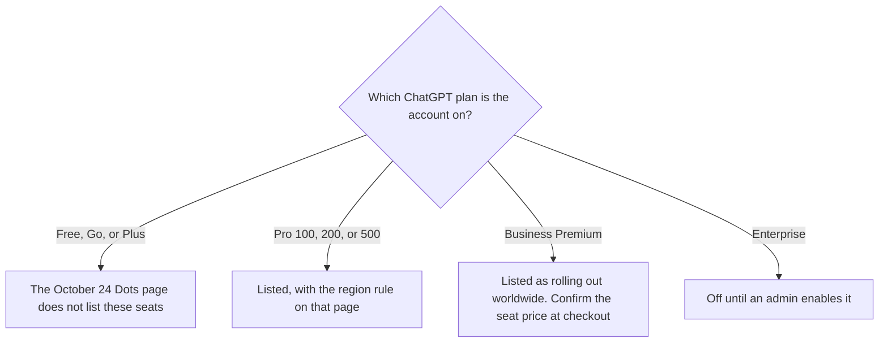

**Dots do not have a separate price on the page we could read on October 24, 2026. That page says they are rolling out to Pro 100, Pro 200, Pro 500, Business Premium, and Enterprise.** Pro's dollar amounts, from the Codex plan page the same day, are $100, $200, and $500 a month. Business Premium's dollar amount was not on the pages that returned 200. The October 16 directory card lists Business Premium at $125 a user a month billed monthly, or $100 annually, and says the first dot is included at no extra cost.

learn.chatgpt.com/docs/dots is the page that loaded. openai.com/index/introducing-dots/ and chatgpt.com/pricing/ returned HTTP 403. The seat ladder is [ChatGPT pricing explained](/blog/chatgpt-pricing-explained-2026/). A different agent with a published Premium door is [Grok Bot pricing explained](/blog/grok-bot-pricing-explained-2026/).

Published October 24, 2026. We did not run a dot. This page does not score agents.

## Who the October 24 page says can get one

| Plan | Access on learn.chatgpt.com/docs/dots | Dollar price we will cite |
|---|---|---|
| Pro 100, Pro 200, Pro 500 | Rolling out. Users over 18, outside the European Economic Area, the United Kingdom, and Switzerland | $100, $200, or $500 a month, from the October 24 Codex plan page |
| Business Premium | Rolling out worldwide, on that Dots page | Not printed there. Directory card, October 16: $125 a user a month monthly, or $100 annually |
| Enterprise | Rolling out worldwide. Off by default. A workspace admin must enable it | Contact sales. No list price on the pages we read |
| Free, Go, Plus | Not listed on that access section | Those seats are priced in the ChatGPT article. Do not add a Dots line |

The same Dots page says you may not see dots immediately even on an eligible plan. Conversations with your dot do not count toward ChatGPT usage limits. Tasks the dot starts in Work or Codex count toward those products' limits as usual. The plan includes an allowance for deeper work, with extended limits for the first month after launch. The page does not print that allowance as a number of tasks or a dollar credit. This article does not invent one.

It also says you create a dot in the ChatGPT mobile app, desktop app, or a desktop browser. Mobile web is not supported. The October 16 directory card says the same platforms in substance, and says Edu and Healthcare can try a beta when an admin enables it. The October 24 page's access section that we read names Enterprise, not Edu or Healthcare. Use the page you can open on the day you buy. The directory's "first dot included" sentence is dated October 16. The October 24 page does not print an add-on price, and it does not print "first dot" in the section we used. Absence of an add-on price is not a promise about a second dot. The directory says OpenAI planned to let you add more dots later and had not published that price.

## What you pay for the seat, not for a dot line

**Pro** is three monthly prices. The Codex page says Pro is billed as those three amounts and names Ultrafast on the $500 tier. A dot does not make those tiers the same product.

**Business,** the plan at $20 a user a month billed annually, is a different name from Business Premium. The October 24 Codex page prices Business. It does not, in the section we read, price Business Premium. If a workspace is on Business and not Business Premium, do not assume dots from the similar name.

**Claude Pro** at $17 a month annual or $20 monthly is a different company's seat, from claude.com/pricing on October 24. It is not a discount on Dots. The invoice is [Claude pricing explained](/blog/claude-pricing-explained-2026/).

**Grok Bot** starts at X Subscription Premium, $30 a month, on docs fetched the same day. That is not an OpenAI product and it does not include a dot.

## What not to assume

Do not add a $20 Plus seat and call it a Dots plan. Do not treat the EEA, UK, and Switzerland exclusion as expired because a blog post is newer than October 24. The page we read still states it for Pro. Do not quote $125 for Business Premium without the October 16 date, until a page you can open prints it. Do not assume a dot's Work tasks are free because the conversation itself is excluded from the chat limit. The page says those tasks count toward Work or Codex limits.

## FAQ

### How much do Dots cost?

No separate SKU on the October 24 Dots page. You pay the eligible ChatGPT plan. Pro is $100, $200, or $500 a month on the plan page from that day. Business Premium's list price on the October 16 directory card is $125 a user a month monthly or $100 annually. Re-check checkout.

### Is the first dot included?

The October 16 directory card says yes, on Pro or Business Premium, at no extra cost. The October 24 page we read does not print a per-dot price. It also does not print a price for additional dots. The directory says that future price was not published as of October 16.

### Why can a coworker see Dots and I cannot?

The page says the rollout is gradual, and Pro has a region rule: over 18, outside the EEA, the UK, and Switzerland. Enterprise stays off until an admin enables it. A matching plan name is not the same as a visible dot.

### Where do I create one?

The October 24 page says the mobile app, the desktop app, or a desktop browser. Not mobile web. Use a current app build, which that page also says.

## Last verified

October 24, 2026 for learn.chatgpt.com/docs/dots and learn.chatgpt.com/docs/pricing. openai.com/index/introducing-dots/ and chatgpt.com/pricing/ returned HTTP 403. Business Premium dollars and the "first dot included" sentence are from the directory card checked October 16, 2026. Published October 24, 2026.

**Sources:** [Meet dots](https://learn.chatgpt.com/docs/dots), [ChatGPT and Codex pricing](https://learn.chatgpt.com/docs/pricing), [Introducing dots](https://openai.com/index/introducing-dots/), [ChatGPT pricing](https://chatgpt.com/pricing/).

*Published by Andrew for [AI Tools Optimizer](https://aitoolsoptimizer.com).*

[OpenAI Dots](/tools/openai-dots/) is in the [automation and agents directory](/tools/category/automation-agents/). Directory pages may use affiliate links. A purchase through them may earn us a commission at no extra cost to you.
