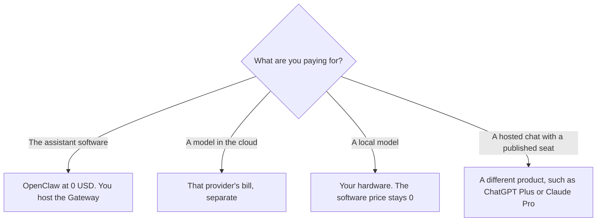

**OpenClaw's software is free. The project site says there is no subscription, no hosted tier, no token, and no paid version. You pay the model provider you connect, unless you run a local model.** That sentence is from openclaw.ai on October 24, 2026. The page says the OpenClaw Foundation, a US 501(c)(3), keeps the product MIT licensed, and that there is no enterprise edition. Donors named on the page do not, in the page's words, own or control the project. OpenClaw is not an OpenAI product, on that same page.

The directory page, checked October 16, 2026, matches: free and open source, model costs separate, no official hosted version. The product page is [OpenClaw](/tools/openclaw/). A hosted chat seat with a published price is [ChatGPT review](/blog/chatgpt-review-2026/). A self-hosted agent with its own card is [Hermes Agent pricing explained](/blog/hermes-agent-pricing-explained-2026/).

Published October 24, 2026. We did not score answers, and we did not run a Gateway for this article.

## What you pay, and what you do not

| Piece | Price on the October 24 project site | What you still pay |
|---|---|---|
| The OpenClaw software | $0. No subscription, no hosted tier, no token | You install and maintain it |
| An enterprise edition | The site says there is no paid version and no enterprise edition | A support contract is not a line on this page |
| The model | Not included | The provider you connect, at that provider's rates |
| A local model | Software still $0 | Your own hardware and electricity. This page does not price hardware |

The October 24 page says you run a Gateway and meet the assistant in channels you already use. The October 16 directory lists WhatsApp, Telegram, Discord, Slack, iMessage, and others, and says your state, memory, and credentials stay on your hardware by default, with prompts going to the model provider and chat platforms you configure. Read the current security notes before you connect a channel. This page is the price, not a setup guide.

## What a hosted seat costs instead

These are not OpenClaw prices. They are the hosted products people compare it with, so a $0 software line is not mistaken for a $0 assistant.

**[Claude](/tools/claude/) Pro** is $17 a month billed annually, $200 up front, or $20 billed monthly, on claude.com/pricing fetched October 24, 2026. Max is $100 or $200 a month. If you point OpenClaw at a Claude account, that account's limits and bill still apply. The review is [Claude review](/blog/claude-review-2026/).

**[ChatGPT](/tools/chatgpt/) Plus** is $20 a month on the directory card checked October 16, 2026. chatgpt.com/pricing returned HTTP 403 on October 24, so this page does not replace that card. Go is $8 and may include ads. Business is $20 a user a month billed annually, with a monthly figure of $25, and it wants at least two users. Connecting a personal Plus seat to a Gateway is a policy question, not a feature of the $0 software.

**[Grok](/tools/grok/) Plus**, through The X Subscription, is $8 a month or $80 a year on the October 16 directory card. The invoice is [Grok pricing explained](/blog/grok-pricing-explained-2026/). It is a hosted assistant. It is not included with OpenClaw.

## What not to assume

Do not add a model invoice and still call OpenClaw free in a budget. The software line is $0. The model line is whatever you connected. Do not assume a donor's model is the default or is discounted. The project page says no lab's model is privileged. Do not expect a vendor support contract. The page says there is nothing to sell. Do not paste customer data into a Gateway your company has not approved, on hardware you do not control.

## FAQ

### How much does OpenClaw cost?

The software is $0. On October 24, 2026 the project site said no subscription, no hosted tier, no token, and no paid version. You pay the model provider you connect, or you pay for the hardware under a local model.

### Is there an enterprise SKU?

The October 24 site says there is no enterprise edition and no paid version. A company can still run it, and the company still owns the install, the channels, and the model bill. There is no OpenClaw seat price to put on a purchase order.

### Does it include Claude or ChatGPT?

No. Those are separate subscriptions. A person can connect a provider the software supports. The provider's plan, limits, and data terms still apply. Quoting OpenClaw at $0 as if it included Claude Pro is wrong.

### What if a hosted service appears later?

Use the project site that day. This page records October 24, 2026: no hosted tier. The October 16 directory said the same. A screenshot of a third-party host is not an OpenClaw price.

## Last verified

October 24, 2026, from openclaw.ai. The directory page was checked October 16, 2026. Claude's prices are from claude.com/pricing on October 24. ChatGPT and Grok figures are from directory pages checked October 16. Published October 24, 2026.

**Sources:** [OpenClaw](https://openclaw.ai), [OpenClaw docs](https://docs.openclaw.ai/), [Claude pricing](https://claude.com/pricing), [ChatGPT pricing](https://chatgpt.com/pricing/).

*Published by Andrew for [AI Tools Optimizer](https://aitoolsoptimizer.com).*

[OpenClaw](/tools/openclaw/) is in the [automation and agents directory](/tools/category/automation-agents/). Directory pages may use affiliate links. A purchase through them may earn us a commission at no extra cost to you.
