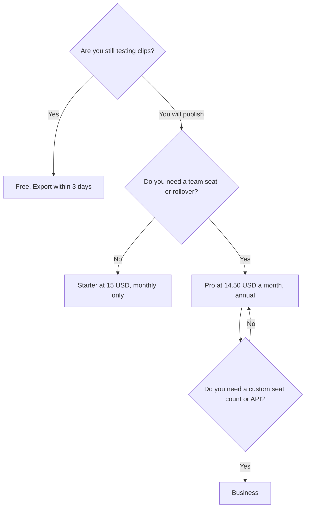

**OpusClip pricing is a monthly credit pool for turning long video into shorts.** Free is $0 with 60 credits, and those clips stop being exportable after 3 days. Starter is $15 a month, monthly billing only, with 150 credits and no watermark. Pro is $29 a month, or $14.50 a month billed annually ($174 a year), with 300 credits. Business is custom. Annual billing saves up to 50% on the plans that offer it. Starter does not.

The product page is [OpusClip review](/blog/opusclip-review-2026/). A general editor, if clipping is the wrong job, is [CapCut review](/blog/capcut-review-2026/). Footage you will cut by the transcript is [Descript pricing explained](/blog/descript-pricing-explained-2026/).

Prices are US list prices excluding tax from OpusClip's pricing page as recorded in the directory on October 16, 2026. A live fetch of that page returned 401 on October 24, 2026, so this article does not replace the directory figures with a newer scrape. Published October 24, 2026. We did not score clip quality or the Virality Score.

## The plans

| Plan | Price | Credits | What changes |
|---|---|---|---|
| Free | $0 | 60 a month | Clips are exportable for 3 days |
| Starter | $15 a month, monthly only | 150 a month | Virality Score, captions in 20+ languages, no watermark. A free trial is listed, without a credit card |
| Pro | $29 a month, or $14.50 a month billed annually ($174 a year) | 300 a month | Rollover for 2 months, a 2-seat workspace, 2 brand templates, 6 social connections, extra credit packs |
| Business | Custom | Custom | Seats, brand assets, storage, and API access, on the card |

Pro annual is $174 a year. Twelve months of Pro at $29 would be $348. The gap is the annual toggle, and it is the "up to 50%" line on this product. Starter has no annual price on the card. Budget $15 × 12 = $180 if Starter is the plan you will keep, and do not assume a half-off Starter exists.

## What a credit is, and what it is not

The directory says credits are used to process video into clips. It does not print "one minute costs this many credits" on the summary we used, so this page does not invent a minutes-per-credit rate. Pro users can add credit packs. Unused Pro credits roll over for 2 months. Free and Starter do not get that sentence on the card.

Run one real source video and read the credit receipt before you annualize. A 300-credit month that processes one webinar is a different product from a 300-credit month that processes daily streams.

## Four buyers

**Someone checking whether the highlights are usable.** Free. Export the test within 3 days. A watermarked or expired file is not a posting plan.

**A solo creator posting a few shorts a month.** Starter at $15, after the receipt fits in 150 credits. Stay on monthly. There is no annual Starter to "forget to switch to."

**Two people and a brand template.** Pro. The 2-seat workspace is the reason, along with rollover and six social connections. Annual at $174 is the math once the second month of clips was worth posting. The Virality Score is a label inside the product. It is not a measurement from this site.

**A company that needs the API or a larger seat count.** Business. Ask for the credit amount and the seat amount in the quote. Do not multiply $14.50 by the whole marketing team and call it Business.

## When a clipper is the wrong invoice

[CapCut](/tools/capcut/) Pro is $19.99 a month, or $179.99 a year, when you need a timeline editor and templates. [Descript](/tools/descript/) Hobbyist is $16 a person a month billed annually when the edit is "cut the ums" on footage you shot. [Runway](/tools/runway/) Standard is $12 a month billed annually when you are generating video, not clipping it. Those are different meters. The creator shelf is [best AI tools for YouTubers](/blog/best-ai-tools-for-youtubers-2026/).

## FAQ

### Is there a free plan?

Yes. 60 credits a month. Clips on that plan stop being exportable after 3 days. It is a test, not an archive.

### Why is Starter monthly only?

That is how the October 16 pricing card records it. Pro is the plan with the $14.50 annual rate. If checkout offers an annual Starter later, the checkout wins, and this page should be updated.

### Do credits roll over?

On Pro, unused credits roll over for 2 months, on the card. Do not assume Free or Starter roll over. The receipt in the product is the record.

### Is the Virality Score a guarantee of views?

No. It is a product feature on Starter and above. This site did not validate it against later view counts. Use it as a sort inside the tool, then watch the clip yourself.

## Last verified

October 16, 2026, from the directory record of OpusClip's pricing page, after a 401 on a direct fetch on October 24, 2026. CapCut, Descript, and Runway use the same October 16 directory check. Published October 24, 2026.

**Sources:** [OpusClip pricing](https://www.opus.pro/pricing), [CapCut pricing](https://www.capcut.com/pricing), [Descript pricing](https://www.descript.com/pricing).

*Published by Andrew for [AI Tools Optimizer](https://aitoolsoptimizer.com).*

[OpusClip](/tools/opusclip/) is in the [video directory](/tools/category/video/). Directory pages may use affiliate links. A purchase through them may earn us a commission at no extra cost to you.
