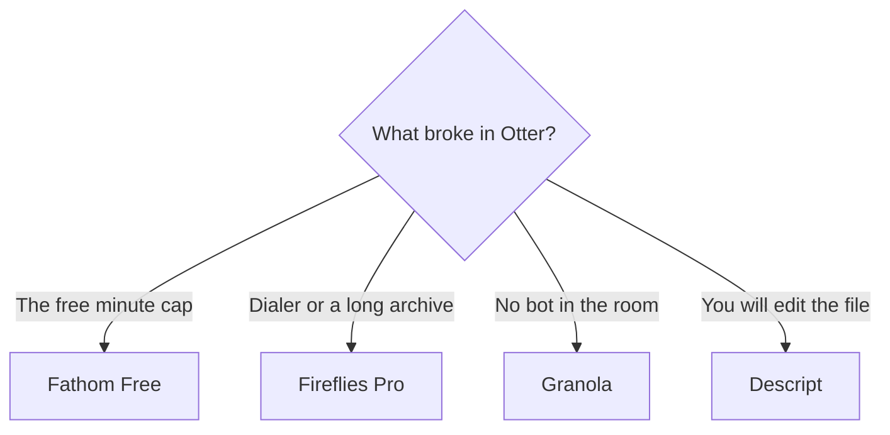

**Leave Otter when a 30-minute conversation cap, a 300-minute free pool, or a visible bot blocks the meeting you actually have.** Stay when your calls fit those caps and you want Otter's published per-conversation limit in the contract. The alternative is a different meter, and sometimes a different capture method.

[Otter](/tools/otter-ai/) Basic is free: 300 minutes a user a month and 30 minutes per conversation. Pro is $16.99 a user a month, or $8.33 billed annually, with 1,200 minutes and 90 minutes per conversation. Business is $30, or $19.99 annually, with unlimited meetings and a 4-hour conversation cap. The invoice is [Otter.ai pricing explained](/blog/otter-ai-pricing-explained-2026/). The product page is [Otter.ai review](/blog/otter-ai-review-2026/).

Prices are US list prices excluding tax. Otter, Fireflies, Granola, and Read AI figures are from directory pages checked October 16, 2026. Fathom's figures were read from its pricing page on October 24, 2026. Published October 24, 2026. We did not score transcript accuracy.

## Pick by the constraint

| The constraint | Try | First paid step |
|---|---|---|
| You want recordings without a monthly minute pool | [Fathom](/tools/fathom/) | Free lists unlimited recordings. Premium is $16/month annually or $20 monthly |
| You need dialers, uploads, and search across months | [Fireflies](/tools/fireflies-ai/) | Pro is $10/user/month annually, or $18 monthly |
| The room will not accept a bot | [Granola](/tools/granola/) | Business is $14/user/month. Basic is free with 30 days of history |
| Five transcripts a month is enough to test | [Read AI](/tools/read-ai/) | Free is 5 transcripts a month. Pro is $15/user/month annually, or $19.75 monthly |
| The artifact you want is a clip reel | [tl;dv](/tools/tl-dv/) | Confirm USD at checkout. The directory page showed Canadian dollar prices |
| You will edit the recording as media | [Descript](/tools/descript/) | Hobbyist is $16/person/month annually, with 10 media hours |

The three-way among the bots is [Otter vs Fireflies vs Fathom](/blog/otter-vs-fireflies-vs-fathom-2026/). The no-bot split is [Granola vs Fathom](/blog/granola-vs-fathom-2026/). The category piece is [best AI meeting notetakers](/blog/best-ai-meeting-notetakers/).

## What each alternative changes on the invoice

**Fathom's free plan is the unusual one.** It lists unlimited recordings and transcripts, plus instant summaries. Premium at $16 a month billed annually adds advanced summaries and AI action items. Team and Business require two users. Business at $25 per user per month billed annually is the CRM field-sync tier. If Otter Basic cut you off at 30 minutes, run one real meeting on Fathom Free before you buy Otter Pro. The Fathom page is [Fathom review](/blog/fathom-review-2026/).

**Fireflies prices the seat, and the knowledge-base article we used does not publish Otter's style of per-call minute cap.** Pro annual is $10, which is $120 a user a year, against $216 if you stay month to month at $18. Business is $19 annually or $29 monthly. Channels include Zoom, Meet, Teams, supported dialers, file upload, and in-person audio. Buy it when the archive and the channel mix are the point. The review is [Fireflies.ai review](/blog/fireflies-ai-review-2026/).

**Granola listens on the computer and keeps notes private by default.** Basic includes 30 days of history. Business at $14 unlocks unlimited history and the broader integration list. There is no meeting bot in that design. If your only objection to Otter was the bot, this is the switch. Enterprise starts at $35 per user per month.

**Read AI's free tier is a small sample.** Five transcripts a month will show you the product and will not cover a calendar. Pro at $15 annual is unlimited transcripts on the directory page, with 100 file-upload credits. Read the review before you treat it as an Otter Business replacement: [Read AI review](/blog/read-ai-review-2026/).

**tl;dv is the clip tool.** The directory recorded Free, Pro, and Business in Canadian dollars, including Pro at C$27 per seat per month billed annually. Do not convert that into a guessed US price. Open the checkout in USD if USD is what you pay.

**Descript edits the file after the meeting.** It is the alternative when the transcript is a rough cut, not a CRM note. Filler-word removal and Studio Sound sit on Hobbyist and above. The order is [how to edit podcasts with Descript](/blog/how-to-edit-podcasts-with-descript-2026/).

## When to stay on Otter

Stay on Pro annual at $8.33 if your meetings are under 90 minutes and 1,200 minutes a month covers the team. Pro workspaces are capped at 5 billed users on the pricing page we used. A sixth paid seat is a Business conversation. Business annual at $19.99 is the plan with unlimited meetings, a 4-hour cap, and the import allowance for a backlog. Promotions appeared on the October 16 check. Budget the list price at renewal.

Consent still applies on every alternative. A bot, a bot-free capture, and a laptop recorder are different notices. Company rules and local law decide which one you may use. The tool does not decide.

## FAQ

### What is the closest alternative to Otter for a normal video call?

Fathom, if you want to try unlimited recordings on the free plan. Fireflies Pro, if you want the cheaper published paid seat at $10 a user a month billed annually and you care about search across calls. Run one meeting through the free tier of the one you pick.

### Is Granola an Otter replacement?

It replaces the bot with notes from your computer audio. It does not replace a shared recording archive in the same way. Read [Granola vs Fathom](/blog/granola-vs-fathom-2026/) if the choice is "no bot" versus "free unlimited recordings."

### Does any alternative include a published per-conversation cap like Otter?

Otter is the one in this set that publishes 30 minutes, 90 minutes, and 4 hours as conversation caps. If that cap is the number finance needs in writing, Otter still has the clearest public figure. The others publish different meters. Read those meters before you assume "unlimited."

### Can I upload a pile of old calls to a free plan?

Otter Basic includes 3 lifetime imports per user. Descript Free includes 60 media minutes a month. Read AI Free is 5 transcripts. Check the import line before you promise a backlog project.

## Last verified

October 16, 2026 for Otter, Fireflies, Granola, Read AI, tl;dv, and Descript. October 24, 2026 for Fathom's pricing page. Published October 24, 2026. tl;dv's directory prices were in Canadian dollars.

**Sources:** [Otter pricing](https://otter.ai/pricing), [Fathom pricing](https://www.fathom.ai/pricing), [Fireflies pricing plans](https://guide.fireflies.ai/articles/3734844560-learn-about-the-fireflies-pricing-plans).

*Published by Andrew for [AI Tools Optimizer](https://aitoolsoptimizer.com).*

[Otter](/tools/otter-ai/), [Fathom](/tools/fathom/), and [Fireflies](/tools/fireflies-ai/) are in the [meetings directory](/tools/category/meetings-transcription/). Directory pages may use affiliate links. A purchase through them may earn us a commission at no extra cost to you.
