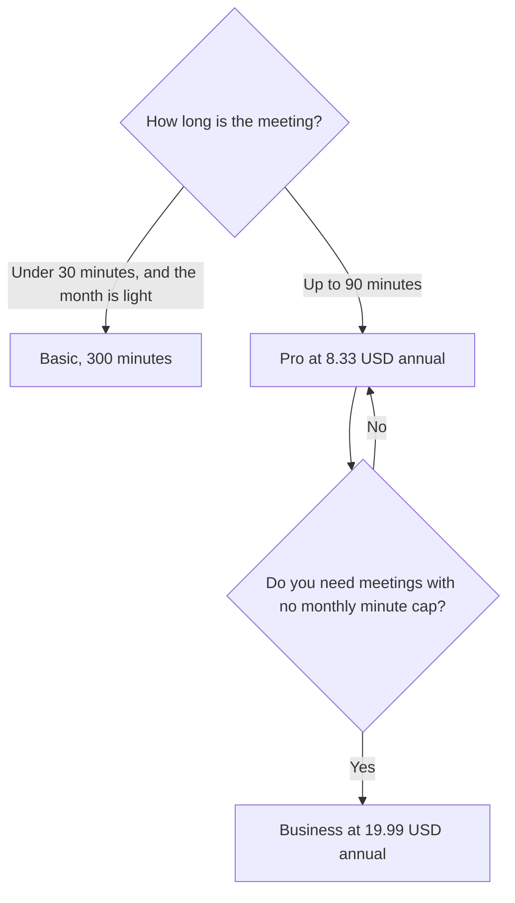

**Otter pricing is a per-user minute pool and a per-conversation cap.** Basic is free: 300 transcription minutes a user a month, and 30 minutes per conversation. Pro is $16.99 a user a month, or $8.33 billed annually, with 1,200 minutes and 90 minutes per conversation. Business is $30 a user a month, or $19.99 billed annually, with unlimited meetings and conversations up to 4 hours.

Prices are US list prices excluding tax, from Otter's pricing page as recorded October 16, 2026. During that check Otter also showed promotions, including 50% off Pro and 20% off Business for 3 months. Treat those as checkout discounts that can disappear. This explainer uses the list prices. Published October 24, 2026.

The product review is [Otter.ai review](/blog/otter-ai-review-2026/). The three-way with the other notetakers is [Otter vs Fireflies vs Fathom](/blog/otter-vs-fireflies-vs-fathom-2026/).

## The ladder

| Plan | Monthly | Annual, per month | Minutes | Conversation cap | AI Chat queries |
|---|---|---|---|---|---|
| Basic | $0 | $0 | 300 per user | 30 minutes | 20 per user |
| Pro | $16.99 | $8.33 | 1,200 per user | 90 minutes | 50 per user |
| Business | $30 | $19.99 | Unlimited meetings | 4 hours | 200 per user |
| Enterprise | Custom | Custom | Custom | Custom | Custom |

Pro workspaces are capped at 5 billed users. Business is capped at 25. A sixth paid seat is a Business conversation, not a sixth Pro seat you should assume will fit.

## The caps people miss

**30 minutes on Basic.** A weekly 45-minute staff meeting does not fit the free conversation cap, even if 300 monthly minutes would cover the arithmetic. The conversation cap is the one that cuts the transcript off.

**Imports are not the same as live meetings.** Basic includes 3 lifetime imports per user. Pro includes 10 imports a month. Business includes up to 6,000 imported minutes per user per month. Uploading a pile of old recordings is a Business feature. It is not a reason to expect Basic to transcribe a backlog.

**AI Chat is metered.** Asking "what did we decide" spends a query: 20, 50, or 200 depending on the plan. A team that lives in chat questions will feel Business's 200 before they feel the minute pool, because Business minutes are unlimited.

**Promotions are not the list price.** The 50% Pro offer we saw would make a month cheaper than $16.99. Budget the renewal at the list price unless the checkout says the discount lasts.

Annual Pro at $8.33 is $99.96 a year if you multiply it out. Otter's page presents the monthly equivalent. Pay from the checkout total, not from this multiplication, if the two ever differ.

## Who should pay

**A person with short calls.** Basic. Tell the other people the meeting is being transcribed. Consent rules vary. Free minutes do not answer that.

**An individual whose meetings run past 30 minutes and stay under 90.** Pro, annual, once you know you will still use it next quarter. Monthly at $16.99 while you are testing past the trial behavior of Basic.

**A team that records long calls or wants custom summary workflows.** Business. Custom AI workflows are a Business line. Unlimited meetings are the other reason. If you only needed unlimited recordings and a free plan is acceptable, price [Fathom](/tools/fathom/) before Business. Fathom Free is unlimited recordings and transcripts. Premium is $16 a month billed annually. The bot-versus-no-bot split with Granola is [Granola vs Fathom](/blog/granola-vs-fathom-2026/).

[Fireflies](/tools/fireflies-ai/) Pro is $10 a user a month billed annually, or $18 monthly. That is the other bot to quote against Otter Pro. The shelf is [best AI meeting notetakers](/blog/best-ai-meeting-notetakers/).

[Granola](/tools/granola/) is the no-bot option. Basic is free with 30 days of history. Business is $14 a user a month. Use it when a bot joining the call is the problem.

Editing a recording you already have, as a video, is [Descript](/tools/descript/), not a meeting plan. Hobbyist is $16 a person a month billed annually. That bill is [Descript pricing explained](/blog/descript-pricing-explained-2026/).

## FAQ

### How much is Otter Pro?

$16.99 per user per month, or $8.33 per user per month billed annually, with 1,200 minutes and a 90-minute conversation cap. Basic is free with 300 minutes and a 30-minute cap.

### How much is Otter Business?

$30 per user per month, or $19.99 billed annually, with unlimited meetings, 4-hour conversations, and 200 AI Chat queries per user. Up to 25 billed users per workspace on the page we checked.

### Is the free plan enough for a one-hour meeting?

No. Basic cuts a conversation at 30 minutes. A one-hour meeting needs Pro's 90-minute cap, or another product.

### Does Otter transcribe YouTube videos?

The directory page describes live meetings and imports of recordings, with the import caps above. It does not describe a YouTube URL field. For a video file you have the right to transcribe, see [how to transcribe YouTube videos with AI](/blog/how-to-transcribe-youtube-videos-with-ai-2026/).

## Last verified

October 16, 2026 for list prices, caps, and the promotions noted above. Published October 24, 2026. Confirm whether a promotion is still on the checkout.

**Sources:** [Otter pricing](https://otter.ai/pricing), [Otter.ai](https://otter.ai/).

*Published by Andrew for [AI Tools Optimizer](https://aitoolsoptimizer.com).*

[Otter](/tools/otter-ai/) is in the [meetings directory](/tools/category/meetings-transcription/). Directory pages may use affiliate links. A purchase through them may earn us a commission at no extra cost to you.
