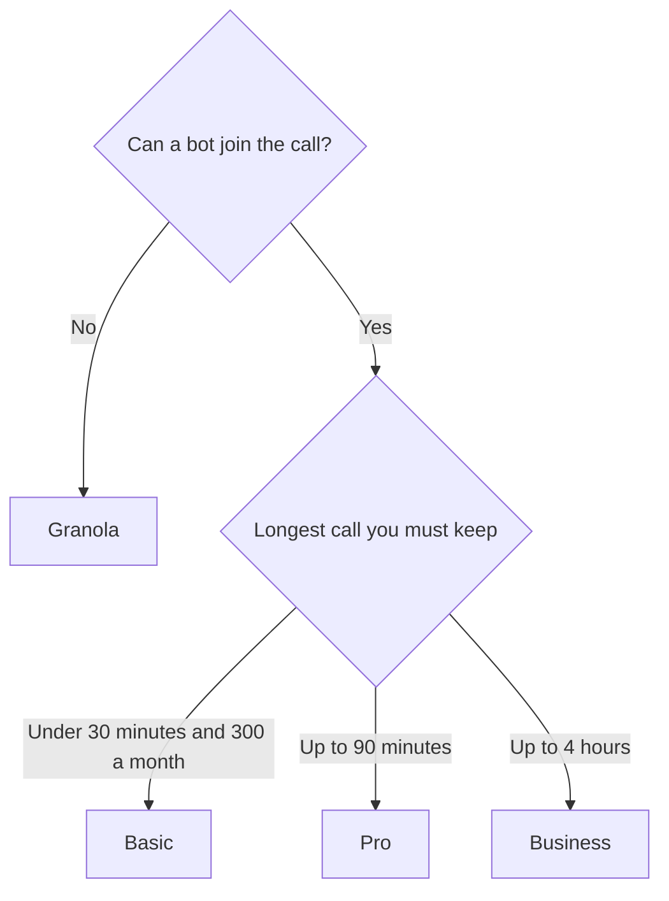

**[Otter.ai](/tools/otter-ai/) joins Zoom, Google Meet, and Microsoft Teams, transcribes live, and returns a summary with action items.** Basic is free: 300 transcription minutes per user each month, and 30 minutes per conversation. Pro is $16.99 per user per month, or $8.33 billed annually, with 1,200 minutes and a 90-minute conversation cap. Business is $30 per user per month, or $19.99 billed annually, with unlimited meetings and conversations up to 4 hours.

Prices are US dollars from Otter's pricing page, recorded October 16, 2026. Otter was also showing promotions then, including 50% off Pro and 20% off Business for 3 months, so the card you see can be lower. Tax and currency at checkout can differ. We did not score transcription accuracy.

The category comparison is [best AI meeting notetakers](/blog/best-ai-meeting-notetakers/). If the budget is zero, start with [best free AI note takers](/blog/best-free-ai-note-takers-2026/) and [how to transcribe a Zoom meeting free](/blog/transcribe-zoom-meeting-free/).

## The cap that decides the plan

Most meeting tools advertise "AI notes." Otter publishes a harder number: how long one conversation may run.

| Plan | Monthly | Annual | Minutes | Per conversation | AI Chat queries |
|---|---|---|---|---|---|
| Basic | $0 | $0 | 300 per user | 30 minutes | 20 per user |
| Pro | $16.99 | $8.33 | 1,200 per user | 90 minutes | 50 per user |
| Business | $30 | $19.99 | Unlimited meetings | 4 hours | 200 per user |
| Enterprise | Custom | Custom | Unlimited | Confirm with sales | Confirm with sales |

A weekly 45-minute staff meeting does not fit Basic, even if you only have one of them. The 300-minute monthly pool would allow several short calls. The 30-minute conversation cap cuts the longer one off. That is the upgrade, before any argument about summary style.

Pro billed annually is $8.33 × 12 = $99.96 a year at the list rate. The same seat left on monthly billing is $16.99 × 12 = $203.88. Business annual is $19.99 × 12 = $239.88, against $360 if you paid the $30 monthly rate all year. Those are list-price products. A promo changes them.

Workspaces are capped at 5 billed users on Pro and 25 on Business.

## What the product is doing

Otter's agent joins the call, or you record in person from the app. You get a live transcript with speakers, highlights, and comments, then a summary and action items. Otter AI Chat answers questions about meetings, inside the monthly query caps above.

Imports are a second meter. Basic allows 3 lifetime imports per user. Pro allows 10 a month. Business includes up to 6,000 imported minutes per user each month. A backlog of old recordings is a Business problem, or a different tool, even if live meetings fit on Pro.

Otter documents a Zapier integration and an MCP server so other assistants can pull meeting context. Custom AI workflows and templates are how a sales call and a lecture stop sharing one summary shape. Advanced workflows are listed on Business.

Exports include mp3, txt, pdf, docx, and srt.

## A month that tells you the plan

1. Connect the calendar and let Otter join one internal meeting you already expect to record. Tell the room. Recording rules differ by country and employer.
2. If the transcript stops at 30 minutes and your real meetings run longer, Basic is a demo.
3. Add up last month's meeting minutes. Under 1,200, with none over 90 minutes, Pro's annual price is the number to compare.
4. If you need the whole team library, conversations past 90 minutes, or a pile of imported files, price Business.
5. If clients flinch at a bot, stop and read the [Granola review](/blog/granola-review-2026/). If the calls are on a phone dialer, read the [Fireflies review](/blog/fireflies-ai-review-2026/).

## Fit score

| Job | Basic | Pro | Business |
|---|---|---|---|
| A short internal call, under 30 minutes | Strong | Strong | Strong |
| A 45-minute weekly meeting | Over the conversation cap | Fits the 90-minute cap | Fits |
| A 2-hour workshop | No | No | Fits the 4-hour cap |
| Ask the transcript a question | 20 queries | 50 queries | 200 queries |
| Import a year of old recordings | 3 lifetime files | 10 a month | Up to 6,000 minutes |
| Hide the bot | No | No | No |

[Fathom](/tools/fathom/) Free is the other bot to try when you want unlimited recordings before you pay. Premium there is $16 a month billed annually. [Read AI](/tools/read-ai/) is the one to open when email and chat search matter as much as the meeting.

## FAQ

### Is Otter.ai free?

Yes. Basic includes 300 meeting minutes per user each month, 30 minutes per conversation, and 20 AI Chat queries.

### How much does Otter Pro cost?

$16.99 per user per month, or $8.33 per user per month billed annually, on the October 16, 2026 list. Promotions can lower checkout.

### Does Otter work on Zoom, Meet, and Teams?

Yes. It can join those three. The mobile app covers in-person recording.

### Will Otter train on my meetings?

Use Otter's current privacy terms for that answer, and your own company's policy. This review does not restate a legal conclusion.

## Last verified

October 16, 2026.

**Sources:** [Otter.ai pricing](https://otter.ai/pricing), [Otter.ai](https://otter.ai).

[Otter.ai](/tools/otter-ai/) is in the [meetings directory](/tools/category/meetings-transcription/). Directory pages may use affiliate links. A purchase through them can earn us a commission at no extra cost to you.
