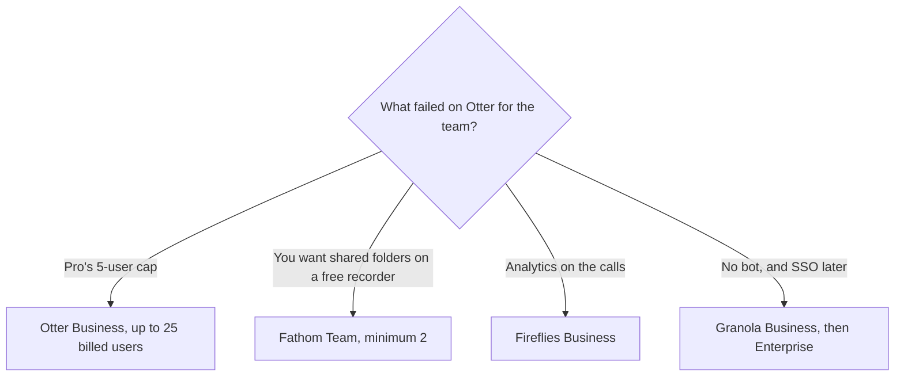

**A team should leave Otter when the billed-user cap, the conversation length, or the missing admin control blocks the workspace you actually have.** Stay on Otter Business when unlimited meetings, a 4-hour conversation cap, and up to 25 billed users match the team, and you want that contract. The individual version of this question, which is about minute caps and bots, is [Otter.ai alternatives](/blog/otter-ai-alternatives-2026/).

[Otter](/tools/otter-ai/) Pro is $16.99 a user a month, or $8.33 billed annually, with 1,200 minutes, 90 minutes per conversation, and a workspace cap of 5 billed users. Business is $30, or $19.99 annually, with unlimited meetings, a 4-hour conversation cap, and up to 25 billed users. Enterprise is custom. The invoice is [Otter.ai pricing explained](/blog/otter-ai-pricing-explained-2026/).

Prices are US list prices excluding tax. Otter, Fireflies, Granola, and Read AI figures are from directory pages checked October 16, 2026. Fathom's figures were read from its pricing page on October 24, 2026. Published October 24, 2026. We did not score transcript accuracy.

## The team constraint

| The constraint | Try | First team step |
|---|---|---|
| You need more than 5 billed users and meetings run long | Otter Business, if 25 is enough | $19.99 a user a month billed annually |
| You want shared comments and folders, and Free recordings are enough to start | [Fathom](/tools/fathom/) Team | $15 a user a month annually, or $19 monthly, minimum 2 users |
| You need analytics across many calls | [Fireflies](/tools/fireflies-ai/) Business | $19 a user a month annually, or $29 monthly |
| The room will not accept a bot, and you need history past 30 days | [Granola](/tools/granola/) Business | $14 a user a month. SSO starts on Enterprise, from $35 |
| Five transcripts a month is only a pilot | [Read AI](/tools/read-ai/) | Free is 5 transcripts a month. Pro is $15 a user annually, or $19.75 monthly |

Ten people is the arithmetic that makes Pro impossible. Otter Pro stops at 5 billed users. Otter Business annual for 10 is 10 × $19.99 = $199.90 a month. Fireflies Business annual for 10 is 10 × $19 = $190. Fathom Team annual for 10 is 10 × $15 = $150, and the plan requires at least two users. Granola Business for 10 is 10 × $14 = $140, without the SSO line. Granola Enterprise at the recorded "from $35" would be 10 × $35 = $350 if every seat is on that tier. Confirm the quote. These are list prices, not a quality ranking.

## What the team plan changes

**Otter Business** is the upgrade when Pro's 90-minute conversation cap or the 5-user workspace is the wall. The directory also lists custom AI workflows, 200 AI Chat queries a user a month, and up to 6,000 imported minutes a user a month. Promotions were running during the October 16 check, so checkout can be lower. Do not budget the promotion as the renewal price. The review is [Otter.ai review](/blog/otter-ai-review-2026/).

**Fathom Team** is the shared layer on top of a free recorder. Free already lists unlimited recordings. Team adds comments, folders, keyword alerts, and shared playlists. Business, at $25 a user annually or $34 monthly, is the CRM tier, also with a two-user minimum. Buy Team when the library is the pain. Buy Business when the CRM field is the pain. The card is [Fathom pricing explained](/blog/fathom-pricing-explained-2026/). The bot comparison is [Fathom vs Fireflies](/blog/fathom-vs-fireflies-2026/).

**Fireflies Business** is the analytics seat. Pro at $10 annually records and searches. The directory says the analytics most teams want sit on Business. Enterprise is $39 a user a month billed annually. The card is [Fireflies pricing explained](/blog/fireflies-pricing-explained-2026/). The three-way among the bots is [Otter vs Fireflies vs Fathom](/blog/otter-vs-fireflies-vs-fathom-2026/).

**Granola** does not put a bot in the room. Business at $14 unlocks unlimited history and integrations such as Zapier, Notion, and Slack. Basic is free and keeps 30 days of history in the app. Enterprise, from $35, is where the directory puts SSO and admin controls. If a security review asks for SSO, the $14 seat is not the answer. The no-bot split is [Granola vs Fathom](/blog/granola-vs-fathom-2026/) and [Otter vs Granola](/blog/otter-vs-granola-2026/).

**Read AI** is a small pilot, not a 50-person library. Pro at $15 annually is a per-user seat. The review is [Read AI review](/blog/read-ai-review-2026/).

The category piece is [best AI meeting notetakers](/blog/best-ai-meeting-notetakers/).

## How a team should switch

Pick one standing meeting and one customer call. Run them for two weeks on the candidate, with consent from the room. Compare the admin questions, not the adjectives: Can we see everyone's notes? Can we delete a recording? Does the bot join? What happens at user 6 and user 26?

Otter Enterprise is the conversation when 25 billed users is not enough or you need a control the Business card does not list. The directory does not print an Enterprise dollar. Ask for it. Do not multiply Business by a guess.

Notes are not the system of record for a decision. File the decision in the ticket or the doc. That distinction is [what a system of record for AI is](/blog/what-is-a-system-of-record-for-ai-2026/).

## FAQ

### Is Otter Business required for any team?

No. A team of three with short calls can live on Pro until the 5-user cap or the 90-minute cap hurts. A team of ten cannot put ten billed users on Pro.

### Which alternative is cheapest for ten people?

On the annual list prices above, Granola Business is $140 a month and Fathom Team is $150, against Otter Business at $199.90 and Fireflies Business at $190. Cheapest is not the same library. Granola has no bot and puts SSO on a higher tier. Fathom's free plan already records. Match the constraint, then the total.

### Do we need a bot?

If the room refuses a bot, Granola is the path to test. If you need a shared recording the whole team can open, a bot product is the usual shape. Get consent either way.

### Can AI notes replace the recap email?

They can draft it. A person sends it, after deleting anything the transcript does not support. The habit is [how to write customer emails with AI](/blog/how-to-write-customer-emails-with-ai-2026/).

## Last verified

October 16, 2026 for Otter, Fireflies, Granola, and Read AI. October 24, 2026 for Fathom's Team and Business prices. Published October 24, 2026.

**Sources:** [Otter pricing](https://otter.ai), [Fathom pricing](https://www.fathom.ai), [Fireflies pricing](https://fireflies.ai).

*Published by Andrew for [AI Tools Optimizer](https://aitoolsoptimizer.com).*

[Otter](/tools/otter-ai/) is in the [meetings and transcription directory](/tools/category/meetings-transcription/). Directory pages may use affiliate links. A purchase through them may earn us a commission at no extra cost to you.
