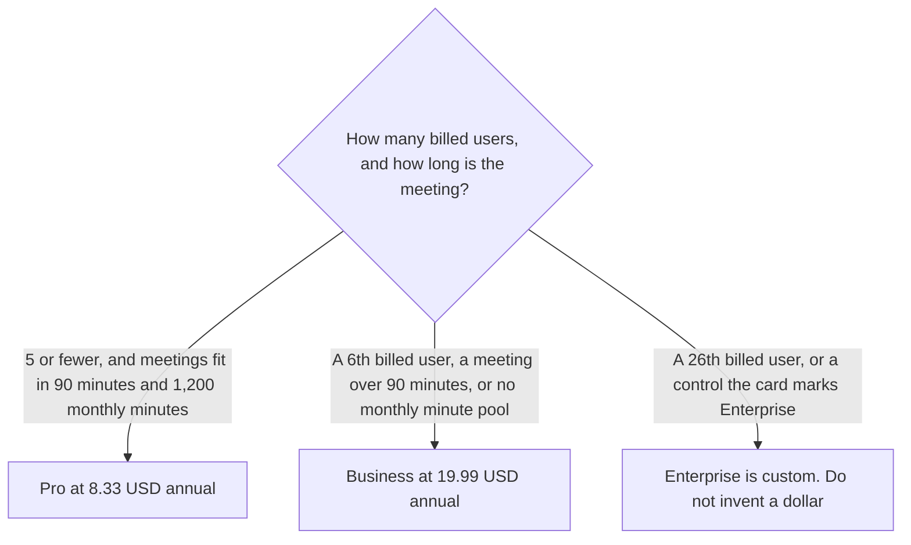

**Otter Business is $30 per user per month, or $19.99 per user per month billed annually.** The October 16, 2026 pricing page lists unlimited meetings, conversations up to 4 hours, 200 Otter AI Chat queries per user per month, custom AI workflows, up to 6,000 imported minutes per user per month, and a workspace cap of 25 billed users. Pro is the seat under that: $16.99 monthly or $8.33 annually, 1,200 minutes, a 90-minute conversation cap, 50 AI Chat queries, and a workspace cap of 5 billed users. The full ladder, including Basic, is [Otter.ai pricing explained](/blog/otter-ai-pricing-explained-2026/). This page is the Business seat.

Enterprise is custom on that page. It has no dollar here. A 26th billed user is an Enterprise conversation, not a 26th Business seat you should assume will fit.

The product review is [Otter.ai review](/blog/otter-ai-review-2026/). The three-way is [Otter vs Fireflies vs Fathom](/blog/otter-vs-fireflies-vs-fathom-2026/).

Prices are US list prices excluding tax, from Otter's pricing page as recorded October 16, 2026. During that check Otter also showed a promotion, 20% off Business for 3 months, and 50% off Pro. Treat those as checkout discounts that can disappear. This page uses the list. Published October 24, 2026. We did not score transcripts.

## What Business changes from Pro

| Line | Pro | Business |
|---|---|---|
| List price | $16.99 a user a month, or $8.33 billed annually | $30 a user a month, or $19.99 billed annually |
| Meetings | 1,200 transcription minutes a user a month | Unlimited meetings, on the card |
| Conversation cap | 90 minutes | 4 hours |
| AI Chat | 50 queries a user a month | 200 queries a user a month |
| Billed users in the workspace | Up to 5 | Up to 25 |
| Imports | 10 a month, on the tool card | Up to 6,000 imported minutes a user a month |
| Workflows | The lower tier | Custom AI workflows, on the card |

Ten users on Business annual are 10 times $19.99, which is $199.90 a month, or $2,398.80 a year. Ten users on Business monthly are 10 times $30, which is $300 a month, or $3,600 a year. The annual gap for those ten seats is $1,201.20 a year. Quote $19.99, not a rounded $20, when the contract is the annual list. A checkout that shows the 20% promotion for three months is a different price. Write the promotion's end date on the quote. Do not treat it as the list.

A sixth Pro seat does not exist on the card. Five is the Pro workspace cap. The sixth person is a Business conversation even if each meeting is short.

## Seats that are not this invoice

**The minute pool.** [Otter](/tools/otter-ai/) Business is the row that removes the 1,200-minute pool and raises the conversation cap to 4 hours. Basic remains free at 300 minutes and 30 minutes per conversation, with 20 AI Chat queries. A team that fits in Pro's caps should not buy Business for the name.

**Analytics, on Fireflies.** [Fireflies](/tools/fireflies-ai/) Business is $19 annually or $29 monthly, for conversation analytics. That $19 is not Otter's $19.99, and it is not the same feature list. The invoice is [Fireflies Business pricing explained](/blog/fireflies-business-pricing-explained-2026/).

**CRM fields, on Fathom.** [Fathom](/tools/fathom/) Business is $25 annually or $34 monthly, with a two-user minimum, for CRM field sync and Deal View. Otter's Business card, as recorded, does not use that minimum. The invoice is [Fathom Business pricing explained](/blog/fathom-business-pricing-explained-2026/).

**A no-bot notebook.** [Granola](/tools/granola/) Business is $14 per user per month on the page read October 24, 2026. History on Basic is 30 days. The invoice is [Granola pricing explained](/blog/granola-pricing-explained-2026/).

## What not to assume

Do not put a 26th person on Business because the first 25 fit. Do not quote the three-month promotion as the annual list. Do not describe 200 AI Chat queries as unlimited. Do not convert a non-USD checkout into these dollars. Enterprise remains custom until a quote says otherwise.

## FAQ

### How much is Otter Business for 10 people?

At the October 16 list, ten users on annual billing are $199.90 a month, or $2,398.80 a year. Ten users on monthly billing are $300 a month, or $3,600 a year. Ten is inside the 25-user workspace cap. Tax can be extra. A promotion at checkout can lower the first three months. The list above is the price to budget after that promotion ends.

### What happens at 6 users, or at 26?

Pro workspaces are capped at 5 billed users. A sixth billed user is Business. Business is capped at 25 billed users. A 26th is Enterprise, and Enterprise has no public dollar on the page we used. Do not multiply $19.99 by 26 and call it a list price.

### What is the 4-hour cap?

Business lists conversations up to 4 hours. Pro lists 90 minutes. Basic lists 30 minutes. A meeting that runs past the cap is a plan change, not a setting the model can waive. Unlimited meetings, on Business, is the monthly pool. It is not a removal of the 4-hour conversation cap.

### Does this page replace the main Otter pricing article?

No. That article is Basic, Pro, Business, the promotion note, and the caps. This article is the Business row: the 25-user cap, the ten-seat arithmetic, and the difference from Fireflies' $19 analytics seat.

## Last verified

October 16, 2026, from Otter's pricing page, as recorded on the directory card and in the base pricing article. The promotion was visible during that check. Published October 24, 2026.

**Sources:** [Otter.ai pricing](https://otter.ai/pricing), [Otter.ai](https://otter.ai).

*Published by Andrew for [AI Tools Optimizer](https://aitoolsoptimizer.com).*

[Otter](/tools/otter-ai/) is in the [meetings directory](/tools/category/meetings-transcription/). Directory pages may use affiliate links. A purchase through them may earn us a commission at no extra cost to you.
