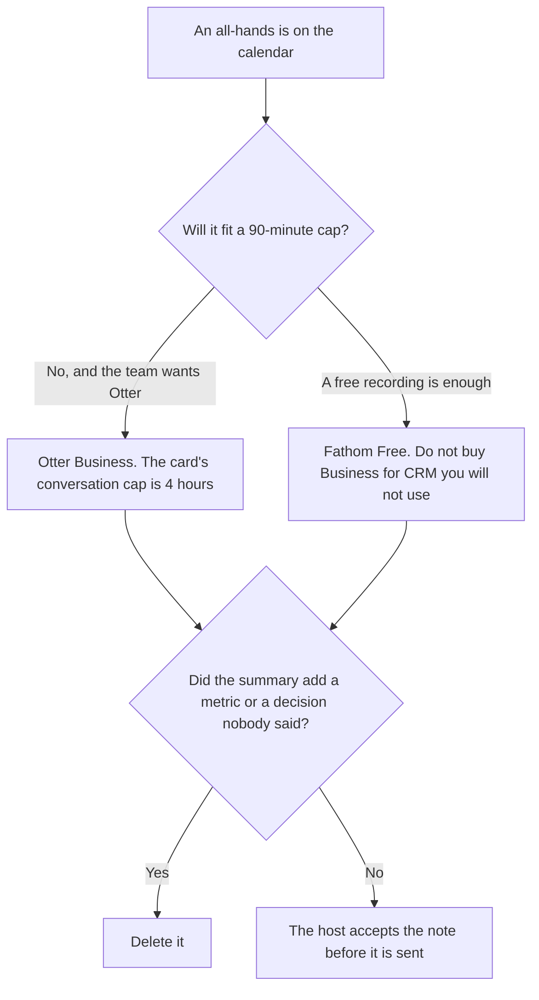

**Use Otter Business when the all-hands must stay inside a 4-hour conversation cap and the team already wants Otter's bot in the call. Use Fathom when a recording and a transcript are enough, including on the free plan, and you do not need CRM field sync.** The notes may list decisions people actually said. They may not invent a metric, an owner, or a policy. The same long meeting against Fireflies is [Otter vs Fireflies for all-hands](/blog/otter-vs-fireflies-for-all-hands-2026/). A short daily meeting is [Otter vs Fathom for standup notes](/blog/otter-vs-fathom-for-standup-notes-2026/).

The action rows after a transcript exists are [Notion AI vs ChatGPT for meeting actions](/blog/notion-ai-vs-chatgpt-for-meeting-actions-2026/). The capture choice is [how to summarize meetings with AI](/blog/how-to-summarize-meetings-with-ai-2026/).

Otter's figures are the October 16, 2026 directory card, restated in [Otter Business pricing explained](/blog/otter-business-pricing-explained-2026/). Fathom's figures are the October 24, 2026 pricing-page read in [Fathom pricing explained](/blog/fathom-pricing-explained-2026/) and [Fathom Business pricing explained](/blog/fathom-business-pricing-explained-2026/). Notion is the October 16 card. Granola's Business price is the October 24 pricing-page read in [Granola pricing explained](/blog/granola-pricing-explained-2026/). Otter's card also showed promotions, so checkout can differ. Published October 24, 2026. We did not score transcription. A bot still needs consent from the people in the room.

## Which plan survives the all-hands

| The all-hands | Start here | First paid step | The limit |
|---|---|---|---|
| Longer than 90 minutes, and you want Otter's bot | [Otter](/tools/otter-ai/) | Business is $19.99 a user a month billed annually, or $30 monthly | 4-hour conversations, on that card. Pro stops at 90 minutes |
| A recording and a transcript, with no CRM | [Fathom](/tools/fathom/) | Free lists unlimited recordings and transcripts | Business, at $25 annual, is the CRM seat. It is the wrong buy for a town hall |
| The decisions the company will keep | [Notion AI](/tools/notion-ai/) | Business is $20 a seat a month | Plus at $10 is not the full AI tier |
| Notes without a bot, if the all-hands is on one laptop | [Granola](/tools/granola/) | Business is $14 a user a month for history past 30 days | Basic is $0 and keeps 30 days. It does not put a bot in the call |

Otter Basic is 300 minutes a month and 30 minutes per conversation. Otter Pro is $16.99 a user a month, or $8.33 billed annually, with 1,200 minutes and 90 minutes per conversation. A quarterly all-hands that runs two hours does not fit Pro. Business is the card with unlimited meetings and 4-hour conversations. A five-hour meeting still does not fit that 4-hour line. Do not assume the cap stretches because the meeting is important. Split the recording, or pick a tool whose card does not publish that cap.

Fathom's pricing page, read October 24, lists unlimited recordings and transcripts on Free. Premium, at $16 a user a month billed annually or $20 monthly, is one person's action items. Team, at $15 annually or $19 monthly, needs two users and adds comments, folders, keyword alerts, and shared playlists. Business, at $25 annually or $34 monthly, also needs two users, and the line is CRM field sync, Deal View, and coaching metrics. An internal all-hands does not become a deal. Buying Business so the town hall is "the team plan" pays for a CRM row. Team is the collaboration seat if you need folders. Free is the recording if you do not.

Granola does not join as a bot. It uses computer audio. That is a different capture. Business at $14 removes the 30-day history cap. It does not add the CRM line Fathom sells, and it does not add Otter's 4-hour conversation product.

## What the note is allowed to contain

Decisions and figures someone said, with the speaker if the transcript has one. A metric from a slide counts only if you paste the slide number and the figure. The model does not remember last quarter's all-hands and fill a blank. The host owns the note. A searchable transcript is not a decision.

**Otter Business** is the long-conversation seat on that card. The invoice is [Otter Business pricing explained](/blog/otter-business-pricing-explained-2026/). The full ladder is [Otter.ai pricing explained](/blog/otter-ai-pricing-explained-2026/).

**Fathom Free** is the recording. Team is the shared folder. The invoice for the CRM row you are refusing is [Fathom Business pricing explained](/blog/fathom-business-pricing-explained-2026/).

**Notion Business** stores the accepted decisions. The invoice is [Notion AI pricing explained](/blog/notion-ai-pricing-explained-2026/).

**Granola Business** is the bot-free archive past 30 days. The review is [Granola review](/blog/granola-review-2026/).

A prompt that holds the line:

"List only decisions and figures that appear in the transcript I pasted. If a metric is missing, write Not said. Do not add an owner. Do not add a policy."

## What not to delegate

Do not buy Fathom Business because the all-hands is important. Do not run a two-hour all-hands on Otter Pro and expect the 90-minute cap to blink. Do not publish a summary that adds a number from a slide you did not paste. The host accepts the note.

## FAQ

### How is this different from Otter vs Fireflies for all-hands?

That page is Otter's per-conversation cap against Fireflies search across many all-hands. This page is Otter's 4-hour Business conversation against Fathom's free recording, and the warning that Fathom Business is a CRM seat. Use that page if the question is search across calls. Use this page if the question is whether the free Fathom recording is enough.

### How is this different from standup notes?

A standup is a short internal meeting. Otter Pro's 90-minute cap can hold it. An all-hands often cannot. Fathom Free is enough for either when you only need the recording. Do not copy the standup seat onto a two-hour town hall without reading the cap.

### Does Fathom Free include a transcript?

The October 24 pricing article records unlimited recordings and transcripts on Free. Advanced summaries and AI action items are Premium. CRM field sync is Business. Quote the row you mean. Do not describe Free as Business.

### Who may send the recap?

The host of the all-hands. Not said stays out. A formatted summary is not a new policy, and a bot in the call is not consent.

## Last verified

October 24, 2026 for Fathom's pricing page and for Granola's pricing page, via the posts cited above. October 16, 2026 for Otter and Notion. Published October 24, 2026. Otter's card showed promotions that day, so checkout can differ.

**Sources:** [Otter pricing](https://otter.ai/pricing), [Fathom pricing](https://www.fathom.ai/pricing), [Notion pricing](https://www.notion.com/pricing), [Granola pricing](https://www.granola.ai/pricing).

*Published by Andrew for [AI Tools Optimizer](https://aitoolsoptimizer.com).*

[Fathom](/tools/fathom/) is in the [meetings directory](/tools/category/meetings-transcription/). Directory pages may use affiliate links. A purchase through them may earn us a commission at no extra cost to you.
