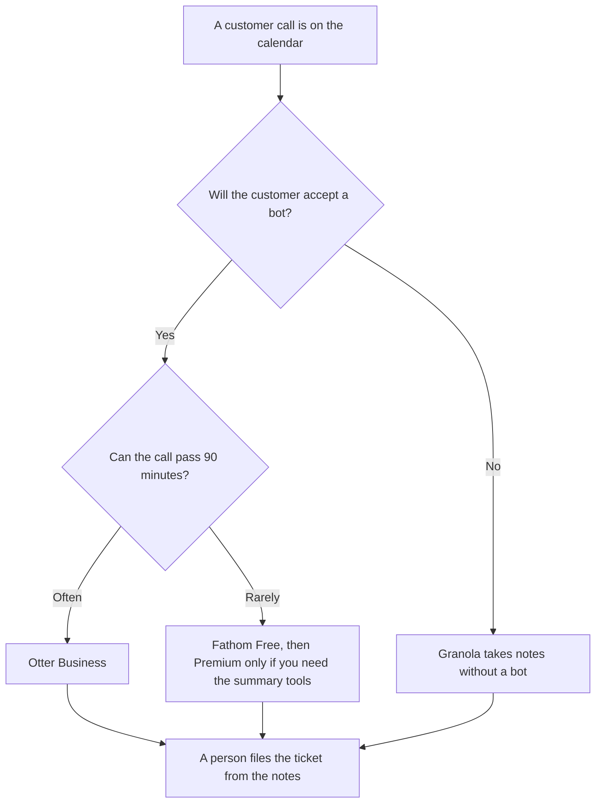

**Use Otter Business when a support or success call can run long and you need the 4-hour conversation cap and unlimited meetings. Use Fathom when the team needs recordings and transcripts on the free plan, and move to a paid Fathom seat only for the summary or CRM field you actually use.** These are customer calls: a ticket, a renewal conversation, a bug report. A sales discovery call is a different page. Both products can put a bot on the call. If the customer will not accept a bot, pick a notetaker that stays off the meeting.

The sales-call decision between this pair is [Otter vs Fathom for sales calls](/blog/otter-vs-fathom-for-sales-calls-2026/). The three-way with Fireflies is [Otter vs Fireflies vs Fathom](/blog/otter-vs-fireflies-vs-fathom-2026/). The no-bot option is [Granola vs Fathom](/blog/granola-vs-fathom-2026/).

Prices are US list prices excluding tax from directory pages checked October 16, 2026. Otter's card also showed promotions that can disappear. Published October 24, 2026. We did not score transcript accuracy. Recording may require consent where you and the customer are. This page is not legal advice.

## Which seat matches the customer call

| The call you actually take | Start here | What you still do |
|---|---|---|
| A short check-in, and a transcript is enough | [Fathom](/tools/fathom/) Free: unlimited recordings and transcripts | You confirm the customer was told the call is recorded |
| Advanced summaries and AI action items | Fathom Premium at $16 a month billed annually, or $20 monthly | You turn action items into a ticket a person files |
| A shared folder for the success team | Fathom Team at $15 a user a month billed annually, or $19 monthly, 2-user minimum | Comments and keyword alerts are the paid reason |
| The note must update a CRM field | Fathom Business at $25 a user a month billed annually, or $34 monthly | Deal View is on that row. A support team may not need it |
| 90 minutes is enough, and you can budget minutes | [Otter](/tools/otter-ai/) Pro at $8.33 a user a month billed annually, or $16.99 monthly | 1,200 minutes a user a month. Workspaces cap at 5 billed users on Pro |
| Long troubleshooting calls | Otter Business at $19.99 a user a month billed annually, or $30 monthly | Unlimited meetings, 4 hours per conversation, up to 25 billed users |

Basic Otter is free, with 300 minutes a user a month and a 30-minute cap per conversation. That cap is the reason a support team outgrows it. Fathom's free plan does not use that minute meter, on the directory card. The paid question on Fathom is whether you need the summary features, the shared team workspace, or CRM field sync.

## What the note is for

The customer's words, the product area, and the next step a person will take in the tool you already use. The note is not a health score, a churn prediction, or a promise of a refund. Those are decisions. File the quote. Let the owner decide.

**Otter Business** is the long-call row. The review is [Otter review](/blog/otter-ai-review-2026/). The full ladder, including promotions that were live at the last check, is [Otter.ai pricing explained](/blog/otter-ai-pricing-explained-2026/).

**Fathom Free** is the row when transcripts are the job and the bot is acceptable. Premium is $16 billed annually when you want the advanced summaries. Business is the CRM row, which many support teams can skip. The review is [Fathom review](/blog/fathom-review-2026/). The ladder is [Fathom pricing explained](/blog/fathom-pricing-explained-2026/).

**No bot.** [Granola](/tools/granola/) Business is $14 a user a month. Basic is free with 30 days of note history. Use it when the customer, or your policy, refuses a bot on the line.

**The ticket home.** [Notion AI](/tools/notion-ai/) Business is $20 a seat a month if the written follow-up lives in the wiki. The transcript is not the system of record. The ticket is. A renewal plan, which is a different document, is [how to write a customer success plan with AI](/blog/how-to-write-a-customer-success-plan-with-ai-2026/).

## What not to delegate

Do not let the summary close the ticket. Do not paste a transcript into a consumer chatbot if the call contains account data your policy forbids there. Do not treat a sales-call CRM setup as the support setup. Pipeline fields and ticket fields are different owners. The support handoff rules are [how to create a support escalation matrix with AI](/blog/how-to-create-a-support-escalation-matrix-with-ai-2026/).

## FAQ

### How is this different from the sales-call page?

Sales calls on this site are pipeline conversations: discovery, CRM fields, a forecast. Customer calls are support and success: a problem, a ticket, a renewal conversation that is not a first demo. The products overlap. The fields you care about do not.

### Is Fathom's free plan enough for a support team?

It is enough for recordings and transcripts, on the October 16 card. Pay for Premium when you need the advanced summaries and action items. Pay for Team when you need shared folders and more than one seat under that plan's minimum. Pay for Business when a CRM field must update. A long 4-hour bridge is the Otter Business reason, not a Fathom upgrade by itself.

### What if we cannot record?

Then neither bot belongs on the call. Take notes in Granola or by hand, with the customer's knowledge, under your policy. A transcript you were not allowed to make is not a better ticket.

### Can the summary draft the reply to the customer?

It can draft from quotes you checked, and a person sends the reply. It should not offer a credit or admit a cause. The apology workflow, when one is actually owed, is separate from the transcript.

## Last verified

October 16, 2026 for Otter, Fathom, Granola, and Notion AI. Published October 24, 2026.

**Sources:** [Otter pricing](https://otter.ai/pricing), [Fathom pricing](https://www.fathom.ai/pricing), [Granola pricing](https://www.granola.ai/pricing), [Notion pricing](https://www.notion.com/pricing).

*Published by Andrew for [AI Tools Optimizer](https://aitoolsoptimizer.com).*

[Fathom](/tools/fathom/) is in the [meetings and transcription directory](/tools/category/meetings-transcription/). Directory pages may use affiliate links. A purchase through them may earn us a commission at no extra cost to you.
