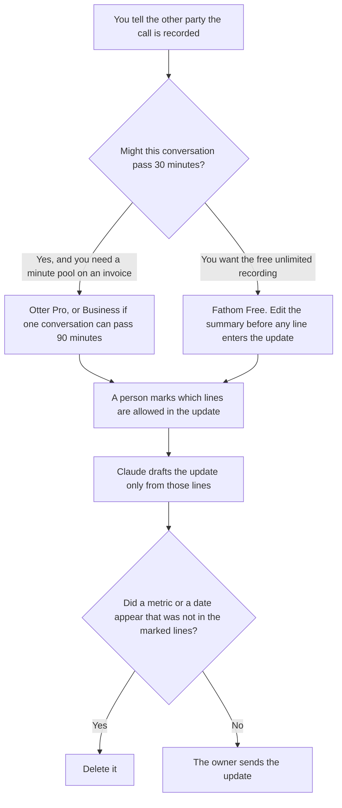

**Use Otter when the investor call may run past the free 30-minute conversation cap and you need a workspace with a minute number you can show. Use Fathom when you want the recording and a summary on the free plan, and a person will edit every sentence before it enters the update.** Neither tool writes the investor letter. The letter is [best AI tools for investor relations](/blog/best-ai-tools-for-investor-relations-2026/). A partner call, which is a different audience, is [Otter vs Fathom for partner calls](/blog/otter-vs-fathom-for-partner-calls-2026/).

Otter and Fathom prices are from directory pages checked October 16, 2026. Notion's price is from that same check. Claude's prices are the October 24, 2026 read of claude.com/pricing recorded in [Claude pricing explained](/blog/claude-pricing-explained-2026/). Published October 24, 2026. We did not score transcripts. We did not send an update.

## Which seat matches the call

| The constraint | Start here | First paid step | The limit |
|---|---|---|---|
| The call may pass 30 minutes, and you need a stated minute pool | [Otter](/tools/otter-ai/) | Pro is $8.33 a user a month billed annually, or $16.99 monthly | 1,200 minutes a user a month, 90 minutes per conversation |
| A long call with no per-meeting cap on the card | [Otter](/tools/otter-ai/) | Business is $19.99 a user a month billed annually, or $30 monthly | Unlimited meetings, 4 hours per conversation, on that card |
| A recording and a summary you will edit | [Fathom](/tools/fathom/) | Free includes unlimited recordings | Premium is $16 a month billed annually, or $20 monthly, for advanced summaries |
| The letter, after the notes are accepted | [Claude](/tools/claude/) | Pro is $17 a month billed annually, or $20 monthly | No figure that was not in the accepted notes |

Otter Basic is free: 300 minutes a user a month, and 30 minutes per conversation. A fundraising conversation that runs past 30 minutes is cut off on that plan. Pro raises the per-conversation cap to 90 minutes. Business is the card's "unlimited meetings" row, with 4 hours per conversation. The October 16 check also showed promotions, 50% off Pro and 20% off Business for 3 months. Those are not the list prices above. The invoice is [Otter.ai pricing explained](/blog/otter-ai-pricing-explained-2026/).

Fathom Free includes unlimited recordings, transcripts, and instant summaries on the October 16 card. Premium at $16 annual adds advanced summaries and AI action items. Team is $15 a user a month billed annually, with a 2-user minimum. Business at $25 a user a month billed annually is the CRM field-sync row. An investor update does not need a CRM field. Do not buy Business because the call felt important.

## What may enter the update

Only lines a person marked, from a call the other party knew was recorded. A projection the model inferred stays out. A valuation that nobody said stays out. The summary is a draft of the notes. It is not the letter.

**Otter Pro** is the path when 90 minutes and 1,200 monthly minutes cover the call. Workspaces are capped at 5 billed users on Pro and 25 on Business, on that card. The review is [Otter.ai review](/blog/otter-ai-review-2026/).

**Fathom Free** is the path when the recording itself is the requirement and a person will edit. Premium is the step when you want the advanced summary the card lists, and you still edit it. The directory is [Fathom](/tools/fathom/).

**Notion Business** stores the marked lines and the date. [Notion AI](/tools/notion-ai/) Business is $20 a seat a month. The invoice is [Notion AI pricing explained](/blog/notion-ai-pricing-explained-2026/).

**Claude Pro** drafts the update from those lines only. The review is [Claude review](/blog/claude-review-2026/).

A prompt that holds the line:

"Draft the investor update from the marked lines I pasted. If a metric is missing, write Metric not in the notes. Do not add a projection. Do not add a date. Do not add a valuation."

## What not to delegate

Do not invite a bot to a call the other party has not been told about. Do not paste the whole transcript into the letter. Do not send Fathom's action items as if the investor agreed to them. The owner of the update accepts every figure. A clean summary is not a send.

## FAQ

### How is this different from a partner call?

A partner call is a working session with a company you already named as a partner. An investor update is a letter an owner sends, fed by a call you recorded with permission. The tools can sit in either room. The template is different so a partner action item does not become a sentence in the investor letter.

### How is this different from the investor-relations shelf?

That page is the filing, the Q&A, and the holding line. This page is only the notetaker on the call that may feed the update. The letter still has an owner. A transcript is not a filing.

### Which transcript is more accurate?

We did not measure that. Otter Pro is the seat with a 90-minute conversation cap at $8.33 annual. Fathom Free does not list a minute cap on recordings. Read the lines you will actually send. A confident summary can still invent a number. The marked-lines rule is the control.

### Who may send the update?

The owner of the investor relationship. A founder can draft from marked lines. They do not send a sentence the notes do not contain. If the call was not recorded with notice, do not reconstruct it from memory inside a model and call it a transcript.

## Last verified

October 16, 2026 for Otter, Fathom, and Notion. October 24, 2026 for Claude, via the pricing article. Published October 24, 2026. This page did not refetch the Otter or Fathom pricing URLs on October 24.

**Sources:** [Otter pricing](https://otter.ai/pricing), [Fathom pricing](https://www.fathom.ai/pricing), [Notion pricing](https://www.notion.com/pricing), [Claude pricing](https://claude.com/pricing).

*Published by Andrew for [AI Tools Optimizer](https://aitoolsoptimizer.com).*

[Fathom](/tools/fathom/) is in the [meetings directory](/tools/category/meetings-transcription/). Directory pages may use affiliate links. A purchase through them may earn us a commission at no extra cost to you.
