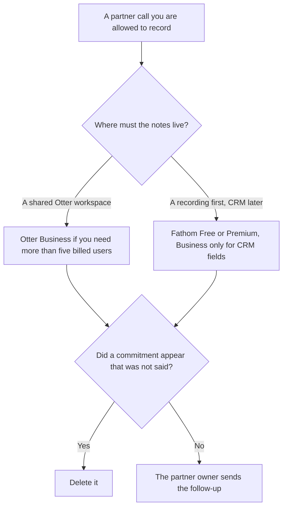

**Use Otter when the partner call has to live in a shared workspace with a cap on how long the conversation runs and a known seat count. Use Fathom when you need the recording and the transcript first, including on the free plan, and CRM fields only if you already use them.** Either tool may summarize words that were said. Neither may invent a commitment the partner did not make. A customer-success call, which is a different room, is [Otter vs tl;dv for customer success calls](/blog/otter-vs-tl-dv-for-customer-success-calls-2026/). A board meeting is [Otter vs Granola for board meetings](/blog/otter-vs-granola-for-board-meetings-2026/).

Otter and Fathom prices are from directory pages checked October 16, 2026. The Otter card notes promotions at checkout, so the sticker below is the list, not a coupon. Claude's prices are from claude.com/pricing on October 24, 2026. Granola's Business price is from the October 16 card. Published October 24, 2026. We did not score transcripts.

## Which partner call you are recording

| The call | Start here | First paid step | The limit |
|---|---|---|---|
| A workspace of up to 25 billed users, longer conversations | [Otter](/tools/otter-ai/) | Business is $30 a user a month, or $19.99 billed annually | Pro caps the workspace at 5 billed users, on that card |
| A recording you can start without a seat | [Fathom](/tools/fathom/) | Premium is $16 a month billed annually, or $20 monthly | Free lists unlimited recordings. Confirm the bot is allowed on the partner's bridge |
| CRM fields after the call | Fathom | Business is $25 a user a month billed annually, or $34 monthly | Team at $15 annually does not list that field sync |
| The follow-up you will actually send | [Claude](/tools/claude/) | Pro is $17 a month billed annually, or $20 monthly | No promise that was not in the transcript |

Otter Pro is $16.99 a user a month, or $8.33 billed annually, with 1,200 transcription minutes and 90-minute conversations, on the October 16 card. Business is the row with unlimited meetings and 4-hour conversations. If the partner call regularly runs past 90 minutes, Pro is the wrong row even when the seat is cheaper. The card also said a promotion may lower checkout. Quote the list until checkout shows the coupon.

Fathom's free plan lists unlimited recordings. Premium is the individual step. Team is $15 a user a month billed annually, or $19 monthly, with a 2-user minimum. Business is the CRM row. Do not buy Business because the call was with a partner. Buy it because you already map insights into CRM fields.

## What the note may say

The topics that were discussed, the questions that were asked, and the next step someone actually said. If the partner said "we will think about it," the note says that. A note that says "they agreed to the pilot" has edited the call.

**Otter Business** is the shared workspace when more than five people must be billed users, or when conversations run long. AI Chat query limits on that card are 200 a user a month on Business, against 50 on Pro. A query limit is not a reason to invent the action item.

**Fathom Premium** is enough when one person owns the partner notes and nobody needs CRM fields. **Fathom Business** is the seat when those fields are the point. The free plan is a real start if the partner's meeting host allows the bot.

**Claude Pro** turns the accepted notes into the email. Paste the transcript excerpt you are willing to keep. The review is [Claude review](/blog/claude-review-2026/).

A bot-free path, if the partner will not accept a bot, is [Granola](/tools/granola/) Business at $14 a user a month on the October 16 card. That is a different product. It is the right detour when the bridge itself is the objection.

A prompt that holds the line:

"Summarize this partner call from the transcript I pasted. List only next steps that were spoken. If a commitment is unclear, write Not agreed. Do not add a price or a date."

## What not to delegate

Do not record a call your policy or the partner did not allow. Do not paste a contract into a personal free account your policy forbids. Do not send the follow-up from the notetaker. The owner of the partnership sends it.

## FAQ

### Which transcript is more accurate?

We did not measure that. Otter Business is the shared workspace with longer conversations. Fathom is the recording you can start on the free plan, with CRM fields on Business. Read one call you were on before you roll a seat out to every partner manager.

### Do I need both?

You need the one your partners can accept and your workspace can administer. Two transcripts of the same call will disagree on a sentence, and someone will forward the wrong one.

### What if the partner refuses a bot?

Do not force one. Granola is the bot-free option on the October 16 card. A refused bot is a constraint. It is not a prompt to find a quieter recorder.

### Who may share the recording?

The partner owner, under the consent you already have. A share link is a distribution decision. Generating the summary does not make it.

## Last verified

October 16, 2026 for Otter, Fathom, and Granola. October 24, 2026 for Claude. Otter's card said promotions may change checkout. Published October 24, 2026.

**Sources:** [Otter pricing](https://otter.ai/pricing), [Fathom pricing](https://www.fathom.ai/pricing), [Granola](https://www.granola.ai/), [Claude pricing](https://claude.com/pricing).

*Published by Andrew for [AI Tools Optimizer](https://aitoolsoptimizer.com).*

[Otter](/tools/otter-ai/) is in the [meetings and transcription directory](/tools/category/meetings-transcription/). Directory pages may use affiliate links. A purchase through them may earn us a commission at no extra cost to you.
