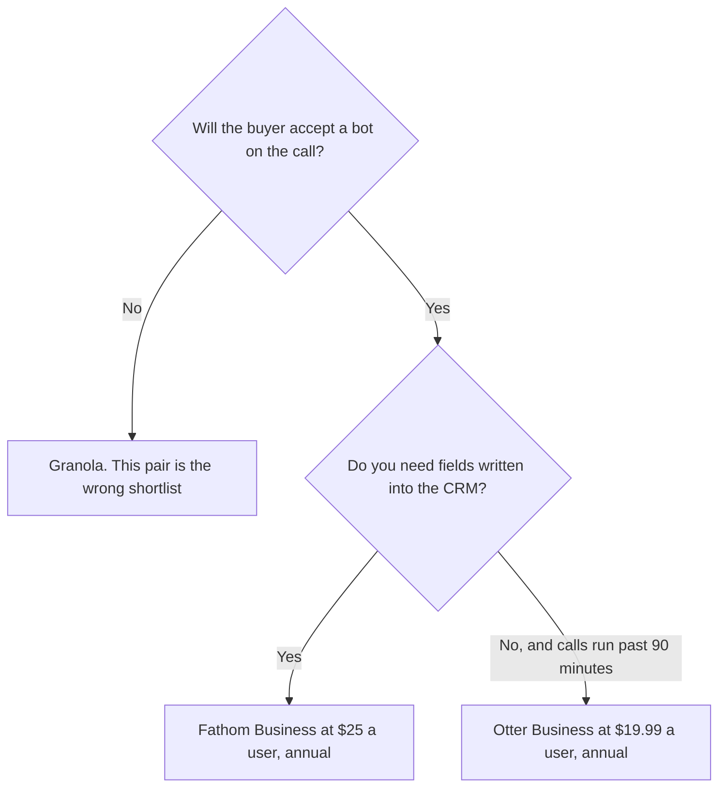

**Use Otter Business when the sales team needs unlimited meetings, a 4-hour conversation cap, and a workspace of up to 25 billed users. Use Fathom Business when the point of the call is a CRM field, not only a transcript.** Both products can put a bot on the call. If the buyer will not accept a bot, this pair is the wrong shortlist. The three-way that includes Fireflies is [Otter vs Fireflies vs Fathom](/blog/otter-vs-fireflies-vs-fathom-2026/). This page is the sales-call decision between these two.

The Otter invoice is [Otter.ai pricing explained](/blog/otter-ai-pricing-explained-2026/). The Fathom invoice is [Fathom pricing explained](/blog/fathom-pricing-explained-2026/). The no-bot alternative is [Granola vs Fathom](/blog/granola-vs-fathom-2026/).

Prices are US list prices excluding tax. Otter figures are from directory pages checked October 16, 2026, including promotions that can disappear. Fathom figures match the directory and the October 24, 2026 pricing article. Published October 24, 2026. We did not score transcript accuracy.

## What a sales team is actually buying

| | [Otter](/tools/otter-ai/) | [Fathom](/tools/fathom/) |
|---|---|---|
| Free | Basic: 300 minutes a user a month, 30 minutes per conversation, 20 AI Chat queries | Unlimited recordings and transcriptions, instant summaries, on the directory card. Confirm it at checkout |
| Individual paid | Pro $16.99 a user a month, or $8.33 billed annually. 1,200 minutes, 90 minutes per conversation, 50 AI Chat queries | Premium $16 a month billed annually, or $20 monthly, for advanced summaries and AI action items |
| The sales step | Business $30 a user a month, or $19.99 billed annually. Unlimited meetings, 4-hour conversations, 200 AI Chat queries | Business $25 a user a month billed annually, or $34 monthly. CRM field sync and Deal View |
| Workspace shape | Pro caps a workspace at 5 billed users. Business caps it at 25 | Team is $15 a user a month annually ($19 monthly) with a 2-user minimum. Business is the CRM tier |
| What the buyer sees | A bot can join Zoom, Meet, and Teams | A bot can join. Free lists unlimited recordings |
| What the CRM gets | A transcript and notes you can paste. The directory does not list native CRM field sync as the Business headline | Business syncs meeting insights into CRM fields |

Five Otter Pro seats on the annual rate are 5 × $8.33 × 12 = $499.80 a year, and the workspace cap is five billed users. A sixth seller does not fit on Pro. Five Otter Business seats are 5 × $19.99 × 12 = $1,199.40 a year, with a 25-user cap. Five Fathom Business seats are 5 × $25 × 12 = $1,500 a year. Fathom Team at $15 is cheaper and does not include the CRM field sync the directory puts on Business. Do not buy Team and assume Deal View came along.

During the October 16 check, Otter also showed promotions, including 50% off Pro and 20% off Business for three months. Those are checkout discounts. This page uses list prices. The product pages are the [Otter.ai review](/blog/otter-ai-review-2026/) and the [Fathom review](/blog/fathom-review-2026/).

## How the call becomes a record

**Discovery that must land in the opportunity.** Fathom Business is the plan the directory ties to CRM fields and Deal View. [HubSpot](/tools/hubspot/) has a free CRM. Starter was listed at $7 or $10 a seat a month as a limited-time offer on October 16, 2026. Confirm the promo. The notes are still wrong if the rep does not check them. The team shelf is [best AI tools for sales teams](/blog/best-ai-tools-for-sales-teams-2026/).

**A long working session, a demo that runs past 90 minutes.** Otter Pro stops the conversation at 90 minutes. Business allows four hours. A two-hour demo on Pro is a truncated transcript. Budget Business before the first enterprise demo, or end the recording on time.

**The buyer said no bots.** [Granola](/tools/granola/) uses computer audio and does not join as a bot. Basic is free with 30 days of history. Business is $14 a user a month for unlimited history. That is a different product decision. Do not hide an Otter or Fathom bot because the notes would be convenient.

**A third notetaker.** [Fireflies](/tools/fireflies-ai/) Pro is $10 a user a month billed annually. The comparison that includes it is the three-way linked above. This page does not re-rank it.

The words you meant to say on the call, written before you dial, are [how to create a demo script with AI](/blog/how-to-create-a-demo-script-with-ai-2026/). The leave-behind after the call is [how to write a sales one-pager with AI](/blog/how-to-write-a-sales-one-pager-with-ai-2026/).

## FAQ

### Is Fathom Free enough for a sales team?

The directory lists unlimited recordings on Free. CRM field sync and Deal View are Business. If the only goal is a personal recap, Free or Premium can be enough. If the goal is the opportunity record, read the Business line before you standardize.

### Why not stay on Otter Pro at $8.33?

Pro is 1,200 minutes, 90 minutes per conversation, and five billed users. A sales pod larger than five, or a demo longer than 90 minutes, is a Business problem. The annual Business rate is $19.99, not $8.33.

### Can the notes update the CRM by themselves?

Fathom Business can sync insights into fields, on the directory card. A person still checks the field. A wrong amount written into the opportunity is a forecast error. Otter's path, on the card we have, is the transcript you place yourself.

### Which one is more accurate?

We did not score accuracy. Pick from the cap, the bot, and whether CRM fields are the job. Listen to one real call on each free or trial path before you roll out a pod.

## Last verified

October 16, 2026 for Otter, Granola, Fireflies, and HubSpot. October 24, 2026 for Fathom prices, consistent with the directory card. Otter promotions were live on the October 16 check and are not the list price. Published October 24, 2026.

**Sources:** [Otter.ai](https://otter.ai), [Fathom](https://www.fathom.ai), [Granola](https://www.granola.ai).

*Published by Andrew for [AI Tools Optimizer](https://aitoolsoptimizer.com).*

[Fathom](/tools/fathom/) is in the [meetings and transcription directory](/tools/category/meetings-transcription/). Directory pages may use affiliate links. A purchase through them may earn us a commission at no extra cost to you.
