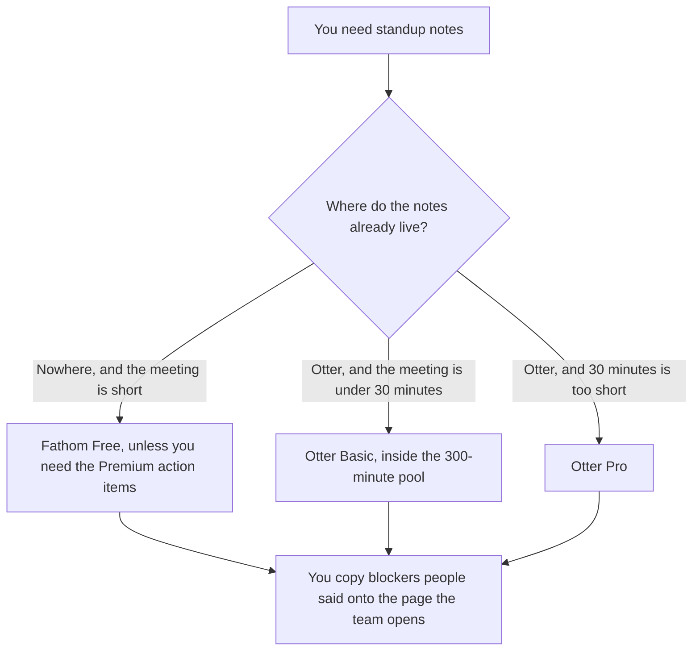

**Use Fathom when the standup only needs a recording, a transcript, and an instant summary, including on the free plan. Use Otter when the team already lives in Otter and the standup fits the conversation cap on the plan you already pay for.** The notes may list blockers people actually said. They may not invent an owner or a deadline. A customer call is a different meeting: [Otter vs Fathom for customer calls](/blog/otter-vs-fathom-for-customer-calls-2026/). A 1:1 is [Otter vs Granola for 1:1s](/blog/otter-vs-granola-for-1-on-1s-2026/).

Prices are US list prices excluding tax from directory pages checked October 16, 2026. A live fetch of vendor pricing pages on October 24, 2026 returned HTTP 401, so this page stays on the directory record. Published October 24, 2026. We did not score transcription accuracy. Otter also showed promotions on that check, so checkout may differ.

## Which plan matches a standup

| The standup you actually run | Start here | First paid step | The limit |
|---|---|---|---|
| A short internal meeting, and a free recording is enough | [Fathom](/tools/fathom/) | Free includes unlimited recordings, transcripts, and instant summaries | Advanced summaries and AI action items are Premium |
| Action items you want on a paid Fathom card | Fathom Premium | $16 a month billed annually, or $20 monthly | Team is $15 a user a month billed annually, with a 2-user minimum |
| The team is already in Otter, and the meeting is under 30 minutes | [Otter.ai](/tools/otter-ai/) | Basic is free: 300 minutes a user a month, 30 minutes per conversation | A standup that runs long gets cut on that cap |
| More than 30 minutes, or a larger monthly pool | Otter Pro | $8.33 a user a month billed annually, or $16.99 monthly | 1,200 minutes, 90 minutes per conversation. Workspaces cap at 5 billed users on Pro |
| The note people will open tomorrow | [Notion AI](/tools/notion-ai/) | Business is $20 a seat a month | The transcript tool is not the standup page |

Fathom's directory card lists Free with unlimited recordings and instant summaries, Premium at $16 a month billed annually or $20 monthly for advanced summaries and AI action items, and Team at $15 a user a month billed annually or $19 monthly, with a 2-user minimum, comments, and folders. Business at $25 a user billed annually is the CRM-sync card. A standup does not need CRM field sync. The invoice is [Fathom pricing explained](/blog/fathom-pricing-explained-2026/).

Otter Business is $19.99 a user a month billed annually, or $30 monthly, with unlimited meetings and 4 hours per conversation, and a 25-user workspace cap on that card. A daily 15-minute standup does not require Business unless the workspace is already there. The 30-minute Basic cap is the constraint to read first.

## What the note is allowed to contain

The date, who spoke, the blocker they named, and the owner they named. If nobody named an owner, the line says Owner missing. A standup note that assigns work the speaker did not accept will be wrong by lunch.

**Fathom Free** is the default when you do not already pay for a notetaker and you want the recording. Move the three sentences that matter onto the team page. **Premium** is the step when you want the advanced summary and AI action items on that card. Read the action items against the transcript before you paste them.

**Otter Basic** fits a standup that ends before 30 minutes and a team that will not blow the 300-minute monthly pool by recording everything else in the same workspace. **Pro** is the step when the meeting runs longer or the pool is the limit. Five billed users is the Pro workspace cap on the directory card. A larger standup group that all need paid Otter seats is a Business conversation, not a quiet upgrade.

**Notion** is where the running list of blockers should live if that is the page people open. The transcript can stay in Otter or Fathom. **[Granola](/tools/granola/)** is the 1:1 article. Business there is $14 a user a month, on the directory card. Do not add it for a standup you already record.

A prompt that holds the line:

"List blockers and owners from the transcript I pasted. Quote the person. Do not assign an owner they did not name. If a blocker has no owner, write Owner missing."

## What not to delegate

Do not record a standup the team has not agreed to record. Do not paste the transcript into a chatbot and ask it to "make the update sound better" in a way that adds a commitment. Do not file the customer-call note and the standup note in the same template. They rot differently. The customer version is the other article.

## FAQ

### Which one takes better standup notes?

We did not measure that. Fathom Free fits a team that wants unlimited recordings and a summary without a seat price. Otter fits a team that already uses Otter and can live inside the conversation cap. The note is better when every blocker was actually said.

### Do I need Fathom Premium for a standup?

Free includes the recording, the transcript, and an instant summary, on the directory card. Premium is the card for advanced summaries and AI action items. Buy it when you are using those, not because the meeting is daily.

### How is this different from the customer-call article?

That page is a call that may become a ticket. This page is a short internal meeting. The same products can join both. The template, the retention, and the owner of the note should not be identical.

### What if the standup is 40 minutes?

Otter Basic's per-conversation cap is 30 minutes, on the directory card. A 40-minute standup needs Pro's 90-minute cap, or a different tool. Fathom's free card does not list a 30-minute cut. The remedy for a 40-minute standup may also be a shorter meeting. The tool will not do that for you.

## Last verified

October 16, 2026 for Otter, Fathom, Notion, and Granola. Published October 24, 2026.

**Sources:** [Otter pricing](https://otter.ai/pricing), [Fathom pricing](https://fathom.ai/pricing), [Notion pricing](https://www.notion.com/pricing), [Granola pricing](https://granola.ai/pricing).

*Published by Andrew for [AI Tools Optimizer](https://aitoolsoptimizer.com).*

[Otter.ai](/tools/otter-ai/) is in the [meetings and transcription directory](/tools/category/meetings-transcription/). Directory pages may use affiliate links. A purchase through them may earn us a commission at no extra cost to you.
