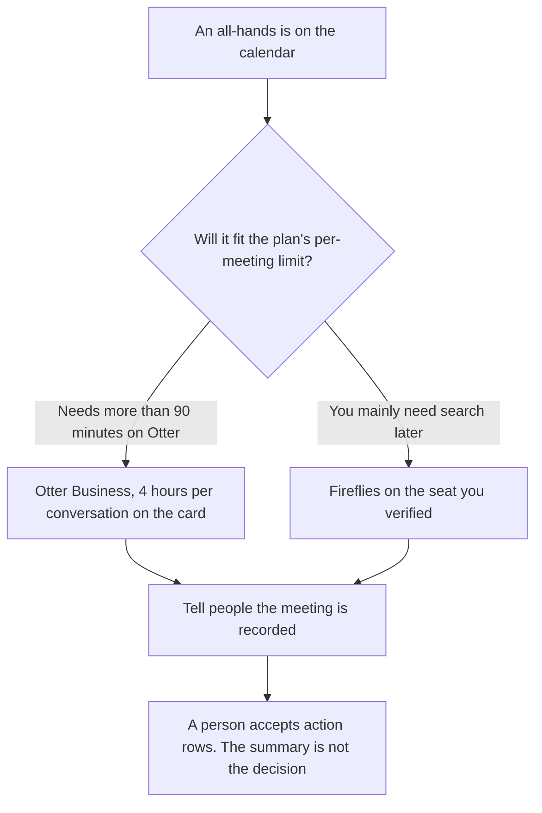

**Use Otter Business when the all-hands runs longer than the Pro cap and you need the higher per-conversation limit on that card. Use Fireflies when you need to search across many all-hands and the per-user plan matches the team.** The model may transcribe and list lines. It may not invent a decision, a metric, or an owner. A number in the summary has to be a number someone said.

A shorter customer call, with a different pair of tools, is [Otter vs tl;dv for customer success calls](/blog/otter-vs-tl-dv-for-customer-success-calls-2026/). The action rows after the transcript exists are [Notion AI vs ChatGPT for meeting actions](/blog/notion-ai-vs-chatgpt-for-meeting-actions-2026/).

Prices are US list prices from directory pages checked October 16, 2026. Otter's card also showed promotions that day, so checkout can differ. Published October 24, 2026. We did not score transcription accuracy.

## Which plan survives a long meeting

| The all-hands in front of you | Start here | First paid step | The limit on the October 16 card |
|---|---|---|---|
| One long meeting, and you need headroom past 90 minutes | [Otter](/tools/otter-ai/) | Business is $19.99 a user a month billed annually, or $30 monthly | Unlimited meetings, 4 hours per conversation. Pro stops at 90 minutes per conversation |
| Search across past all-hands | [Fireflies](/tools/fireflies-ai/) | Pro is $10 a user a month billed annually, or $18 monthly | The card does not print a minute cap on this row. Read the current plan before a long meeting |
| The action page afterward | [Notion AI](/tools/notion-ai/) | Business is $20 a seat a month | The transcript is not the task list |
| A free recording seat, if the limit fits | [Fathom](/tools/fathom/) | Free is $0 for unlimited recordings on that card. Premium is $16 a month billed annually | This page does not move the all-hands to Fathom unless you have checked the current limits |

Otter Basic is 300 minutes a user a month and 30 minutes per conversation. Pro is 1,200 minutes and 90 minutes per conversation, at $8.33 a user a month billed annually or $16.99 monthly. Workspaces are capped at 5 billed users on Pro and 25 on Business, on that card. An all-hands that runs two hours does not fit Pro's 90-minute conversation cap. The invoice is [Otter AI pricing explained](/blog/otter-ai-pricing-explained-2026/).

Fireflies Free is $0. Business is $19 a user a month billed annually or $29 monthly. Enterprise is $39 a user a month billed annually on that card. Talk dictation is included on all plans, which is not the same thing as an all-hands transcript. The invoice is [Fireflies pricing explained](/blog/fireflies-pricing-explained-2026/).

## What you may keep from the meeting

Decisions a person stated, numbers a person stated, and questions that stayed open. A summary that says the company "committed to a record quarter" has upgraded a slogan into a forecast. Delete it. The action list is a second document, with owners, on the meeting-actions page.

**Otter Business** is the long-meeting path on the card we have. Pro is the wrong seat if you already know the meeting exceeds 90 minutes. The card's promotions, 50% off Pro and 20% off Business for three months during that check, are not the renewal price.

**Fireflies Pro** is the search path when the team will ask "what did we say in March?" Business at the annual $19 rate is the next seat on that card. Confirm storage and meeting length on the current page, because this card's table does not print them.

**Notion Business** receives only the rows a person accepted. **Fathom's** free plan is a different product on the same October 16 check. Use it when its limits match the meeting, and say which product recorded the file.

A prompt that holds the line:

"From this transcript, list decisions and numbers that were explicitly stated. If a line is vague, write Not a decision. Do not add a target or an owner."

## What not to delegate

Do not let the summary write the company strategy. Do not record people who were not told. Do not paste the full employee meeting into a tool your company has not approved. The questions you still cannot answer stay open.

## FAQ

### Which one transcribes an all-hands more accurately?

We did not measure that. Otter Business is the seat on the October 16 card with a 4-hour conversation limit. Fireflies is the seat when search across meetings is the reason you are paying. Accuracy is a test you run on your own audio, not a figure this page invents.

### Is Otter Pro enough?

Not for a meeting longer than 90 minutes, on that card. Basic's 30-minute cap is shorter. If your all-hands is 45 minutes, Pro's conversation cap fits and the monthly minute pool still has to cover the month.

### Do I need Notion as well?

You need a page for accepted actions if the transcript tool is not the system of record. Many teams already use Notion for that page. The transcript can stay in Otter or Fireflies.

### Who may share the recording?

The owner of the meeting, under the policy you already have. A tool's share button is not the policy. A summary is easier to over-share than it looks, because it sounds finished.

## Last verified

October 16, 2026 for Otter, Fireflies, Notion, and Fathom. Published October 24, 2026.

**Sources:** [Otter pricing](https://otter.ai/pricing), [Fireflies pricing](https://fireflies.ai), [Notion pricing](https://www.notion.com/pricing), [Fathom pricing](https://www.fathom.ai/pricing).

*Published by Andrew for [AI Tools Optimizer](https://aitoolsoptimizer.com).*

[Otter](/tools/otter-ai/) is in the [meetings and transcription directory](/tools/category/meetings-transcription/). Directory pages may use affiliate links. A purchase through them may earn us a commission at no extra cost to you.
