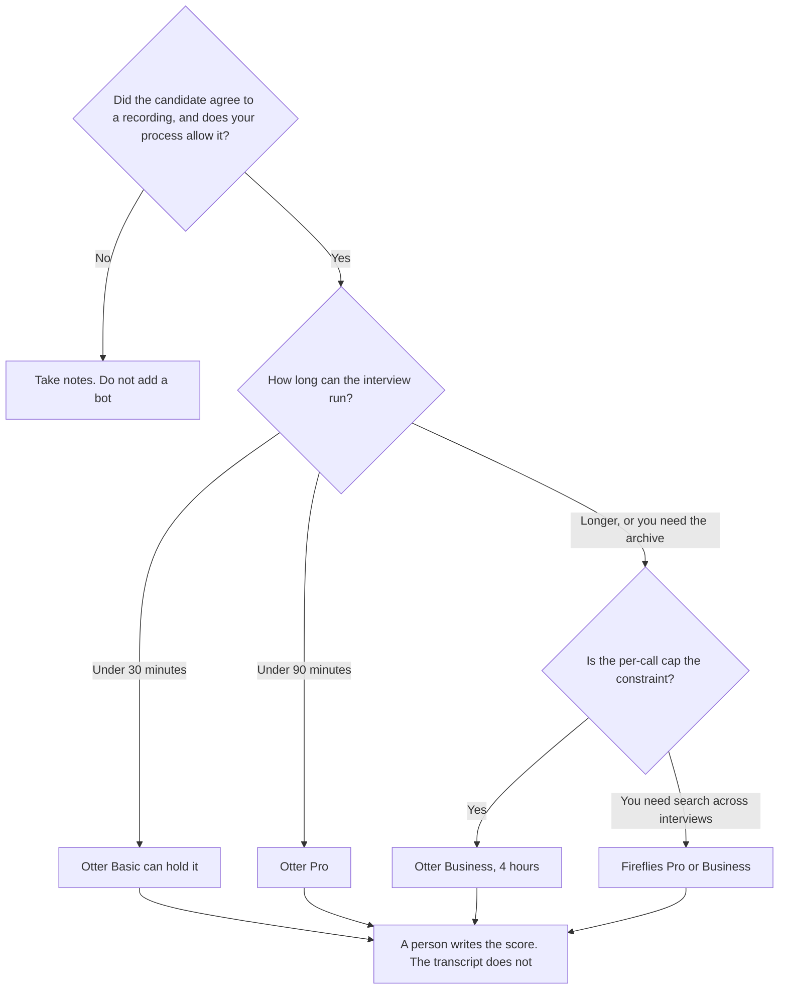

**Use Otter when the interview fits a conversation cap you can read on the plan: 30 minutes on Basic, 90 on Pro, 4 hours on Business. Use Fireflies when you want a per-seat archive and the October 24 pricing page's Pro row, at $10 a seat a month billed annually, which lists unlimited transcription and does not print a per-conversation minute cap.** Both can put a bot in the room. Tell the candidate. A transcript is not a score.

The three-way with Fathom is [Otter vs Fireflies vs Fathom](/blog/otter-vs-fireflies-vs-fathom-2026/). The invoices are [Otter.ai pricing explained](/blog/otter-ai-pricing-explained-2026/) and [Fireflies pricing explained](/blog/fireflies-pricing-explained-2026/). The scorecard a person fills, which is not this transcript, is [how to create interview scorecards with AI](/blog/how-to-create-interview-scorecards-with-ai-2026/).

Prices are US list prices excluding tax. Otter's conversation caps and the $16.99, $8.33, $30, and $19.99 list prices were on Otter's pricing page on October 24, 2026, and match the directory checked October 16. That page also showed promotional figures with asterisks. This article quotes the list, not the asterisk. Fireflies' $10, $18, $19, $29, and $39 figures were on its pricing page the same day. Published October 24, 2026. We did not score transcripts. This page is not legal advice and not a hiring decision.

## Which seat matches the interview

| The interview you actually run | Start here | The limit that matters |
|---|---|---|
| A short screen, under 30 minutes, and a bot is allowed | [Otter](/tools/otter-ai/) Basic at $0 | 300 minutes a month and 30 minutes per conversation |
| One interview that can run past 30 minutes and under 90 | Otter Pro at $8.33 a user a month billed annually, or $16.99 monthly | 1,200 minutes and 90 minutes per conversation |
| A panel that can run for hours | Otter Business at $19.99 annually or $30 monthly | Unlimited meetings on the card, and 4 hours per conversation |
| Search across many interviews, and a per-call cap is not on the card | [Fireflies](/tools/fireflies-ai/) Pro at $10 a seat a month billed annually, or $18 monthly | The October 24 page lists unlimited transcription, 8,000 minutes of storage per seat, and no per-conversation cap in the text we captured |
| The candidate should not see a bot | [Granola](/tools/granola/) | Granola Business is $14 a user a month. It listens on your computer. It is not this pair |

Fireflies Business is $19 a seat a month billed annually, or $29 monthly. Enterprise is $39 annually. Free lists unlimited transcription with an asterisk on the October 24 page, limited AI summaries, and 400 minutes of storage per team. Do not put a hiring loop on Free storage without reading that asterisk in the product. Ten interviewers on Fireflies Pro annual is $100 a month. The same ten on Otter Pro annual is $83.30 a month at the $8.33 list. The cheaper seat is the wrong seat if the conversation cap cuts the interview off.

## What the transcript is for

A record the interviewer can check while they fill a scorecard they already wrote. It is not a rank, a culture-fit paragraph, or a reason to reject someone. Names will be wrong. You correct them before anyone else reads the file. The hiring shelf that is not a notetaker is [best AI tools for HR teams](/blog/best-ai-tools-for-hr-teams-2026/).

**Otter** is the path when the minute cap is the number you need in writing. The review is [Otter.ai review](/blog/otter-ai-review-2026/).

**Fireflies** is the path when the archive and the seat price are the decision, and you have read that the page does not give you Otter's per-call cap. The product page is [Fireflies.ai review](/blog/fireflies-ai-review-2026/).

**Fathom** is the other bot if you want the free unlimited-recording claim on that directory card. Premium is $16 a month billed annually. The invoice is [Fathom pricing explained](/blog/fathom-pricing-explained-2026/). The no-bot split is [Granola vs Fathom](/blog/granola-vs-fathom-2026/).

A prompt that holds the line, after you have a transcript you are allowed to use:

"List questions the interviewer asked and topics the candidate raised, using only the transcript I pasted. Do not score the candidate. Do not infer traits. If a name is unclear, write Name unclear."

## What not to delegate

Do not summarize a candidate into a hire or no-hire. Do not record a conversation your process does not allow, then paste it into a personal chatbot. Do not keep recordings longer than your retention rule. The scorecard stays a human document.

## FAQ

### Will the bot be visible?

Otter and Fireflies join as participants when they are used that way. The candidate can see a bot. Say so before the interview starts. If that changes the conversation in a way you will not accept, use notes or a no-bot tool.

### Is 90 minutes enough?

For many one-person interviews, yes. For a panel, a work trial, or a conversation that runs long, Pro will cut off. Business is the Otter row with a 4-hour conversation cap. Check the clock against your loop before you buy a seat per interviewer.

### Does Fireflies have a per-interview cap?

The October 24 pricing page we read lists unlimited transcription on Pro and does not print a per-conversation minute cap. It does print storage: 8,000 minutes per seat on Pro, and 400 minutes per team on Free. Storage can still end a hiring archive. Read the current page before a loop that will be stored for months.

### Who is allowed to read the transcript?

The people your hiring process names. A shared workspace is not a reason to forward the file to the whole company. Delete it on the schedule you already follow for other candidate records.

## Last verified

October 24, 2026 for the Otter and Fireflies prices and caps named above. Promotional Otter prices on that page are not the list this article quotes. Published October 24, 2026.

**Sources:** [Otter pricing](https://otter.ai/pricing), [Fireflies pricing](https://fireflies.ai/pricing), [Granola pricing](https://www.granola.ai/pricing).

*Published by Andrew for [AI Tools Optimizer](https://aitoolsoptimizer.com).*

[Otter](/tools/otter-ai/) is in the [meetings and transcription directory](/tools/category/meetings-transcription/). Directory pages may use affiliate links. A purchase through them may earn us a commission at no extra cost to you.
