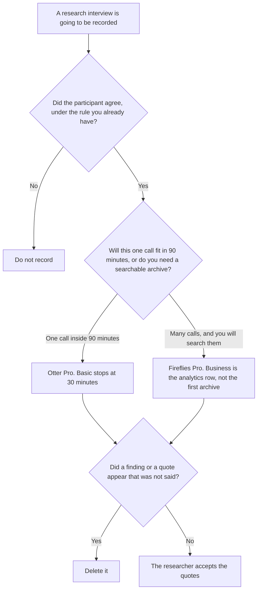

**Use Otter when the research interview fits a conversation cap you can read on the plan: 30 minutes on Basic, 90 on Pro, 4 hours on Business. Use Fireflies when you are keeping many interviews and you want the archive seat, Pro at $10 a user a month billed annually, whose October 24 pricing page listed unlimited transcription and did not print a per-conversation cap.** The notes may quote what was said. They may not invent a finding, a recommendation, or a quote.

Hiring interviews, where the output is a score a person writes, are [Otter vs Fireflies for hiring interviews](/blog/otter-vs-fireflies-for-hiring-interviews-2026/). The debrief after a customer interview is [how to write a customer interview debrief with AI](/blog/how-to-write-a-customer-interview-debrief-with-ai-2026/). The invoices are [Otter.ai pricing explained](/blog/otter-ai-pricing-explained-2026/) and [Fireflies pricing explained](/blog/fireflies-pricing-explained-2026/).

Prices are US list prices excluding tax. Otter's caps and the $16.99, $8.33, $30, and $19.99 list prices are the October 24 read recorded in the hiring comparison, and they match the October 16 directory. Fireflies' $10, $18, $19, $29, and $39 figures are the same October 24 read. Published October 24, 2026. We did not score transcripts. A recording still needs the consent your counsel already requires. This page does not supply that rule, and it does not score a candidate.

## Which seat matches the interview

| The interview you actually run | Start here | The limit that matters |
|---|---|---|
| A short call, under 30 minutes | [Otter](/tools/otter-ai/) Basic at $0 | 300 minutes a month and 30 minutes per conversation |
| One research interview that can run past 30 minutes and under 90 | Otter Pro at $8.33 a user a month billed annually, or $16.99 monthly | 1,200 minutes and 90 minutes per conversation |
| A session that can run for hours | Otter Business at $19.99 annually or $30 monthly | Unlimited meetings on the card, 4 hours per conversation, and up to 25 billed users |
| Search across many interviews | [Fireflies](/tools/fireflies-ai/) Pro at $10 a seat a month billed annually, or $18 monthly | The October 24 page lists unlimited transcription and does not print a per-conversation cap. Storage on that read is 8,000 minutes per seat |
| The quote, in words that were said | [Claude](/tools/claude/) | Pro is $17 a month billed annually, or $20 monthly. No finding that was not in the transcript |
| The page that holds the accepted quotes | [Notion AI](/tools/notion-ai/) | Business is $20 a seat a month |

Otter Basic's 30-minute cap is the usual miss on a research interview. A 45-minute call does not fit. Pro's 90 minutes does, until the call runs long. Business is the 4-hour cap and the 25-user workspace, at $19.99 a user a month billed annually or $30 monthly. The detail is [Otter Business pricing explained](/blog/otter-business-pricing-explained-2026/). Buying Business to get a transcript of a 45-minute call pays for a row Pro already covers, if you are inside 90 minutes and 1,200 monthly minutes.

Fireflies Pro at $10 annually or $18 monthly is the recording and search seat on the October 16 ladder, and the October 24 page read for the hiring article listed unlimited transcription with 8,000 minutes of storage per seat. Conversation analytics are Business, at $19 annually or $29 monthly. Enterprise at $39 billed annually is a higher published seat. Read [Fireflies Business pricing explained](/blog/fireflies-business-pricing-explained-2026/) before you call Business the archive. The archive on that record starts at Pro.

Claude writes the quote list only from lines that were said. A theme the researcher has not accepted stays out. Notion holds the quotes the researcher already marked. The debrief page is the next document. This page is the recording seat.

## What the note is allowed to say

Who was on the call, the question you asked, and the words they used. A finding you hoped to hear stays out. A recommendation stays out. If a quote is unclear, the line says Quote not clear. It does not get repaired into a cleaner sentence.

**Otter Pro** is the 90-minute research call. The review is [Otter.ai review](/blog/otter-ai-review-2026/).

**Fireflies Pro** is the archive. The review is [Fireflies review](/blog/fireflies-ai-review-2026/).

**Claude Pro** is the quote list. The review is [Claude review](/blog/claude-review-2026/).

A prompt that holds the line:

"List quotes from the transcript lines I pasted. If a line is unclear, write Quote not clear. Do not add a finding. Do not add a recommendation."

## What not to delegate

Do not let the summary decide what the participant "meant." Do not use the hiring scorecard on a research call. Do not pick Fireflies Business because the archive feels important, if Pro already has the search you meant. The researcher owns the quotes.

## FAQ

### How is this different from the hiring interview page?

That page is a candidate, a bot, and a score a person writes. This page is a research or customer interview whose output is quotes. The same recording tools can sit in both rooms. The decision at the end is different, and this page does not score anyone.

### Does Otter Basic cover a typical research interview?

Not if the call runs past 30 minutes. Basic is 300 minutes a month and 30 minutes per conversation. Pro is the 90-minute cap, at $8.33 a user a month billed annually or $16.99 monthly. Business is the 4-hour cap.

### What is the Fireflies seat for an archive?

Pro, at $10 a user a month billed annually or $18 monthly, on the prices those articles use. The October 24 read cited above lists unlimited transcription and 8,000 minutes of storage per seat, and it does not print a per-conversation cap. Business at $19 or $29 is the analytics row.

### Who may keep a quote?

The researcher, after they check it against the transcript, and only where the participant agreed under your existing rule. Quote not clear stays out of the debrief. A summary is not a finding.

## Last verified

October 24, 2026 for the Otter and Fireflies list prices, via the posts cited above, matching the October 16 directory. October 24, 2026 for Claude. October 16, 2026 for Notion. Published October 24, 2026. We did not score transcripts.

**Sources:** [Otter pricing](https://otter.ai/pricing), [Fireflies pricing](https://guide.fireflies.ai/articles/3734844560-learn-about-the-fireflies-pricing-plans), [Claude pricing](https://claude.com/pricing), [Notion pricing](https://www.notion.com/pricing).

*Published by Andrew for [AI Tools Optimizer](https://aitoolsoptimizer.com).*

[Otter](/tools/otter-ai/) is in the [meetings directory](/tools/category/meetings-transcription/). Directory pages may use affiliate links. A purchase through them may earn us a commission at no extra cost to you.
