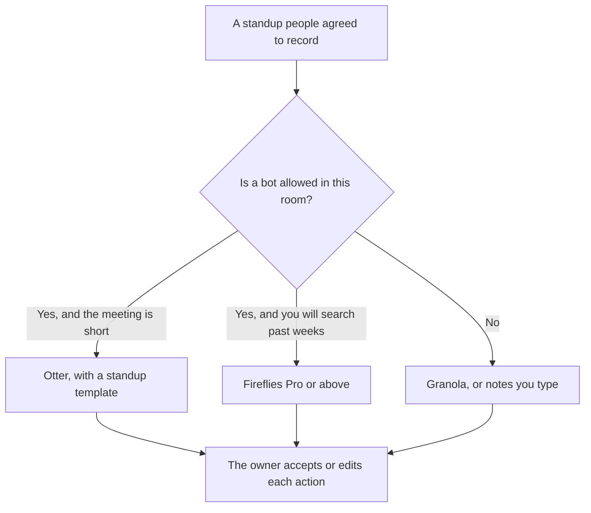

**For a short standup, Otter Pro at $8.33 a user a month billed annually fits when you want a template and the 90-minute conversation cap is longer than the meeting. Fireflies Pro at $10 a user a month billed annually fits when you need to search what the team said across many standups.** Tell people a bot is in the room. We did not score transcription accuracy.

The wider Fireflies comparison with a different notetaker is [Fathom vs Fireflies](/blog/fathom-vs-fireflies-2026/). The no-bot alternative sits in [Granola vs Fathom](/blog/granola-vs-fathom-2026/). The Fireflies invoice is [Fireflies pricing explained](/blog/fireflies-pricing-explained-2026/).

Prices are US list prices excluding tax from directory pages checked October 16, 2026. Published October 24, 2026. A standup note is a draft until the people who spoke accept the actions. We did not measure word-error rate.

## What a standup needs from the tool

| The need | Start here | The limit you should read |
|---|---|---|
| A 15-minute standup and a light transcript | [Otter](/tools/otter-ai/) Basic, free, 300 minutes a user a month and 30 minutes per conversation | A standup that runs past 30 minutes does not fit the free per-conversation cap |
| Templates for a recurring standup, and more minutes | Otter Pro, $16.99 a user a month, or $8.33 billed annually, 1,200 minutes and 90 minutes per conversation | Workspaces are capped at 5 billed users on Pro |
| Search across weeks of standups | [Fireflies](/tools/fireflies-ai/) Pro, $10 a user a month billed annually, or $18 monthly | Free exists. Pro is the recorded paid start |
| A larger team and analytics | Fireflies Business, $19 a user a month billed annually, or $29 monthly | Enterprise is $39 a user a month billed annually |
| No bot on the call | [Granola](/tools/granola/) Basic, free, with 30 days of history. Business is $14 a user a month | You still write down the action. Granola is not Otter or Fireflies |

Otter also showed promotions when the directory was checked, including 50 percent off Pro for three months. Checkout can differ from the card. Business is $30 a user a month, or $19.99 billed annually, with unlimited meetings and four hours per conversation. A standup does not need the four-hour cap. A planning meeting that you mislabeled as a standup might.

## What you are paying for

**Otter Basic** is a real free tier for a short meeting: 300 minutes a month, 30 minutes per conversation. A team that standups for 15 minutes can stay there until the minute cap or the conversation cap binds. Pro is the template-and-minutes step. Business is the longer meeting and the advanced workflows. Enterprise is custom. The tool page is [Otter](/tools/otter-ai/).

**Fireflies Pro at $10 annual** is the search step: ask across meetings, not only inside today's note. Business at $19 annual is the analytics and admin step the knowledge base described for that tier. The directory's pricing table does not itemize every analytics feature in one cell, so this page does not invent a feature list beyond the plan names and prices. Read the current knowledge base before you buy Business for a single checkbox. The tool page is [Fireflies](/tools/fireflies-ai/).

**Granola Business at $14** is the path when the team will not accept a bot. Basic keeps 30 days of history. A standup archive you need for a quarter is the paid history, or a note you paste into the tracker the same day. The invoice is [Granola pricing explained](/blog/granola-pricing-explained-2026/).

**Fathom** Free includes unlimited recordings on the directory card, with a bot. Premium is $16 a month billed annually. Use Fathom if that is already the company standard. Do not add a third bot to the same standup. One recorder, agreed in advance.

A prompt that holds the line, after the transcript exists:

"From this standup transcript, list blockers, owners, and dates that were actually said. If an owner was not named, write Unassigned. Do not invent a decision. Do not add a task that was only a joke or a side comment. Keep yesterday's unresolved items only if they appear in this transcript."

The person who accepts the action is [what human-in-the-loop AI is](/blog/what-is-human-in-the-loop-ai-2026/). A task nobody said is [what an AI hallucination is](/blog/what-is-ai-hallucination-2026/).

## What the note is for

The note feeds the tracker. It does not replace the tracker. If the team runs the work in [ClickUp](/tools/clickup-brain/), the task lives there after a person creates it. ClickUp Brain² starts at $9 a user a month on the directory card, on top of a ClickUp plan. A transcript is not a task until someone assigns it.

Do not record a standup that includes a performance conversation, a medical update, or a customer secret the whole channel should not have. Stop the bot. Those topics are the wrong input for a shared summary. The written record you do keep, for ordinary blockers, should match what was said. That habit is [what a system of record for AI is](/blog/what-is-a-system-of-record-for-ai-2026/).

## FAQ

### Which transcribes a standup more accurately?

We did not measure accuracy. Read the note before you assign work. Names and dates fail first. Fix those by hand.

### Is the free plan enough?

Otter Basic can cover a short standup inside the 30-minute conversation cap and the monthly minutes. Fireflies Free exists and includes Talk dictation on every plan. Pay when you need Otter's longer cap and templates, or Fireflies search across meetings.

### Do we have to announce the bot?

Yes. Tell the people in the meeting, including anyone who joins late. A surprise recorder is a trust problem before it is a product problem. If someone opts out, stop the bot or reschedule the topic.

### Can the summary write the status report?

It can draft bullets from accepted notes. The status report still needs the owner. A weekly rewrite from raw transcripts will promote side comments into commitments. Filter first.

## Last verified

October 16, 2026 for Otter, Fireflies, Granola, Fathom, and ClickUp Brain. Published October 24, 2026. Otter's promotions can change the checkout price.

**Sources:** [Otter pricing](https://otter.ai/pricing), [Fireflies pricing](https://fireflies.ai/pricing), [Granola pricing](https://www.granola.ai/pricing).

*Published by Andrew for [AI Tools Optimizer](https://aitoolsoptimizer.com).*

[Otter](/tools/otter-ai/) is in the [meetings and transcription directory](/tools/category/meetings-transcription/). Directory pages may use affiliate links. A purchase through them may earn us a commission at no extra cost to you.
