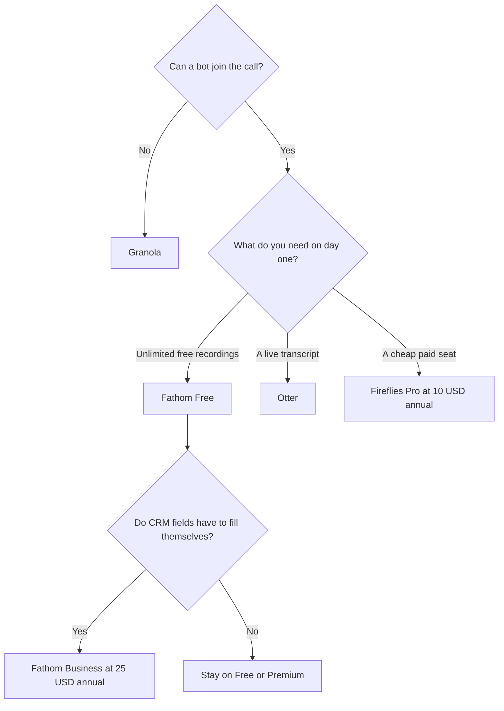

**Invite Fathom when you want unlimited free recordings and a summary after the call. Invite Otter when you need a live transcript and you can live inside a minute cap. Invite Fireflies when the confirmed annual seat price is the constraint and you want search across calls.** All three put a bot in the meeting. If the bot is the problem, leave this page for [Granola vs Fathom](/blog/granola-vs-fathom-2026/).

The four-tool roundup, including Granola, is [best AI meeting notetakers](/blog/best-ai-meeting-notetakers/). This article stays on the three bots and the way their plans fail: conversation length, a minute pool, and a CRM field that sits on a higher tier. Prices are US list prices excluding tax, last verified October 16, 2026. We did not score transcription accuracy.

## The bot decision

| Your constraint | Choose | The number that matters |
|---|---|---|
| You will not pay until the notes prove useful | [Fathom](/tools/fathom/) Free | Unlimited recordings, transcripts, instant summaries, clips, and search |
| You want the transcript on screen during the call | [Otter](/tools/otter-ai/) | Free is 300 minutes per user per month and 30 minutes per conversation |
| You want the lowest confirmed paid seat | [Fireflies](/tools/fireflies-ai/) Pro | $10/user/month billed annually, or $18 month to month |
| Action items on an individual paid plan | Fathom Premium or Otter Pro | Fathom Premium $16/month annual. Otter Pro $8.33/user/month annual |
| CRM field sync | Fathom Business | $25/user/month billed annually, or $34 monthly |
| The room will not accept a bot | [Granola](/tools/granola/) | Business is $14/user/month. Basic is free with 30 days of history |

Product pages: [Otter review](/blog/otter-ai-review-2026/), [Fireflies review](/blog/fireflies-ai-review-2026/), [Fathom review](/blog/fathom-review-2026/).

## What each bot is selling

**Otter** joins Zoom, Google Meet, or Microsoft Teams, and it can record in person from the app. The documented output is a live transcript with speakers, a summary, action items, and chat over the meeting. The free plan's 30-minute conversation cap is the surprise. A one-hour customer call does not fit. Pro raises the cap to 90 minutes and the pool to 1,200 minutes a user a month. Business is the plan with unlimited meetings and a 4-hour conversation cap, at $19.99 a user a month billed annually ($30 monthly). Pro workspaces are capped at 5 billed users. Business is capped at 25. A 50% introductory discount on Pro was visible when we checked. It is not in the table. Read checkout.

**Fireflies** joins from the calendar and covers video meetings, dialer calls, uploads, and in-person audio. AskFred is the cross-meeting Q&A. Fireflies Talk, the dictation feature, is on every plan, including Free. Pro is $10 a user a month on annual billing and $18 monthly. Business is $19 annual or $29 monthly. Enterprise is $39 a user a month on the annual column we used. The knowledge-base page that listed those prices did not list minute caps. Confirm the recording limit on the pricing page before you roll it out. We will not invent one.

**Fathom** joins Zoom, Meet, and Teams and sends the summary when the call ends. Free really is the product test: unlimited recordings and transcripts. Premium at $16 a month billed annually ($20 monthly) is where advanced summaries and AI action items sit. Team is $15 a user a month annual ($19 monthly) with a two-user minimum, comments, folders, and keyword alerts. Business at $25 annual ($34 monthly) adds CRM field sync and Deal View. Annual billing is the price Fathom leads with and saves 25% or more versus monthly. Team plans include a trial and a 90-day guarantee, per the pricing page.

## A team of 10, bots only

| Plan | Annual rate | 10 people | What you added by paying |
|---|---|---|---|
| Fathom Team | $15/user/month | $150/month | Shared comments, folders, alerts. Two-user minimum already satisfied |
| Fathom Business | $25/user/month | $250/month | CRM field sync and Deal View |
| Fireflies Pro | $10/user/month | $100/month | The paid seat. Confirm recording caps before you promise the team unlimited calls |
| Fireflies Business | $19/user/month | $190/month | The team tier above Pro |
| Otter Business | $19.99/user/month | about $200/month | Unlimited meetings, up to 25 billed users, 4 hours per conversation |
| Otter Pro | $8.33/user/month | Not a 10-person plan | Pro workspaces stop at 5 billed users |

Otter Free at 300 minutes is five hours a person. It will not survive a calendar of hour-long calls. Fathom Free will, and the bot will be visible in the participant list. That visibility is the trade.

[Read AI](/tools/read-ai/) is the adjacent product if the job is search across meetings plus email and chat, not the transcript itself. Pro is $15 a user a month billed annually. It is not a fourth bot in this price table.

## Before you turn the bot on

Tell the other people the meeting is being recorded. Consent rules depend on where the participants are. This article is not legal advice. Enterprise controls (Fireflies at $39 a user on the annual price we saw, and the enterprise tiers on Otter) are where admin and retention features concentrate. An individual Pro seat is not that contract.

After the notes exist, copying action items into another tool is an automation problem. The comparison is [Zapier vs Make vs n8n](/blog/zapier-vs-make-vs-n8n/). Otter's directory page notes a Zapier integration specifically.

If this notetaker would be your second or third AI bill, set it next to the $8 to $20 assistant plans in [which AI subscription is worth paying for](/blog/which-ai-subscription-is-worth-paying-for/).

## FAQ

### Which is cheaper, Otter or Fireflies?

On confirmed annual rates, Otter Pro is $8.33 a user a month and Fireflies Pro is $10. Otter Pro is a workspace of up to 5 users, with 1,200 minutes and 90 minutes per conversation. A team that needs unlimited Otter meetings is on Business at $19.99 annual, close to Fireflies Business at $19. Fathom Free is $0 with unlimited recordings, which beats both until you need the paid extras.

### Does Fathom Free include action items?

The free plan we checked documents unlimited recordings, transcripts, instant summaries, clips, and search. Advanced summaries and AI action items are Premium, at $16 a month billed annually.

### Can I use these without a bot?

Not these three. [Granola](/tools/granola/) captures computer audio and rewrites notes you type. The head-to-head with Fathom's free unlimited plan is [Granola vs Fathom](/blog/granola-vs-fathom-2026/).

### Which is better for a sales team?

Fathom Business is the bot in this trio with a published CRM field sync price, at $25 a user a month billed annually. Fireflies Business and Enterprise are the team tiers if you are already standardizing on Fireflies. A revenue-intelligence platform with custom pricing, [Gong](/tools/gong/), is a different budget. The sales stack is [best AI tools for sales teams](/blog/best-ai-tools-for-sales-teams-2026/).

## Last verified

October 16, 2026.

**Sources:** [Otter pricing](https://otter.ai/pricing), [Fireflies pricing plans](https://guide.fireflies.ai/articles/3734844560-learn-about-the-fireflies-pricing-plans), [Fathom pricing](https://www.fathom.ai/pricing).

[Otter](/tools/otter-ai/), [Fireflies](/tools/fireflies-ai/), and [Fathom](/tools/fathom/) are in the [meetings directory](/tools/category/meetings-transcription/). Directory pages may use affiliate links. A purchase through them may earn us a commission at no extra cost to you.
