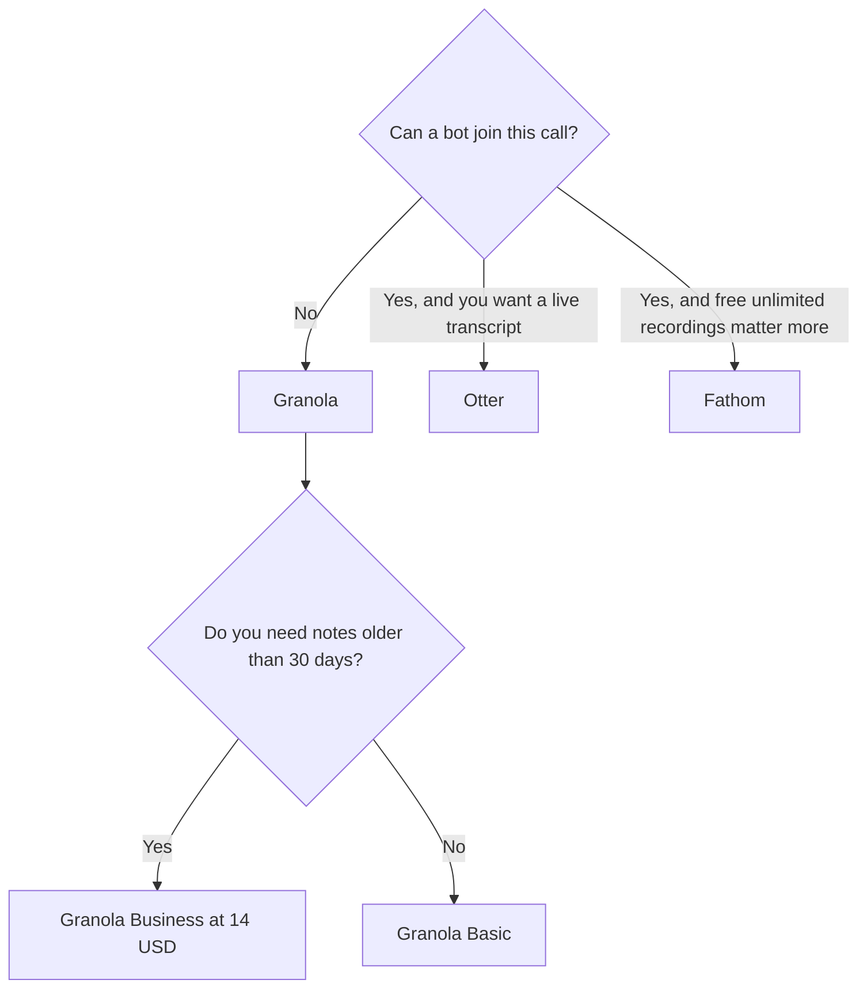

**Use Otter when you want a live transcript and a bot in the meeting, and you can live inside a minute cap. Use Granola when a bot would change the room, and you will type the notes the model should improve.** Otter joins the call. Granola listens to your computer's audio and does not add a participant. The three-bot comparison, which is a different question, is [Otter vs Fireflies vs Fathom](/blog/otter-vs-fireflies-vs-fathom-2026/). The no-bot comparison against Fathom is [Granola vs Fathom](/blog/granola-vs-fathom-2026/).

Prices are US list prices excluding tax from directory pages checked October 16, 2026. Published October 24, 2026. We did not score transcription accuracy. Otter was running promotions during that check. Quote checkout, not a banner.

## The constraint that decides it

| Your constraint | Choose | The number |
|---|---|---|
| You want the transcript on screen during the call | [Otter](/tools/otter-ai/) | Free is 300 minutes per user per month and 30 minutes per conversation |
| The room will not accept a bot | [Granola](/tools/granola/) | Basic is free. History in the app is 30 days |
| You need the recording kept, and a bot is fine | [Fathom](/tools/fathom/) | Free is unlimited recordings and transcripts |
| You need search across many bot-recorded calls | [Fireflies](/tools/fireflies-ai/) | Pro is $10/user/month billed annually, or $18 monthly |
| The notes should land in the wiki | Granola Business, or a paste into [Notion](/tools/notion-ai/) | Granola Business is $14/user/month. Notion Business is $20/seat for the full AI tier |

## The receipts

**Otter Basic** is free, with 300 meeting-transcription minutes per user per month and 30 minutes per conversation. A weekly one-hour call already spends 240 minutes. One long workshop hits the 30-minute conversation cap and stops being one conversation. Pro is $16.99 a user a month, or $8.33 billed annually, with 1,200 minutes and 90 minutes per conversation. Business is $30 a user a month, or $19.99 billed annually, with unlimited meetings and 4-hour conversations. The directory noted extra promotions, including an example of 50% off Pro. Treat that as a promotion, not a list price. The card is [Otter pricing explained](/blog/otter-ai-pricing-explained-2026/). The review is [Otter review](/blog/otter-ai-review-2026/).

**Granola Basic** is free, with AI notes and chat, and 30 days of note history in the app. There is no bot. It uses your computer's audio and works with Zoom, Meet, Teams, and other apps. Business is $14 a user a month, with unlimited history, manual model selection, and integrations such as Zapier, Notion, Slack, and Attio. Enterprise starts at $35 a user a month, with SSO, admin controls, and policy management. Mobile apps are free to use, on the directory card. The card is [Granola pricing explained](/blog/granola-pricing-explained-2026/). The review is [Granola review](/blog/granola-review-2026/).

Granola is a bad fit if you wanted a transcript you did not participate in writing. Otter is a bad fit if the guest will change what they say because a bot is in the list. Tell people when a bot is recording. A surprise participant is not a feature.

## What to do with the notes

Neither tool decides the meeting. A summary can drop the objection and keep the small talk. Read it the same day, while you still remember who disagreed. The habit is [how to summarize meetings with AI](/blog/how-to-summarize-meetings-with-ai-2026/). The agenda that should have existed first is [how to create meeting agendas with AI](/blog/how-to-create-meeting-agendas-with-ai-2026/).

If the notes need to become a page the company will reopen, paste the approved lines into [Notion](/tools/notion-ai/). Business at $20 a seat is the full AI tier. Plus at $10 is not. The writing split is [ChatGPT vs Notion AI for writing](/blog/chatgpt-vs-notion-ai-for-writing-2026/). A chat thread is not the archive.

The wider shelf, including tools this page does not center, is [best AI meeting notetakers](/blog/best-ai-meeting-notetakers/).

## FAQ

### Is Granola cheaper than Otter?

Basic is free on both. Otter Pro annual is $8.33 a user. Granola Business is $14 a user, and it is the plan that removes the 30-day history cap. The cheaper paid seat is Otter Pro, and it still puts a bot in the call. Compare them after you know whether the bot is allowed.

### Does Otter work without a bot?

The product this comparison is about joins meetings and transcribes them. If the requirement is no bot, use Granola. Do not buy Otter Business to approximate a notepad.

### Can I use both?

Yes, on purpose. Granola for the customer call that should not show a bot. Otter for the internal meeting where a live transcript is the point. Running both on the same call is a duplicate and a second consent problem.

### Which transcript is more accurate?

This page did not measure that. Read one meeting you were in. Keep the tool whose misses you can see, and whose presence the room accepts.

## Last verified

October 16, 2026 for Otter, Granola, Fathom, Fireflies, and Notion prices named above. Published October 24, 2026. Promotional Otter discounts were visible during that check and are not the list price.

**Sources:** [Otter pricing](https://otter.ai/pricing), [Granola](https://www.granola.ai/), [Notion pricing](https://www.notion.com/pricing).

*Published by Andrew for [AI Tools Optimizer](https://aitoolsoptimizer.com).*

[Otter](/tools/otter-ai/) and [Granola](/tools/granola/) are in the [meetings and transcription directory](/tools/category/meetings-transcription/). Directory pages may use affiliate links. A purchase through them may earn us a commission at no extra cost to you.
