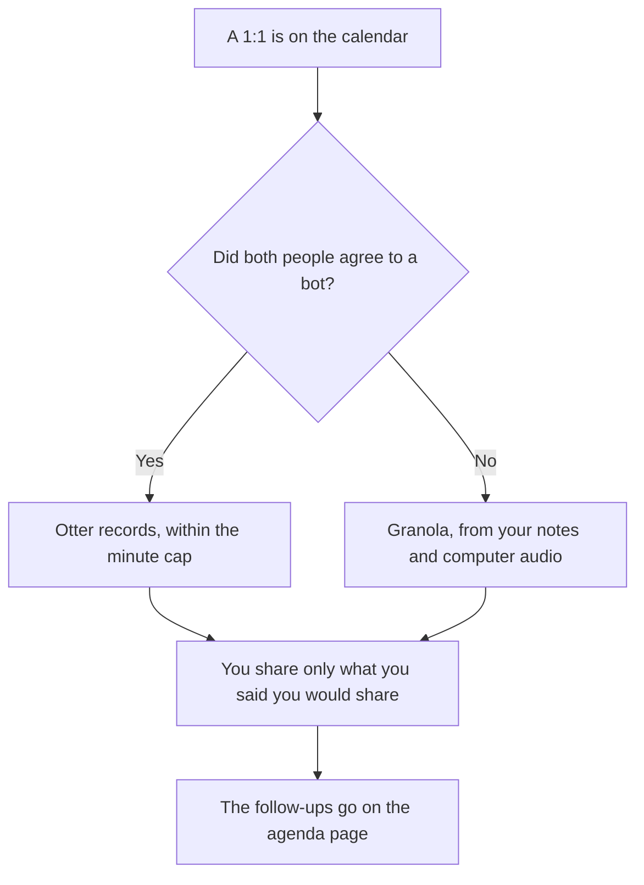

**Use Otter for a 1:1 only when both people expect a bot and you want a transcript. Use Granola when a bot would change the conversation, and you will type the notes the model should clean up.** A 1:1 is not a hiring loop and not a company all-hands. The general comparison is [Otter vs Granola](/blog/otter-vs-granola-2026/). The hiring version is [Otter vs Granola for interviews](/blog/otter-vs-granola-for-interviews-2026/).

Prices are US list prices excluding tax from directory pages checked October 16, 2026. Otter was running promotions during that check. Quote checkout, not a banner. Published October 24, 2026. We did not score transcription accuracy.

## What the 1:1 will tolerate

| The room | Start here | First paid step | Where the note lives |
|---|---|---|---|
| Both people agreed to a bot and a transcript | [Otter](/tools/otter-ai/) Basic, 300 minutes a month and 30 minutes per conversation | Pro is $16.99 a month, or $8.33 billed annually, with 1,200 minutes and 90 minutes per conversation | A place the other person knows about |
| No bot, and you will jot the points yourself | [Granola](/tools/granola/) Basic, 30 days of history | Business is $14 a user a month for unlimited history | Your notes, shared only if you choose |
| A visible recorder the team already standardizes | [Fathom](/tools/fathom/) | The Fathom comparison | A different default |
| The agenda and the follow-ups in the wiki | [Notion AI](/tools/notion-ai/) | Business is $20 a seat a month | The page, after you delete commentary that does not belong in a shared wiki |

Otter Business is $30 a month, or $19.99 billed annually, with a higher conversation length, on the directory card. A weekly 1:1 does not need Business unless the workspace already standardized on it. Granola Enterprise starts at $35 a user a month on that card. A manager's 1:1s do not need Enterprise unless the company requires SSO. The Granola invoice is [Granola pricing explained](/blog/granola-pricing-explained-2026/). The no-bot comparison against another recorder is [Granola vs Fathom](/blog/granola-vs-fathom-2026/).

## What may be in the note

Decisions, commitments, and dates you both heard. Performance commentary, medical details, and compensation numbers do not belong in a transcript a wider workspace can search. If the 1:1 covered those topics, the shared note says the topic was discussed and the detail stays in the system your HR process already names. The model does not get to paraphrase a rating.

**Otter Pro** is the bot path. Basic's 30-minute cap will cut a normal 1:1 in half. Say the bot is there at the start. If the other person says no, stop it. A surprise participant is a different meeting.

**Granola Business** is the path when history matters past 30 days. Basic can cover a month of notes and then the older ones leave the app, on the directory card. If you will need last quarter's commitments, Business is the seat. Granola does not add a bot. You still need consent to capture audio. The directory is explicit that computer audio is the method, and consent is still yours.

**Notion** holds the agenda both people can see. Paste follow-ups there. Do not paste the raw transcript into a team wiki.

A prompt that holds the line:

"From the notes I pasted, list commitments, owners, and dates. Do not add a performance judgment. Do not add a topic I did not write down. If a date is missing, write Date missing."

## What not to delegate

Do not email a recording the other person did not expect. Do not ask the model who is "doing well." Do not store a 1:1 transcript in a shared Otter workspace if the workspace is wider than the two of you, unless both people know that. The hiring scorecard is a different document, and it has its own article.

## FAQ

### Which one takes better 1:1 notes?

We did not measure that. Otter fits a transcript both people expected. Granola fits notes you typed, without a bot in the room. The useful note is the commitments, not the transcript length.

### Is Otter's annual price $8.33?

On the directory card checked October 16, 2026, Pro is $16.99 a month or $8.33 a month billed annually. Promotions were running. Checkout wins.

### What if my manager forbids bots and also forbids local recording?

Then neither tool should capture the audio. Type the commitments yourself. A tool that "just listens" is still a capture.

### Can I use the interview article for 1:1s?

That article is a candidate, a scorecard, and a loop. A 1:1 has a different privacy bar. Use this page for the recurring manager conversation.

## Last verified

October 16, 2026 for Otter, Granola, Fathom, and Notion. Published October 24, 2026. Consent and retention rules at your company win over either product default.

**Sources:** [Otter pricing](https://otter.ai/pricing), [Granola pricing](https://www.granola.ai/pricing), [Notion pricing](https://www.notion.com/pricing).

*Published by Andrew for [AI Tools Optimizer](https://aitoolsoptimizer.com).*

[Granola](/tools/granola/) is in the [meetings and transcription directory](/tools/category/meetings-transcription/). Directory pages may use affiliate links. A purchase through them may earn us a commission at no extra cost to you.
