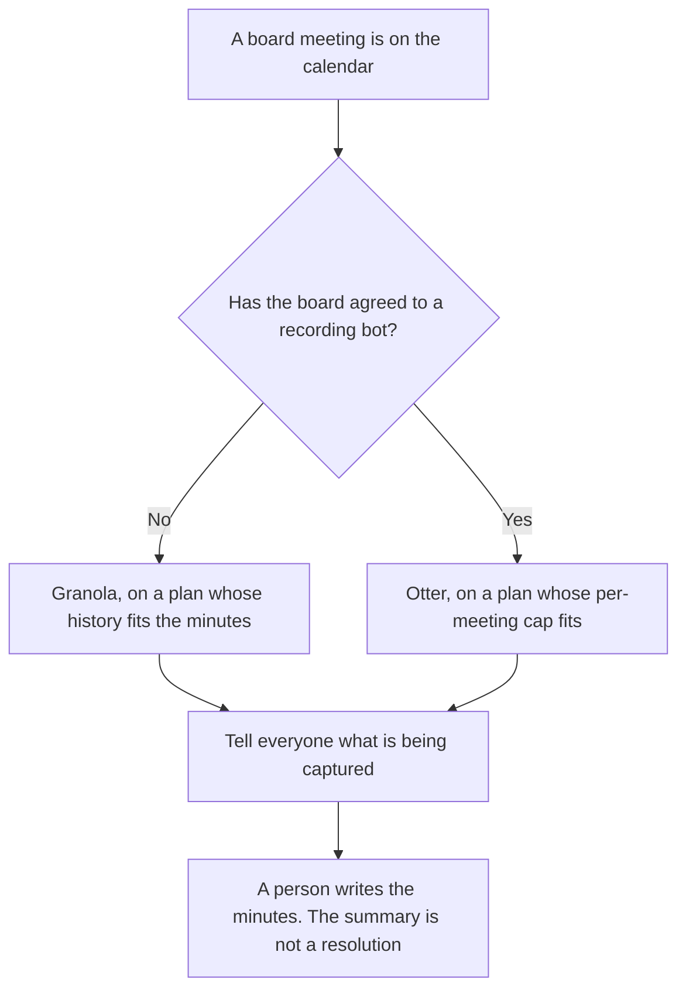

**Use Granola when the board should not see a meeting bot, and the notes have to live longer than the free plan's 30-day history. Use Otter when the board has agreed to a recording and you need a transcript file with a per-meeting limit you have checked.** The model may transcribe or clean notes. It may not invent a resolution, a vote, or a number. A one-to-one is [Otter vs Granola for 1:1s](/blog/otter-vs-granola-for-1-on-1s-2026/). A long all-hands, with a different second tool, is [Otter vs Fireflies for all-hands](/blog/otter-vs-fireflies-for-all-hands-2026/).

Prices are US list prices from directory pages checked October 16, 2026. Otter's card also showed promotions that day, so checkout can differ. Published October 24, 2026. We did not score accuracy. This page is not governance advice.

## Which record the board actually allowed

| The meeting | Start here | First paid step | The limit on the October 16 card |
|---|---|---|---|
| No bot in the room, and you need history past 30 days | [Granola](/tools/granola/) | Business is $14 a user a month | Basic is free and keeps 30 days of note history in the app |
| A recording the board was told about | [Otter](/tools/otter-ai/) | Business is $19.99 a user a month billed annually, or $30 monthly | 4 hours per conversation. Pro stops at 90 minutes per conversation |
| The minute book people will cite | [Notion AI](/tools/notion-ai/) | Business is $20 a seat a month | The transcript is not the minutes |
| A free recording seat, only if the policy allows a bot | [Fathom](/tools/fathom/) | Free is $0 for unlimited recordings on that card. Premium is $16 a month billed annually | Do not move a board meeting here until the board has agreed |

Board material is confidential by default. A personal login is the wrong place for it if your policy says the notes belong to the company. The system of record for the minutes is the minute book, not the chat.

## What the cards say about keeping the record

**Granola Basic** is free, with AI notes and no daily transcription limit, and 30 days of history in the app, on the October 16 card. Business at $14 a user a month is the seat with unlimited history and integrations such as Notion and Slack. Enterprise starts at $35 a user a month, with SSO and admin controls. A board pack you must open next year does not fit a 30-day history. The invoice is [Granola pricing explained](/blog/granola-pricing-explained-2026/). Granola uses computer audio. No bot joins. You still need consent.

**Otter Basic** is 300 minutes a user a month and 30 minutes per conversation. Pro is 1,200 minutes and 90 minutes per conversation, at $8.33 a user a month billed annually or $16.99 monthly. A board meeting that runs past 90 minutes does not fit Pro. Business is the 4-hour conversation row. The card's promotions are not the renewal price. The invoice is [Otter AI pricing explained](/blog/otter-ai-pricing-explained-2026/).

**Notion Business** receives only sentences a person has accepted as minutes. **Fathom's** free plan is a different product. Use it only when a bot is allowed and you have read [Fathom pricing explained](/blog/fathom-pricing-explained-2026/).

A prompt that holds the line:

"From these notes, list statements that were explicitly made. If a line is not a resolution, write Not a resolution. Do not add a vote, a number, or an owner."

## What not to delegate

Do not record directors who were not told. Do not let a summary say the board "approved the plan" because someone said the plan looked reasonable. Do not paste the pack into a tool the company has not approved. The cleanup of rough notes, after you have the words, is [ChatGPT vs Claude for meeting notes cleanup](/blog/chatgpt-vs-claude-for-meeting-notes-cleanup-2026/).

## FAQ

### Which one is more accurate for a board?

We did not measure that. Granola fits a room that will not accept a bot, on a paid history plan if you must keep the notes. Otter fits a recording the board already allowed, on a conversation cap that covers the meeting. Accuracy is a test on your own audio.

### Is Granola's free plan enough?

Not if you need the notes after 30 days. Basic is a real free plan on that card, and the history limit is the reason a board pack moves to Business. Enterprise is the seat when you need SSO. Read the current admin terms before you put a board on a personal workspace.

### Do the minutes live in Otter or Granola?

They live in the minute book a person signs. The tool can hold a transcript or enhanced notes. A share link is not the minutes.

### Who may circulate the summary?

The person your board process names, usually the corporate secretary or the chair's delegate. A model does not circulate anything. A polished paragraph is not a unanimous vote.

## Last verified

October 16, 2026 for Otter, Granola, Notion, and Fathom. Published October 24, 2026.

**Sources:** [Otter pricing](https://otter.ai/pricing), [Granola pricing](https://www.granola.ai/pricing), [Notion pricing](https://www.notion.com/pricing), [Fathom pricing](https://www.fathom.ai/pricing).

*Published by Andrew for [AI Tools Optimizer](https://aitoolsoptimizer.com).*

[Granola](/tools/granola/) is in the [meetings and transcription directory](/tools/category/meetings-transcription/). Directory pages may use affiliate links. A purchase through them may earn us a commission at no extra cost to you.
