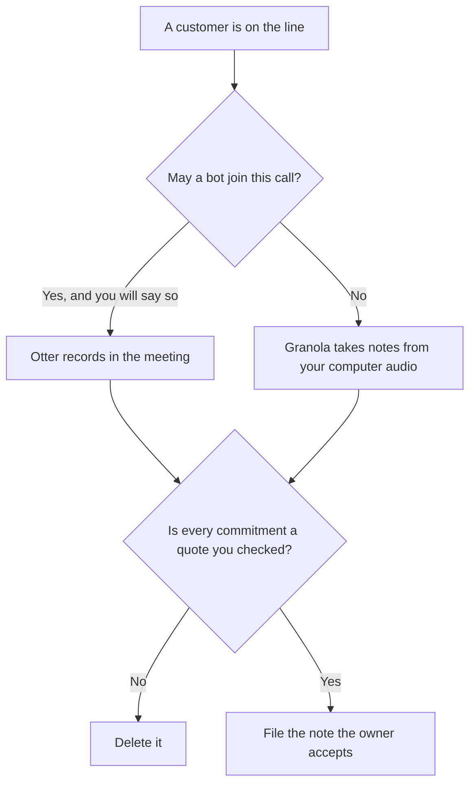

**Use Otter when the customer call should have a bot in the meeting and a shared transcript your team can reopen. Use Granola when notes should come from your computer's audio, with no bot joining the customer.** Either tool may format notes from what was said. Neither may invent a commitment, a discount, or a complaint the customer did not make. The ticket-versus-pipeline split, with Fathom in the other seat, is [Otter vs Fathom for customer calls](/blog/otter-vs-fathom-for-customer-calls-2026/). The account note after a success call is [Otter vs tl;dv for customer success calls](/blog/otter-vs-tl-dv-for-customer-success-calls-2026/).

Otter's prices are from the directory page checked October 16, 2026. Granola's prices are from the pricing page read October 24, 2026, as recorded in the Granola pricing article. Claude's prices are from claude.com/pricing on October 24. Notion is the October 16 card. Published October 24, 2026. We did not score transcripts.

## Which customer call you are on

| The room | Start here | First paid step | The limit |
|---|---|---|---|
| A bot may join, and the team needs the transcript | [Otter](/tools/otter-ai/) | Pro is $16.99 a user a month, or $8.33 billed annually | Tell the customer a bot is present. No promise they did not say |
| No bot, and you will write from your own notes plus audio | [Granola](/tools/granola/) | Business is $14 a user a month | History on the free plan is 30 days. The note is still not a contract |
| The follow-up, in words you reuse | [Claude](/tools/claude/) | Pro is $17 a month billed annually, or $20 monthly | It drafts from quotes you checked |
| The account page | [Notion AI](/tools/notion-ai/) | Business is $20 a seat a month | The page stores what you accepted |

A customer call is not an internal standup. The other party did not agree to your tool by working at your company. If you cannot say how notes are taken, do not start the tool. Granola's directory card says no bot joins and that it uses computer audio. Otter's card describes it joining calls. Those are the product shapes this page uses. Confirm the current join behavior on the day of the call.

Otter Business is $30 a user a month, or $19.99 billed annually, on the October 16 card, with unlimited meetings on that card. Pro is the individual minute pool: 1,200 minutes and 90 minutes per conversation. Promotions were running during that check. Checkout wins. The Granola invoice is [Granola pricing explained](/blog/granola-pricing-explained-2026/). Enterprise there is $35 a user a month. Basic is free with 30 days of history, which is a poor archive for a customer promise.

## What the note is allowed to contain

What the customer asked, what you agreed, and what you explicitly did not agree. If a number was fuzzy, the note says Amount not stated. The follow-up email uses the same lines. It does not upgrade a "we'll look" into a delivery date.

**Otter Pro or Business** is the shared-transcript path. Business is the team seat on that card. Say the bot's name when it joins.

**Granola Business** is the no-bot path, with history past 30 days. Your rough notes still matter. The tool enhances them. It does not replace a sentence you failed to write down if the audio was not captured.

**Claude Pro** drafts the follow-up from quotes you checked. The review is [Claude review](/blog/claude-review-2026/).

**Notion Business** is the account page. Link the call date. The invoice is [Notion AI pricing explained](/blog/notion-ai-pricing-explained-2026/).

A prompt that holds the line:

"Draft the customer-call note from the quotes I pasted. If a commitment is not in a quote, write Not agreed. Do not add a discount. Do not add a delivery date."

## What not to delegate

Do not ask the model what the customer "really wanted." Do not paste a recording into a personal account your company forbids. Do not send the follow-up before the owner checks the commitments. A clean summary is not consent.

## FAQ

### How is this different from Otter vs Fathom for customer calls?

That page chooses between Otter and Fathom for the ticket, not the pipeline. This page chooses between a bot in the meeting and notes from your machine. Fathom is not the alternative here. Granola is.

### How is this different from the tl;dv customer-success page?

That page is the account note after a success motion. This page is the capture method on the call itself: bot or no bot. The same customer can appear on both pages. The templates stay different.

### Which plan holds a year's worth of customer notes?

Otter's October 16 Business card lists unlimited meetings. Granola's October 24 page lists unlimited history on Business at $14, and 30 days on Basic. A free Granola archive is the wrong place for a promise you may need next quarter.

### Who may send the follow-up?

The person who owns the customer relationship, after they check every commitment against a quote. The note tool does not send it. A model draft is not the email.

## Last verified

October 16, 2026 for Otter and Notion. October 24, 2026 for Granola's prices, as recorded in the Granola pricing article, and for Claude. Published October 24, 2026.

**Sources:** [Otter pricing](https://otter.ai/pricing), [Granola pricing](https://www.granola.ai/pricing), [Claude pricing](https://claude.com/pricing), [Notion pricing](https://www.notion.com/pricing).

*Published by Andrew for [AI Tools Optimizer](https://aitoolsoptimizer.com).*

[Granola](/tools/granola/) is in the [meetings and transcription directory](/tools/category/meetings-transcription/). Directory pages may use affiliate links. A purchase through them may earn us a commission at no extra cost to you.
