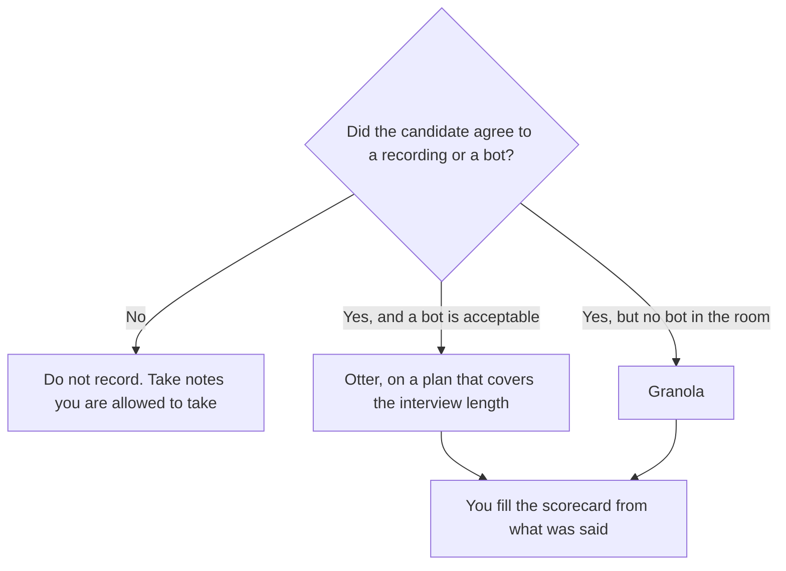

**Use Otter for a recruiting interview when the candidate has agreed to a bot and you need a transcript the hiring loop can search. Use Granola when a bot would change the conversation, and the interviewer will still type the notes the model should clean up.** This page is the interview. The general meeting comparison, which is a different room, is [Otter vs Granola](/blog/otter-vs-granola-2026/). A scorecard is a separate artifact. The notes are not a hire.

The guide you write before the call is [how to create a user interview guide with AI](/blog/how-to-create-a-user-interview-guide-with-ai-2026/) when the conversation is research, and the same discipline applies to a hiring loop: questions first, transcript second. The scorecard workflow is [how to create interview scorecards with AI](/blog/how-to-create-interview-scorecards-with-ai-2026/). The recruiter shelf is [best AI tools for recruiters](/blog/best-ai-tools-for-recruiters-2026/).

Prices are US list prices excluding tax from directory pages checked October 16, 2026. Published October 24, 2026. We did not score transcription accuracy. Otter was running promotions during that check. Quote checkout, not a banner. Recording people requires consent. This page is not legal advice on notice rules in your region.

## The constraint that shows up in a hiring loop

| Your constraint | Choose | The number that matters in an interview |
|---|---|---|
| The panel wants a searchable transcript, and the candidate agreed to a bot | [Otter](/tools/otter-ai/) | Free caps a conversation at 30 minutes and gives 300 minutes a month. A loop longer than that needs Pro |
| A bot would make the candidate perform for a recording | [Granola](/tools/granola/) | No bot. Basic is free, and history in the app is 30 days |
| The interview runs past 90 minutes | Otter Business, or Granola | Otter Pro conversations are 90 minutes on the card. Business lists 4-hour conversations |
| The loop lasts longer than a month and you are still on a free seat | Granola Business, or export before day 30 | Granola Basic keeps 30 days of history in the app |
| The decision lives in a scorecard, not in the transcript | Either, then a human writes the score | The transcript does not check the rubric |

Otter Pro is $16.99 a user a month, or $8.33 billed annually, with 1,200 minutes and 90 minutes per conversation. Business is $30 a user a month, or $19.99 billed annually, with unlimited meetings and 4-hour conversations. A one-hour interview does not fit the free 30-minute conversation cap. Do not plan a loop on Basic and discover the cutoff mid-answer.

Granola Business is $14 a user a month, with unlimited history. Enterprise starts at $35 a user a month. Billing is per workspace. Mobile apps are free to use on the card. Free is genuinely usable for a week of interviews and a poor archive for a search that runs six weeks, because the history line is 30 days.

## What the hiring committee still does

**The scorecard.** [Claude](/tools/claude/) Pro is $20 a month, or $17 billed annually, can turn notes you paste into a draft against a rubric you paste. It may not invent a quote or a skill the notes do not contain. [ChatGPT](/tools/chatgpt/) Plus at $20 is the same rule in the other chat. The writing pair is [ChatGPT vs Claude for writing](/blog/chatgpt-vs-claude-for-writing-2026/).

**The file the loop can reopen.** [Notion AI](/tools/notion-ai/) Business is $20 a seat a month. Put the scorecard there, with the interviewer as the author. A transcript link is an attachment. It is not the decision. The invoice is [Notion AI pricing explained](/blog/notion-ai-pricing-explained-2026/).

**A bot the candidate already expects, if you want the free recording tier.** [Fathom](/tools/fathom/) lists unlimited recordings on the free plan. That is still a bot. Use it only with the same consent. The sales-call pair is a different meeting: [Otter vs Fathom for sales calls](/blog/otter-vs-fathom-for-sales-calls-2026/).

The research-note habit, if this conversation is a user interview and not a hire, is [how to use AI for user interview notes](/blog/how-to-use-ai-for-user-interview-notes-2026/).

A prompt that holds the line:

"Here is the rubric and my notes from this interview. Draft a scorecard. Every claim needs a line from my notes. If a competency was not discussed, write Not asked. Do not infer seniority, motivation, or a hire recommendation."

The person who submits the score is [what human-in-the-loop AI is](/blog/what-is-human-in-the-loop-ai-2026/).

## FAQ

### Can I record a candidate without telling them?

No. Get agreement before the bot joins or before computer audio is captured. If they decline, take notes. A tool setting is not consent. Local notice rules vary, and this page does not summarize them.

### Is Otter Basic enough for a phone screen?

Only if the screen is under 30 minutes and you can live inside 300 minutes a month. A standard hour-long interview exceeds the free conversation cap on the card. Pro is the individual step that raises that cap to 90 minutes.

### Does Granola replace a structured interview?

No. Granola cleans notes. It does not ask the questions. Bring the guide. Type the evidence you will need later, because a polished summary can drop the phrase the scorecard required.

### How long should we keep the transcript?

As long as your hiring policy says, and no longer. Granola Basic will not be there after 30 days in the app. If policy requires a longer file, export it or use a plan with history, and restrict who can open it.

## Last verified

October 16, 2026 for Otter, Granola, Claude, Notion, and Fathom. Otter promotions at that check can change the checkout price. Published October 24, 2026.

**Sources:** [Otter pricing](https://otter.ai/pricing), [Granola pricing](https://www.granola.ai/pricing), [Claude pricing](https://claude.com/pricing).

*Published by Andrew for [AI Tools Optimizer](https://aitoolsoptimizer.com).*

[Otter](/tools/otter-ai/) is in the [meetings and transcription directory](/tools/category/meetings-transcription/). Directory pages may use affiliate links. A purchase through them may earn us a commission at no extra cost to you.
