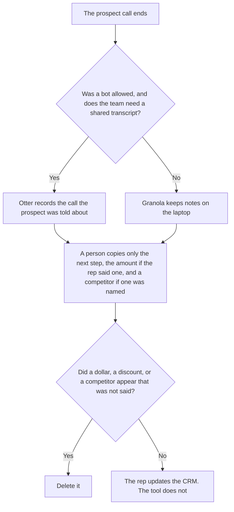

**Use Otter when the sales team needs a shared transcript and a bot the prospect was told about. Use Granola when the rep will not put a bot on the call, the notes stay on the laptop, and a person pastes into the CRM only the fields they will stand behind.** Either tool may format what was said. Neither may invent a next step, a dollar amount, a discount, or a competitor. The both-bots decision, with CRM field sync, is [Otter vs Fathom for sales calls](/blog/otter-vs-fathom-for-sales-calls-2026/). If the buyer will not accept a bot, that pair is the wrong shortlist. This page is the no-bot alternative.

A customer-success or support call, where the risk is a commitment the customer heard, is [Otter vs Granola for customer calls](/blog/otter-vs-granola-for-customer-calls-2026/). A sales call here is a prospect conversation: the next step, and nothing else the rep did not say.

Otter's prices are from the directory page checked October 16, 2026, as recorded in [Otter.ai pricing explained](/blog/otter-ai-pricing-explained-2026/). Granola's prices are from the pricing page read October 24, 2026, as recorded in [Granola pricing explained](/blog/granola-pricing-explained-2026/). Notion is the October 16 card. HubSpot's CRM price is a quote or a promo, recorded in [HubSpot pricing explained](/blog/hubspot-pricing-explained-2026/). Published October 24, 2026. We did not score transcripts or win rates.

## Which sales call you are on

| The call | Start here | First paid step | The limit |
|---|---|---|---|
| The team reopens a shared transcript, and the prospect knows a bot is there | [Otter](/tools/otter-ai/) | Pro is $16.99 a user a month, or $8.33 billed annually | 90 minutes per conversation on Pro. Longer calls are Business |
| No bot. Notes from the laptop. The rep writes the CRM fields | [Granola](/tools/granola/) | Business is $14 a user a month | Basic keeps history for 30 days. Salesforce-class integrations are Enterprise, at $35 |
| The fields a person already checked | [HubSpot](/tools/hubspot/) | Free CRM exists. Starter was a limited-time $7 or $10 | The seat is not the AI price. Do not invent a Professional dollar |
| The note the manager will read | [Notion AI](/tools/notion-ai/) | Business is $20 a seat a month | Plus at $10 is not the full AI tier |

Otter Basic is 300 minutes a month and 30 minutes per conversation. A discovery call that runs past 30 minutes does not fit Basic even if the monthly pool would. Pro is 1,200 minutes and 90 minutes per conversation. Business is $30 a user a month, or $19.99 billed annually, with unlimited meetings and conversations up to 4 hours. A team library of long calls is the Business reason. Promotions are not the list price. Budget the renewal at the list price unless checkout says the discount lasts.

Granola Basic is $0 and keeps meeting history for 30 days. Business at $14 removes that cap and lists HubSpot among the integrations on the October 24 page. Enterprise at $35 is the SSO and Salesforce-class row. Confirm the connector on the live table before you promise a CRM write. Granola does not put a bot in the meeting. The prospect still needs to know how notes are taken. Consent rules vary. A missing bot is not a missing disclosure.

## What may be copied into the CRM

The next step the rep said, the date the rep said, and an amount only if the rep said that amount. A competitor only if a person on the call named them. If the amount was not said, the field says Amount not stated. It does not pull a price from a deck that was not discussed. HubSpot can hold the field. The free CRM is real, on the October 16 card. Professional and Enterprise do not have a public sticker there. Do not fill a forecast category from a transcript.

**Otter Business** is the shared library when calls run long and more than one rep will reopen them. The review is [Otter.ai review](/blog/otter-ai-review-2026/).

**Granola Business** is the no-bot path at $14. The 30-day history cliff is Basic. A sales team that needs last quarter's notes is not on Basic. The review is [Granola review](/blog/granola-review-2026/).

**Notion Business** stores the manager note after the rep has checked the fields. The invoice is [Notion AI pricing explained](/blog/notion-ai-pricing-explained-2026/).

A prompt that holds the line:

"Draft the sales-call note from the next step, the date, and the amount I pasted. If the amount is missing, write Amount not stated. Do not add a discount. Do not add a competitor. Do not update the CRM."

## What not to delegate

Do not ask the model to score the deal. Do not write a forecast category from adjectives in the transcript. Do not invite a bot the prospect was not told about. The rep owns the CRM fields. A tidy note is not a stage change.

## FAQ

### How is this different from Otter vs Fathom for sales calls?

That page chooses Otter Business or Fathom Business when a bot is acceptable, and the Fathom reason is CRM field sync. This page is the choice when a bot is not acceptable: Otter only if the team still wants a shared transcript with a disclosed bot, Granola when the notes stay on the laptop. If you need Fathom's CRM sync, use that page. This page does not quote a Fathom price as a Granola feature.

### How is this different from Otter vs Granola for customer calls?

That page is a customer who is already a customer: commitments, discounts, and complaints they did or did not make. This page is a sales call with a prospect: the next step and the fields the rep will defend. A discount the prospect asked for is not a discount you record as offered. Keep the templates apart so a sales note does not read like a support ticket.

### Does Granola write the HubSpot deal?

The October 24 Granola page lists HubSpot on Business. A listing is not a completed write. The rep checks the fields first. Salesforce-class integrations are the Enterprise row, at $35, on that page. Confirm the connector before you plan on it. HubSpot Professional still has no dollar on our directory card.

### Who may change the deal stage?

The rep, or the person that rep's manager names. Otter and Granola do not change the stage. Amount not stated stays until a person heard an amount.

## Last verified

October 16, 2026 for Otter and for Notion. October 24, 2026 for Granola, via the pricing article. HubSpot seat figures stay on the October 16 directory card. Published October 24, 2026.

**Sources:** [Otter pricing](https://otter.ai/pricing), [Granola pricing](https://www.granola.ai/pricing), [HubSpot pricing](https://www.hubspot.com/pricing), [Notion pricing](https://www.notion.com/pricing).

*Published by Andrew for [AI Tools Optimizer](https://aitoolsoptimizer.com).*

[Otter.ai](/tools/otter-ai/) is in the [meetings directory](/tools/category/meetings-transcription/). Directory pages may use affiliate links. A purchase through them may earn us a commission at no extra cost to you.
