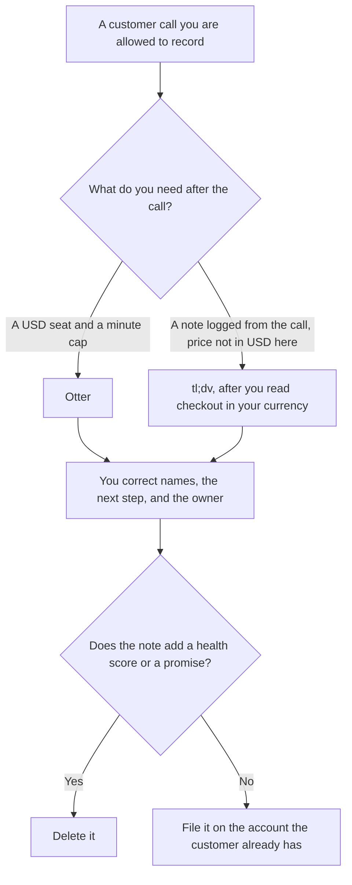

**Use Otter when you want a USD seat price and a transcript with a minute cap you can put on a spreadsheet. Use tl;dv when the call note should be logged after the meeting and you accept that the price we could read was not in USD.** A customer success note records what the customer said, plus the next step and the owner who was on the call. It does not invent a health score, a churn risk, or a promise nobody made.

The general note comparison is [Otter vs tl;dv for meeting notes](/blog/otter-vs-tl-dv-for-meeting-notes-2026/). The team shelf is [best AI tools for customer success](/blog/best-ai-tools-for-customer-success-2026/). The Otter invoice is [Otter.ai pricing explained](/blog/otter-ai-pricing-explained-2026/).

Otter's prices below are from otter.ai/pricing on October 24, 2026, in USD. A fetch of tldv.io/app/pricing the same day returned structured prices in euros, not USD. The October 16 directory record had shown Canadian dollar figures and said USD was not confirmed. This page does not convert euros or Canadian dollars into USD. Published October 24, 2026. We did not score transcription accuracy or retention.

## Which seat matches the call

| The call you actually have | Start here | What you still do |
|---|---|---|
| A few check-ins a month | [Otter](/tools/otter-ai/) Basic, free, 300 minutes a user a month and 30 minutes a conversation | You read the note before it reaches the account |
| An individual USD seat | Otter Pro at $16.99 a user a month, or $8.33 billed annually | 1,200 minutes and 90 minutes a conversation, on that page |
| A team that needs longer Otter meetings | Otter Business at $30 a user a month. The page also showed $24, labeled 20% off for 3 months | Annual Business on that page is $19.99 a user a month. Unlimited meetings and 4-hour conversations are the Business line |
| Recording first, few AI notes | [tl;dv](/tools/tl-dv/) Free, €0 on the October 24 structured data | Confirm what checkout shows you. The October 16 card described unlimited transcription and 10 meetings with AI notes |
| Paid tl;dv, in the currency of that fetch | Pro at €29 a seat a month, or €18 a seat a month billed annually (€216 a year) | Business was €39 a month, or €29 a seat a month billed annually (€348 a year). These are euros |

Otter's October 24 page also lists a student and teacher price: Pro annual at $6.67 a month, billed $79.99 a year, and Pro monthly at $13.59, for an email ending in .edu. That discount is not the company seat. AI Chat query caps on the October 16 directory card are 20 a user a month on Basic, 50 on Pro, and 200 on Business.

tl;dv's October 16 directory card is the one that described CRM logging, follow-up drafts, and multi-meeting insights on Business. The October 24 fetch confirmed euro prices and did not restate every feature. Use the product page for the feature and checkout for the currency. [Fathom](/tools/fathom/) Premium is $16 a month billed annually, or $20 monthly, on the October 16 card, if you want a third USD comparison. The invoice is [Fathom pricing explained](/blog/fathom-pricing-explained-2026/).

## What the note may say

Words from the transcript, a next step you can timestamp, and an owner who was in the room. It may not add "the account is unhappy," a renewal risk, or a discount. If the recording stopped, the note says Recording incomplete. A CRM field is a write. It belongs only where your policy already allows the sync, and a person confirms it.

**Otter Pro** is the paid path when the annual USD math is what finance can approve. The review is [Otter.ai review](/blog/otter-ai-review-2026/).

**tl;dv** is the path when the workflow you want is the log after the call, and you will read the price in the currency checkout shows. Do not put €29 into a USD spreadsheet as if it were $29.

**Notion Business** at $20 a seat a month, on the October 16 card, is where the accepted note can live if the success plan is already in Notion. Plus at $10 is not the full AI tier. The invoice is [Notion AI pricing explained](/blog/notion-ai-pricing-explained-2026/).

A prompt that holds the line:

"Summarize this transcript into what the customer asked, the next step, and the owner. Quote the line you used. Do not add a health score, a risk, or a promise. If a name is uncertain, write Name unclear."

## What not to delegate

Do not ask the model whether the account will renew. Do not paste a transcript that includes payment details into a personal seat. Do not let a multi-call report invent a theme that no single call supports. The meeting-notes article covers a generic internal meeting. This page is the customer conversation that can be pasted onto an account.

## FAQ

### Which one is more accurate?

We did not measure that. Otter fits a USD seat with a published minute cap. tl;dv fits a logging workflow whose October 24 price we could read in euros. Accuracy is the note that matches the recording, after a person reads it.

### Why not quote a USD price for tl;dv?

The October 24 structured data was in euros. The October 16 directory record was in Canadian dollars and said USD was not confirmed. Converting either number would invent a price. Checkout in your currency is the bill.

### Do I need Business on Otter?

Basic and Pro have minute caps, and Pro conversations stop at 90 minutes on the page we read. A long success review that runs past that cap is the Business question. The $24 figure is a 3-month discount on the $30 monthly price, in the page's own label. The annual figure on that page is $19.99.

### Who may write a risk on the account?

The owner of the account, in the field your CRM already has, from evidence they can point at. A model does not set health. A renewal quote belongs in the commercial process, not in a transcript summary.

## Last verified

October 24, 2026 for Otter's USD page and tl;dv's euro structured prices. October 16, 2026 for Otter's AI Chat caps, tl;dv's feature card, Fathom, and Notion. Published October 24, 2026.

**Sources:** [Otter pricing](https://otter.ai/pricing), [tl;dv pricing](https://tldv.io/app/pricing/), [Fathom pricing](https://www.fathom.ai/pricing), [Notion pricing](https://www.notion.com/pricing).

*Published by Andrew for [AI Tools Optimizer](https://aitoolsoptimizer.com).*

[Otter](/tools/otter-ai/) is in the [meetings and transcription directory](/tools/category/meetings-transcription/). Directory pages may use affiliate links. A purchase through them may earn us a commission at no extra cost to you.
