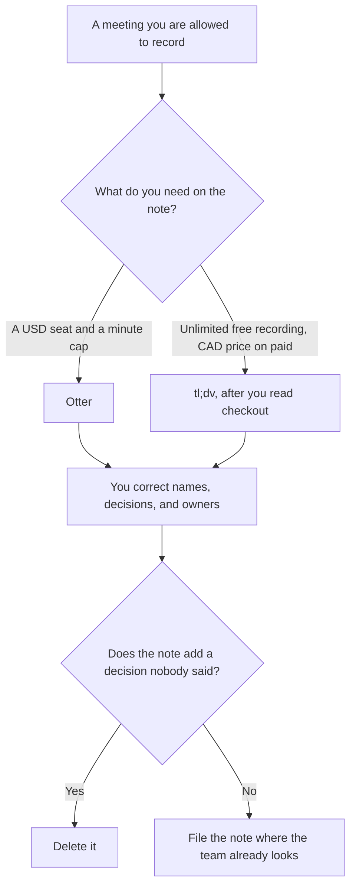

**Use Otter when you want a USD seat price you can put on a spreadsheet and a transcript with a minute cap you can see. Use tl;dv when unlimited recording on the free plan matters and you accept that this directory could not confirm a USD price.** A meeting note is a record of what was said, plus decisions and owners you can point at in the transcript. It is not a performance review, and it is not a CRM update the attendee did not agree to.

The notetaker shelf is [best AI meeting notetakers](/blog/best-ai-meeting-notetakers/). The Otter invoice is [Otter.ai pricing explained](/blog/otter-ai-pricing-explained-2026/). The agenda you should have had first is [how to create meeting agendas with AI](/blog/how-to-create-meeting-agendas-with-ai-2026/).

Prices are from directory pages checked October 16, 2026. Otter's figures are USD. tl;dv's paid figures were shown to the directory in Canadian dollars, and the directory says USD was not confirmed. A live fetch of the tl;dv pricing page returned HTTP 401 on October 24, 2026, so this page does not invent a USD conversion. Published October 24, 2026. We did not score transcription accuracy.

## Which seat matches the note

| The meeting you actually have | Start here | What you still do |
|---|---|---|
| Short calls, a few a month | [Otter](/tools/otter-ai/) Basic, free, 300 minutes a user a month and 30 minutes a conversation | You read the note |
| An individual who wants the annual USD seat | Otter Pro at $8.33 a user a month billed annually, or $16.99 monthly | 1,200 minutes and 90 minutes a conversation |
| A team that needs longer Otter meetings | Otter Business at $19.99 a user billed annually, or $30 monthly | Unlimited meetings and 4-hour conversations, on that card |
| Unlimited recordings, few AI notes | [tl;dv](/tools/tl-dv/) Free | Unlimited transcription in 30+ languages, and 10 meetings with AI notes |
| Unlimited AI notes, price shown in CAD | tl;dv Pro, shown as C$27 a seat a month billed annually | Confirm USD at checkout. This page will not convert it |
| Notes across many calls | tl;dv Business, shown as C$39 | Multi-meeting insights are the Business line on the card |

Otter was running promotions during the October 16 check, including an example of 50 percent off Pro. Treat a promo as temporary. AI Chat queries on that card are 20 a user a month on Basic, 50 on Pro, and 200 on Business. tl;dv's directory note says annual billing saves up to 40 percent, without a USD figure. Enterprise on both products is custom. [Fathom](/tools/fathom/) Premium is $16 a month billed annually, or $20 monthly, with free unlimited recordings on the free plan, if you want a third USD comparison. The invoice is [Fathom pricing explained](/blog/fathom-pricing-explained-2026/).

## What the note may say

Words from the transcript, a decision you can timestamp, and an owner who was in the room. It may not add a sentiment score, a "they seemed unsure," or a next step nobody offered. If the recording stopped, the note says Recording incomplete. A CRM field is a write. It belongs only where your policy already allows the sync.

**Otter Pro** is the paid path when the annual USD math is the reason you can approve the seat. The review is [Otter.ai review](/blog/otter-ai-review-2026/).

**tl;dv Free** is the path when you need the recording more than the AI note, and ten AI notes are enough to test. Paid tl;dv is a checkout decision in the currency the page shows you. The directory could not confirm USD.

**Fireflies** Pro is $10 a user a month billed annually, or $18 monthly, when that product is the one already in the room. The invoice is [Fireflies pricing explained](/blog/fireflies-pricing-explained-2026/). It is not required to choose between Otter and tl;dv.

A prompt that holds the line:

"Summarize this transcript into decisions, owners, and open questions. Quote the line you used. Do not add a decision that is not in the transcript. Do not describe anyone's mood. If a name is uncertain, write Name unclear."

## What not to delegate

Do not record people who have not been told. Do not let a bot join a call your company forbids. Do not paste the transcript into a second tool "to see what it finds" if the meeting was confidential. The note is a record. A fluent paragraph that invents alignment is worse than the raw transcript. The factual pass on anything that leaves the company is [how to fact-check AI writing](/blog/how-to-fact-check-ai-writing-2026/).

## FAQ

### Which one takes better notes?

We did not measure that. Pick Otter when you need a USD price and you can live inside the minute caps. Pick tl;dv when unlimited recording on the free plan is the feature you will use, and you will read the currency at checkout. The note is only as good as the corrections you make.

### Why is tl;dv not in USD here?

The directory recorded Pro at C$27 a seat a month billed annually and Business at C$39, and it said a non-U.S. check could not confirm USD. A live fetch on October 24, 2026 returned HTTP 401. Converting Canadian dollars would invent a price. Use the figure your checkout shows.

### Can either tool update the CRM?

tl;dv's directory page describes CRM logging and follow-up drafts. That write still needs a policy and a person. Otter's Zapier integration can move text you approve. Neither integration is permission to log a prospect who did not know they were recorded.

### What about a 30-minute cap?

Otter Basic ends a conversation at 30 minutes and a user at 300 minutes a month. A weekly staff meeting that runs 45 minutes does not fit Basic. Pro raises the conversation cap to 90 minutes. If your meetings are longer than that, price Business before you blame the transcript.

## Last verified

October 16, 2026 for Otter, tl;dv, Fathom, and Fireflies. Published October 24, 2026. The tl;dv pricing URL returned HTTP 401 on October 24, 2026.

**Sources:** [Otter pricing](https://otter.ai/pricing), [tl;dv pricing](https://tldv.io/app/pricing/), [Fathom pricing](https://www.fathom.ai/pricing), [Fireflies pricing](https://guide.fireflies.ai/articles/3734844560-learn-about-the-fireflies-pricing-plans).

*Published by Andrew for [AI Tools Optimizer](https://aitoolsoptimizer.com).*

[tl;dv](/tools/tl-dv/) is in the [meetings and transcription directory](/tools/category/meetings-transcription/). Directory pages may use affiliate links. A purchase through them may earn us a commission at no extra cost to you.
