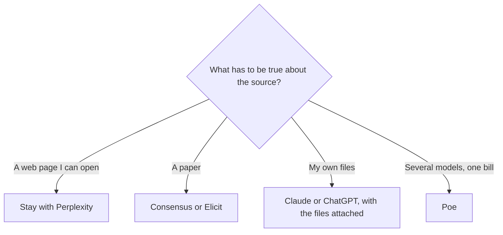

**Leave Perplexity when the source you need is not the open web.** Papers, a writing draft, a Google or Microsoft workflow, or a multi-model comparison are different products. Staying on Perplexity and buying Max because a paper search felt thin is the expensive version of the wrong aisle.

Prices are US list prices excluding tax, from vendor pages checked October 16, 2026, published here on October 24, 2026. A live refetch of the pricing URLs that day did not return numbers. The "should I pay for this one" piece is [is Perplexity Pro worth it](/blog/is-perplexity-pro-worth-it-2026/). The product overview is [Perplexity review](/blog/perplexity-review-2026/).

## What you are replacing

[Perplexity](/tools/perplexity/) searches and answers with citations. Free covers top models with a weekly cap. Pro is $17/month billed annually and adds Perplexity Computer, model selection, file and app creation, and premium data such as PitchBook and Statista. Max is $167/month billed annually, with higher Computer usage, 10,000 monthly credits, and 35,000 bonus credits. Enterprise Pro is $40/seat/month. Enterprise Max is $325/seat/month.

That is a web answer engine with a research mode. It is not a library of peer-reviewed papers, and it is not a long-form editor.

| You needed | Use this instead | Entry price |
|---|---|---|
| Journal articles, with a consensus-style read of the literature | [Consensus](/tools/consensus/) | Free includes unlimited paper search, 10 Pro messages, and 3 Deep reviews a month. Pro is $12/month on annual billing ($144/year), or $20 monthly |
| Paper search, summaries, and a research agent with a tight seat price | [Elicit](/tools/elicit/) | Free includes unlimited paper search, summaries, and chat with papers, with limited agent use. Plus is $11/user/month billed annually |
| Cited web answers inside Google's stack | [Gemini](/tools/gemini/) | Free with a Google account. Google AI Plus is $4.99/month |
| A general assistant that can also search, then do the rest of your day | [ChatGPT](/tools/chatgpt/) | Plus is $20/month. Go is $8 |
| A draft written from sources you paste in | [Claude](/tools/claude/) | Pro is $20/month, or $17 annually |
| News and posts on X, in the same bundle as a code editor | [Grok](/tools/grok/) | Plus is $8/month on The X Subscription |
| The same question run across several models | [Poe](/tools/poe/) | From $4.99/month, plus a free daily point allotment |

## Academic search is a different index

Consensus and Elicit are the directory tools built to search papers. Consensus Pro is the cheaper of the two paid steps if you bill annually, at $12 against Elicit's $11, so they are close. The difference to read on their pricing pages is the meter: Consensus counts Pro messages and Deep reviews on the free plan. Elicit emphasizes unlimited search and summaries on free, with the agent and reports limited until you pay.

Use them when a citation has to be a paper, not a blog that mentions a paper. Perplexity will often surface the blog. That is useful for a first pass and a bad final bibliography. The reviews are [Consensus review](/blog/consensus-review-2026/) and [Elicit review](/blog/elicit-review-2026/).

Neither academic tool replaces Perplexity for "what did this company announce last week." Papers are slow. The web is not.

## General assistants that also search

ChatGPT, Claude, Gemini, and Grok can browse. That does not make them Perplexity. Perplexity's product is the citation list as the default shape of the answer. A general assistant's product is the conversation, and the sources are a feature you have to check.

Use Gemini when the rest of the work is in Google's apps and $4.99 is the budget. Use ChatGPT when you already pay for Plus and the research is one step inside a larger chat. The three-way comparison is [ChatGPT vs Gemini vs Claude](/blog/chatgpt-vs-gemini-vs-claude-2026/). Use Claude when the output is a memo you will edit, and you are pasting sources you already trust. Use Grok when the subject is X, or when Plus is already the subscription that includes [Cursor](/tools/cursor/).

Poe is the comparison tool. Ask the same sourced question of more than one bot and pay in points. It will not build you a literature review. It will show you that two models cited different pages. That is worth $4.99 and a careful reading. It is not worth canceling a tool that already holds your files.

## When Perplexity is still the one to keep

- You publish answers and you need a link on every claim a reader might challenge.
- You want one box that picks among several frontier models and still shows sources.
- You are a solo researcher, not a lab, and Pro at $17 annually is the whole budget.

Buy Max only after Pro's Computer and research limits are the thing that stopped a real project. Max is nearly ten times Pro's annual list. Premium data and higher limits are the product. A nicer paragraph is not.

Skip Perplexity, even Pro, when the work is a novel, a brand voice, or a codebase. Those are [Claude](/tools/claude/), [Jasper](/tools/jasper/) is for brand systems if you are a marketing team, and a coding assistant. The wider "not just the big three" list is [ChatGPT alternatives](/blog/chatgpt-alternatives-2026/).

## A two-tool research stack

For most people who are not in a university workflow: Perplexity free or Pro for the web, and Consensus or Elicit free for anything that has to be a paper. Add Claude only when you are writing the brief from notes you saved. Three paid research seats is how a $17 problem becomes a $200 problem.

## FAQ

### What is the closest alternative to Perplexity?

For cited web answers, Gemini or ChatGPT with search turned on, and you will do more checking. For the same "answer plus links" habit, there is not a cheaper clone in this directory that matches the product. The closer swaps are job swaps: papers, or writing.

### Is Consensus better than Perplexity for school?

For assigned papers, yes, start with Consensus or Elicit, because the index is the literature. Perplexity is the better first stop for a news explainer or a product comparison. Follow your school's rules on AI either way.

### Can I replace Perplexity Pro with Poe?

You can compare models on Poe. You do not get Perplexity's citation-first answer or the premium data sources as part of that $4.99. If the citations are why you pay, Poe is an extra, not a replacement.

### Is the free Perplexity plan enough?

Enough for a limited number of top-model answers each week. If you hit that cap on days you are actually researching, Pro is the next step. If you hit it because you are using Perplexity as a general chatbot, a writing assistant may be the better paid seat.

## Last verified

October 16, 2026 for prices. Published October 24, 2026. Pricing pages did not return a fresh fetch that day.

**Sources:** [Perplexity pricing](https://www.perplexity.ai/hub/pricing), [Consensus](https://consensus.app), [Elicit](https://elicit.com), [Poe purchases FAQ](https://help.poe.com/hc/en-us/articles/19945140063636-Poe-Purchases-FAQs).

Research tools are in the [research and search directory](/tools/category/research-search/). [Perplexity](/tools/perplexity/), [Consensus](/tools/consensus/), and [Elicit](/tools/elicit/) may use affiliate links. A purchase through them may earn us a commission at no extra cost to you.
