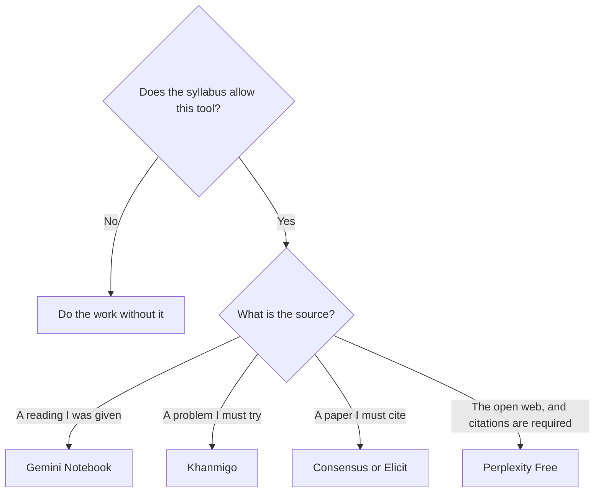

**A student should leave Perplexity when the assignment is a reading you were given, a problem you are supposed to attempt, or a paper you have to cite from the literature.** Perplexity is a cited answer over the open web. That is a useful habit, and it is the wrong default for a PDF in the syllabus. The general map, for people who are not doing homework, is [Perplexity alternatives](/blog/perplexity-alternatives-2026/). This page is the student version: campus rules first, then the source you were assigned.

Prices are US list prices excluding tax from directory pages checked October 16, 2026, except where a price could not be loaded. Published October 24, 2026. We did not run a learning study. Your school's academic-integrity rules outrank this page.

## What the assignment actually is

| The assignment | Use this | Price to know | Leave Perplexity because |
|---|---|---|---|
| A packet of readings you have to use | [Gemini Notebook](/tools/gemini-notebook/) | Free with a Google account. Plus is $4.99 a month if you need higher limits | The source is the packet, not the web |
| A problem set, and you want a hint instead of the answer | [Khanmigo](/tools/khanmigo/) | Learners and families: $4 a month or $44 a year. Free for teachers | A web answer will hand you the result |
| Papers, with citations you can put in a bibliography | [Consensus](/tools/consensus/) or [Elicit](/tools/elicit/) | Consensus Free includes 10 Pro messages and 3 Deep reviews a month. Elicit Plus is $11 a user a month annually | A blog post is not the paper |
| A sentence you already wrote | [Grammarly](/tools/grammarly/) Free | Pro is $12 a member a month billed annually, if you outgrow Free | The job is editing, not searching |
| Terms you have to remember | [Quizlet](/tools/quizlet/) | Free includes flashcards. We could not confirm Plus prices on October 16 | Search will not drill the list |
| You were told to "research the web and cite it" | Stay on [Perplexity](/tools/perplexity/) Free | Pro is $17 a month billed annually. You do not need Max for a course | This row is the one where Perplexity fits |

## Do not buy the professional plan for a class

[Perplexity](/tools/perplexity/) Free includes top models with a weekly cap. Pro at $17 a month billed annually adds Perplexity Computer, model selection, files and apps, and premium data such as PitchBook and Statista. Max is $167 a month billed annually. A student who hit the weekly cap does not need Statista. Wait, or narrow the question. The buying note for people who do need the premium sources is [is Perplexity Pro worth it](/blog/is-perplexity-pro-worth-it-2026/). The product page is [Perplexity review](/blog/perplexity-review-2026/).

**Gemini Notebook** answers from the sources you upload, with citations. That is the right shape for a weekly reading. Google AI Plus is $4.99 a month. Pro is $19.99. The free tier is the one to exhaust first. The workflows are [Gemini Notebook study workflows](/blog/gemini-notebook-study-workflows/). An empty notebook will answer from nothing useful. Upload the reading.

**Khanmigo** is built to guide rather than dump the answer. Learners and families pay $4 a month or $44 a year. Teachers are free, on the directory card. Parents can add up to 10 children. If the honor code forbids any assistant on the problem set, $4 does not help. If hints are allowed, it is a closer fit than a web answer engine. The wider shelf is [best AI tools for students](/blog/best-ai-tools-for-students-2026/).

**Consensus and Elicit** are for the literature, not for the textbook chapter you already have. Consensus Pro is $12 a month on the $144 annual plan, or $20 monthly. Elicit Free includes unlimited paper search, summaries, and chat with papers. Plus is $11 a user a month billed annually. Open the paper before you cite it. The comparison, written for research rather than for a syllabus, is [Perplexity vs Elicit](/blog/perplexity-vs-elicit-for-research-2026/).

**Grammarly** Free is the pass on prose you wrote. It will not supply a missing citation. Pro at $12 annual is optional. The comparison with a workspace tool is [Notion AI vs Grammarly](/blog/notion-ai-vs-grammarly-2026/).

**Quizlet** Free includes flashcards, practice questions, diagrams, and activities. Plus adds extended access to Practice Tests, Study Guides, and Learn. The upgrade page did not load for the October 16 check, so this page does not print a Plus price. Confirm it at quizlet.com/upgrade.

[ChatGPT](/tools/chatgpt/) Plus at $20 will write the essay if you ask. That is the failure mode, not the alternative. If your school allows a draft assistant, paste your outline and your sources, and keep the sentences you can defend. The fact pass is [how to fact-check AI writing](/blog/how-to-fact-check-ai-writing-2026/). Go at $8 is the smaller seat if a chatbot is allowed at all.

## FAQ

### Is Perplexity Pro a student plan?

The directory records Pro at $17 a month billed annually for the product, including premium data sources. It does not record a student discount on that line. Do not assume one. Free is the student default on this page.

### Can I cite Perplexity as the source?

Cite the page it linked, after you open it, if your style guide allows that page. Perplexity is not the source. A citation you did not open is [what AI grounding](/blog/what-is-ai-grounding-2026/) you skipped.

### What if the professor banned AI?

Then none of these tools belong in the assignment. This page is for work your rules allow. A tutor that withholds answers is still an AI tool. Ask if you are unsure. The ban wins.

### Is Gemini Notebook the same as searching in Gemini?

No. The notebook is grounded in what you upload. [Gemini](/tools/gemini/) chat can also search and use the wider Google account. Google AI Plus is $4.99. Use the notebook when the reading is the corpus. The rename note is [NotebookLM is now Gemini Notebook](/blog/notebooklm-is-now-gemini-notebook/).

## Last verified

October 16, 2026 for Perplexity, Gemini, Khanmigo, Consensus, Elicit, Grammarly, and ChatGPT prices. Quizlet's Plus price was not available in that check. Published October 24, 2026.

**Sources:** [Perplexity](https://www.perplexity.ai/), [Gemini Notebook](https://workspace.google.com/products/gemini-notebook/), [Khan Academy Khanmigo](https://www.khanmigo.ai/).

*Published by Andrew for [AI Tools Optimizer](https://aitoolsoptimizer.com).*

[Gemini Notebook](/tools/gemini-notebook/) is in the [research and search directory](/tools/category/research-search/). Directory pages may use affiliate links. A purchase through them may earn us a commission at no extra cost to you.
