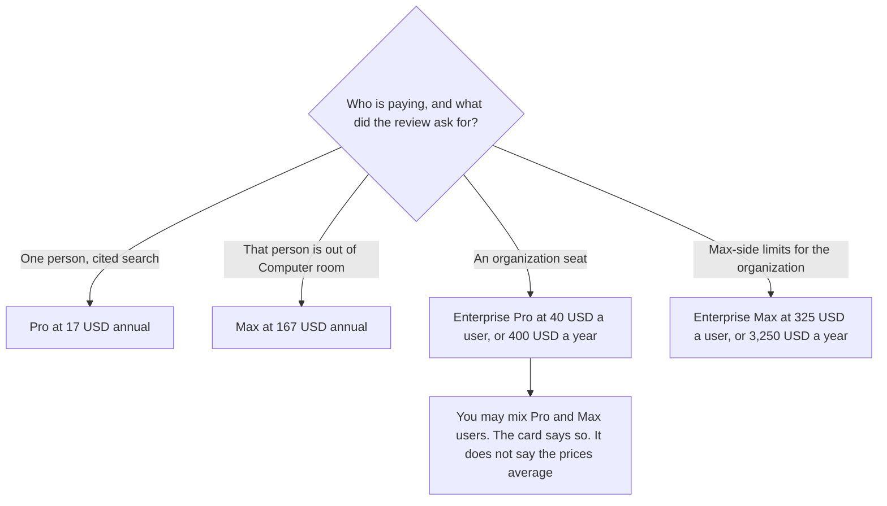

**Perplexity Enterprise Pro is $40 per user per month, or $400 per year. Enterprise Max is $325 per user per month, or $3,250 per year.** You can mix Pro and Max users in one organization. Those sentences are the directory FAQ checked October 16, 2026. Personal Pro at $17 a month billed annually is a different seat. The full ladder, including Free and Max, is [Perplexity pricing explained](/blog/perplexity-pricing-explained-2026/).

The research desk is [Perplexity review](/blog/perplexity-review-2026/). Papers are not this bill. [Elicit pricing explained](/blog/elicit-pricing-explained-2026/) is the literature table.

A live fetch of perplexity.ai/enterprise returned HTTP 401 on October 24, 2026. The seat dollars stay on the October 16 card, which the pricing article also restated from a help-center read that day. Published October 24, 2026. We did not score answers. The developer API is a separate bill, as that pricing article records. Do not fold an API invoice into the $40.

## The organization seats

| Seat | Price recorded | Buy it when | Do not buy it when |
|---|---|---|---|
| Enterprise Pro | $40 a user a month, or $400 a year | The company needs an organization seat and admin controls, as the pricing article describes that row | One person wants a higher personal limit. That step is Max, if Pro's meter is the constraint |
| Enterprise Max | $325 a user a month, or $3,250 a year | The organization needs the Max-side limits, and the pricing article names SCIM and audit logs on this step | You wanted Pro features for a larger team. That is more Enterprise Pro seats, not Max |
| Pro, for contrast | $17 a month billed annually | A person, not an organization contract | A company question that required the enterprise data stance |
| Max, for contrast | $167 a month billed annually | A person's Computer limits on Pro are the bottleneck they can show | An organization default |

The pricing article records a help-center line for eligible nonprofits and educational institutions, outside the student program, at $30 a seat per month or $300 a seat annually. That is a discount you ask about. It is not Enterprise Pro's list price. Education Pro for a verified student is $10 a month in that article. It is not an enterprise seat. Use the quote you receive.

Ten Enterprise Pro seats at the annual figure are 10 × $400 = $4,000 a year. Ten Enterprise Max seats are 10 × $3,250 = $32,500 a year. Mixing is allowed. A forecast that prices every seat at $40 because "the org is Enterprise" understates a Max user by $3,250 − $400 = $2,850 a year. Write the mix down.

The same pricing article says you can opt out of data collection on personal Pro, Education Pro, and Max. It treats the enterprise data stance as a reason to buy the organization seat rather than a personal login on a company question. Read the terms you are offered. This page is not those terms.

## What the seat is not

**A larger personal Pro.** [Perplexity](/tools/perplexity/) Pro at $17 annual is the personal plan. Enterprise Pro is $40, or $400 a year, because it is the organization seat. Do not describe $40 as "Pro plus a logo."

**The API.** The pricing article says the developer API is billed separately from these seats. An Enterprise order does not, on that sentence, include a blank check for API traffic. Price the API from its own card. This page does not have that card's rates.

**Elicit, if the rows are papers.** [Elicit](/tools/elicit/) Plus is $11 a user a month billed annually on the non-industry annual card recorded October 16. A literature table is [Perplexity vs Elicit for evidence tables](/blog/perplexity-vs-elicit-for-evidence-tables-2026/).

**Claude, if the work is a summary you will file.** [Claude](/tools/claude/) Pro is $17 a month billed annually, $200 up front, or $20 monthly, on claude.com/pricing fetched October 24, 2026. [ChatGPT](/tools/chatgpt/) Plus is $20 a month on the plan page that day. Neither is an Enterprise Perplexity seat. The ladder is [Claude pricing explained](/blog/claude-pricing-explained-2026/).

## What not to assume

Do not quote a monthly Enterprise price other than the per-user monthly figures above. The card gives $40 and $325 a month, and the annual totals. Do not carry personal Max's $167 onto Enterprise Max. Do not assume the $30 nonprofit line applies until you have the quote. Do not paste a confidential corpus into a personal Pro seat and call it "basically Enterprise."

## FAQ

### How much is Perplexity Enterprise?

Enterprise Pro is $40 per user per month or $400 per year. Enterprise Max is $325 per user per month or $3,250 per year. Those figures are the October 16 directory FAQ. A live fetch of the enterprise URL returned HTTP 401 on October 24, 2026. If checkout disagrees, checkout wins.

### Can one organization mix Pro and Max?

Yes, on that FAQ. Mix means some users on Enterprise Pro and some on Enterprise Max. It does not mean a blended rate. Invoice the seat each person is on.

### How is this different from Pro and Max?

Pro at $17 annual and Max at $167 annual are personal plans. Enterprise is the organization price, at $40 or $325 a user. The pricing article points at admin controls, and at SCIM and audit logs for the Max organization step. A personal opt-out of data collection is not the same document as an organization contract.

### Does Enterprise include the API?

Not as the pricing article describes it. The developer API is billed separately from these seats. Ask for the API rate on its own quote. Do not divide $400 by an imagined token count and call it a rate.

## Last verified

October 16, 2026 for the directory FAQ. The personal annual figures, the nonprofit line, the SCIM and audit-log description, and the separate API sentence are from the pricing article's October 24, 2026 help-center read. Published October 24, 2026. The enterprise URL returned HTTP 401 that day.

**Sources:** [Perplexity enterprise](https://www.perplexity.ai/enterprise), [Perplexity pricing](https://www.perplexity.ai/hub/pricing), [Perplexity help center](https://www.perplexity.ai/hub/helpcenter).

*Published by Andrew for [AI Tools Optimizer](https://aitoolsoptimizer.com).*

[Perplexity](/tools/perplexity/) is in the [research directory](/tools/category/research-search/). Directory pages may use affiliate links. A purchase through them may earn us a commission at no extra cost to you.
