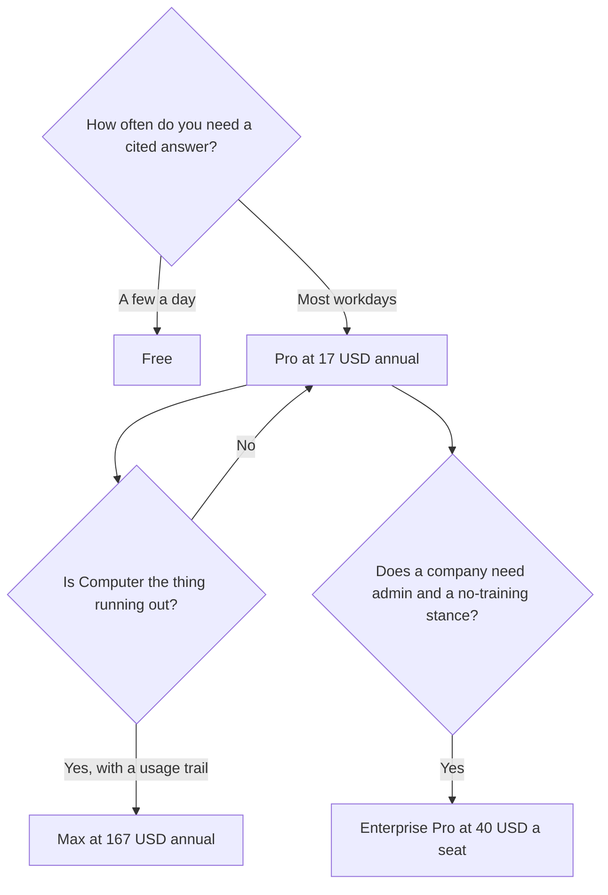

**Perplexity pricing is a free cited search with a tight Pro Search allowance, then Pro at $17 a month billed annually, then Max at $167 a month billed annually for heavier Computer use.** Enterprise is a seat price with admin controls, not a larger personal Pro. Education Pro is a verified discount, not a secret unlimited plan you should assume.

The $17 and $167 annual prices, the Education Pro price, and the limit table below are from Perplexity's pricing pages and help-center comparison as read October 24, 2026, and recorded in [is Perplexity Pro worth it](/blog/is-perplexity-pro-worth-it-2026/). Monthly prices were higher on the page and were not a single number we could quote cleanly, so this explainer uses annual figures for Pro and Max. Enterprise figures are the ones on the directory tool page and that same help-center read. The research desk, as opposed to the bill, is [Perplexity review](/blog/perplexity-review-2026/).

## The ladder

| Plan | Published price | Buy it when |
|---|---|---|
| Free | $0 | A few cited answers a day. The help-center table lists 3 Pro Searches a day and 1 research query a month |
| Pro | $17/month billed annually | You want model choice, higher limits, files and apps, and Perplexity Computer |
| Education Pro | $10/month with SheerID verification | You are a student or educator and the discount applies to you |
| Max | $167/month billed annually | Computer and Deep Research limits on Pro are the bottleneck you can show |
| Enterprise Pro | $40/user/month, or $400/year per seat | A team needs admin controls and the enterprise data stance |
| Enterprise Max | $325/user/month, or $3,250/year per seat | The organization needs the Max-side limits, SCIM, and audit logs |

Eligible nonprofits and educational institutions outside the student program can ask about a discount the help center listed at $30 a seat per month or $300 a seat annually. Use the quote you receive. A limited-time Computer credit bonus has appeared on cards. Treat bonuses as time-limited until the card says they are included for the life of the plan.

## Limits worth putting in a spreadsheet

The help-center comparison is more specific than the marketing page.

| | Free | Pro | Max | Enterprise Pro |
|---|---|---|---|---|
| Pro Searches | 3/day | Weekly limits, described as average use | Weekly limits, described as advanced use | 400/week |
| Research queries | 1/month | Monthly limits, average use | Monthly limits, advanced use | 50/month |
| Comet Assistant | No | Monthly limits, average use | Monthly limits, advanced use | 80/month |
| Advanced models | No | Yes | Yes | Yes |
| Image generation | No | Yes | Yes | Yes |

"Average use" and "advanced use" are Perplexity's words. Pro does not publish a simple daily Pro Search count the way Free publishes 3. If procurement needs a hard quota, Free's 3 a day and Enterprise Pro's 400 a week are the figures in that table.

There is a wording clash on Education Pro. One help-center section has described unlimited Pro Searches. The comparison table puts Education Pro in the same weekly-limit cell as Pro. If you are verifying with SheerID in order to get unlimited searches, ask support which sentence is current. This article treats the table as the more specific document.

Other Pro lines from the same read: extended Pro Search, a limited number of create-files-and-apps queries per 30 days, image and video generation, higher upload limits, and up to 50 file uploads per project. The public Pro card also listed expanded Computer access and a credit bonus. Max's card listed maximum Computer usage, 10,000 monthly credits, and a larger bonus. The [directory tool page](/tools/perplexity/) records Max at 10,000 monthly credits and 35,000 bonus credits, from the October 16 check. Confirm the bonus before you put it in a forecast.

## What Pro adds, in one week of use

Perplexity's pricing FAQ says Pro raises limits and adds Computer, premium data such as PitchBook and Statista, search across files and apps, and model choice. Model names on the page change. Buy Pro for citations plus those controls, not for a model string that may be renamed.

Computer is the feature that makes Max expensive. If you will not hand tasks to an agent, Pro is higher search limits, model choice, and data sources. That can still be worth $17. It is a smaller product than a homepage implies. The market-research steps are [how to use Perplexity for market research](/blog/how-to-use-perplexity-for-market-research-2026/).

You can opt out of data collection on Pro, Education Pro, and Max. The developer API is billed separately from these seats.

## Four buyers

**A person who checks a few claims a week.** Free. Three Pro Searches a day and basic cited search cover that. Do not buy Pro for a logo.

**An analyst who lives in cited web research.** Pro at $17 annual. Open the sources. Premium data is a reason to pay if you would otherwise buy those sources separately. It is not a reason if you never open them.

**A verified student.** Education Pro at $10, after you confirm the SheerID offer and the limit sentence. A student whose sources are assigned PDFs may want [Gemini Notebook](/tools/gemini-notebook/) instead. The workflow is [how to study with Gemini Notebook](/blog/gemini-notebook-study-workflows/).

**A company that needs admin and a contractual data stance.** Enterprise Pro at $40 a seat a month or $400 a year. Enterprise Max when the organization can point at Max-level usage. Mixing Pro and Max users in one organization is allowed on the tool page we recorded. A personal Pro seat on a company question is a different risk decision.

Papers are not this bill. [Consensus](/tools/consensus/) Pro is $12 a month on annual billing. [Elicit](/tools/elicit/) Plus is $11 a user a month on the non-Industry annual card. The split is [Perplexity alternatives](/blog/perplexity-alternatives-2026/).

## Mistakes that change the bill

- **Buying Max because a page said unlimited.** The help center still describes weekly and monthly limits on Max, at a higher intensity.
- **Quoting a monthly price we did not print.** Use the annual figures here, then read monthly at checkout.
- **Paying for Pro to get a writing partner.** [Claude](/tools/claude/) Pro is $20, or $17 annual, and is the writing seat. See [Claude Pro vs Max](/blog/claude-pro-vs-max-2026/). [ChatGPT](/tools/chatgpt/) Plus is $20 for a general chat seat. [Gemini](/tools/gemini/) on Google AI Pro is $19.99. Neither one is this citation bill.
- **Counting a credit bonus as a permanent allowance.** Read the card's dates.
- **Using Enterprise Max as a personal upgrade.** $325 a seat is an organization plan. Max at $167 is the personal capacity step, and only after Pro's meter is the constraint.

Where $17 sits among other subscriptions is [which AI subscription is worth paying for](/blog/which-ai-subscription-is-worth-paying-for/).

## FAQ

### How much is Perplexity Pro?

$17 a month billed annually, on the October 24, 2026 read. Monthly billing costs more. We are not quoting a monthly dollar figure because the page did not give us one clean number to reprint.

### Is Perplexity free?

Yes. Free includes cited search, with 3 Pro Searches a day and 1 research query a month in the help-center table.

### How much is Perplexity Max?

$167 a month billed annually. It is the capacity plan for Computer and research. It is not required to see citations.

### How much is Perplexity Enterprise?

Enterprise Pro is $40 per user per month or $400 per year. Enterprise Max is $325 per user per month or $3,250 per year. Confirm the checkout figure, especially if a promotion is sitting next to the card.

## Last verified

October 24, 2026 for the Pro, Max, Education, and help-center limit figures. Enterprise seat prices match that read and the directory page checked October 16, 2026. Published October 24, 2026.

**Sources:** [Perplexity Pro](https://www.perplexity.ai/pro), [Perplexity enterprise pricing](https://www.perplexity.ai/enterprise), [Perplexity help center](https://www.perplexity.ai/hub/helpcenter).

[Perplexity](/tools/perplexity/) is in the [research directory](/tools/category/research-search/). Directory pages may use affiliate links. A purchase through them may earn us a commission at no extra cost to you.
