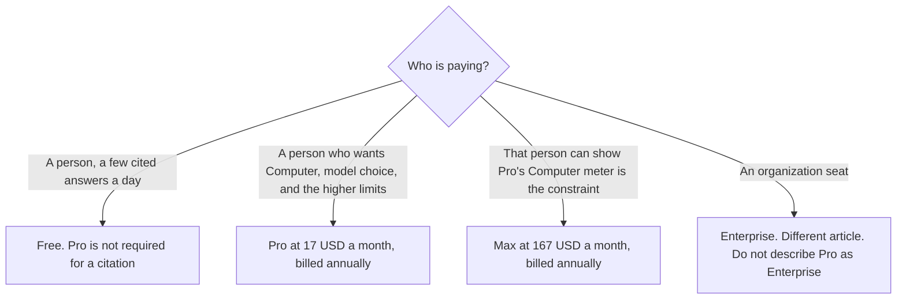

**Perplexity Pro is $17 a month billed annually.** That figure is the help-center and pricing-page read on October 24, 2026, recorded in [Perplexity pricing explained](/blog/perplexity-pricing-explained-2026/). Monthly billing costs more, and that read did not give one clean monthly dollar to reprint. A refetch of perplexity.ai/hub/pricing and perplexity.ai/pro timed out on October 24, so this page does not add a monthly price. Max, Enterprise, and the full ladder live on the other articles. This page is the Pro seat.

Whether that seat is the right upgrade is [is Perplexity Pro worth it](/blog/is-perplexity-pro-worth-it-2026/). The organization prices are [Perplexity Enterprise pricing explained](/blog/perplexity-enterprise-pricing-explained-2026/). The research desk is [Perplexity review](/blog/perplexity-review-2026/).

## What the $17 seat is

| | Pro, on the October 24 read | The next row, if Pro is the wrong seat |
|---|---|---|
| Price | $17 a month billed annually | Max is $167 a month billed annually. Enterprise Pro is $40 a user a month, or $400 a year |
| Who pays | A person | Max is still a person. Enterprise is an organization |
| What the pricing FAQ said Pro adds | Higher limits, Computer, premium data such as PitchBook and Statista, search across files and apps, model choice | Max when Computer and Deep Research limits on Pro are the bottleneck you can show |
| Searches | Weekly limits, described as average use. Not a daily number we can reprint | Free is 3 Pro Searches a day and 1 research query a month, in that help-center table |
| API | Billed separately | An Enterprise order does not, on the pricing article, include the API |

Education Pro is $10 a month with SheerID verification, on that same read. It is a discount for a student or educator. It is not a coupon on a company seat. The pricing article records a wording clash: one help-center section has described unlimited Pro Searches for Education Pro, and the comparison table puts Education Pro in the same weekly-limit cell as Pro. If you are verifying in order to get unlimited searches, ask which sentence is current. This page does not pick the unlimited sentence.

The directory card checked October 16 records Max at 10,000 monthly credits and 35,000 bonus credits. The October 24 pricing article says limited-time Computer credit bonuses have appeared, and not to treat a bonus as permanent. Pro's public card, on that read, listed expanded Computer access. It did not list Max's 10,000-credit line. Do not copy Max's credits onto Pro.

You can opt out of data collection on Pro, Education Pro, and Max, on that read. The article treats an enterprise data stance as a reason to buy the organization seat rather than a personal login on a company question. An opt-out is not Enterprise Pro at $40.

## What Pro is not

**A larger free plan with a logo.** Free already cites sources. Pro is the seat for the limits and the controls the FAQ named. Three Pro Searches a day is the Free figure in the help-center table. Pro's figure is a weekly limit described as average use. If procurement needs a hard quota, Free's 3 a day and Enterprise Pro's 400 a week are the numbers that table actually printed. Pro is the vague one. Say so in the forecast.

**The API.** The pricing article says the developer API is billed separately from these seats. Do not divide $17 by an imagined query count and call it an API rate.

**Elicit, if the rows are papers.** [Elicit](/tools/elicit/) Plus is $11 a user a month billed annually on the non-industry annual card recorded October 16. A literature table is [Perplexity vs Elicit for evidence tables](/blog/perplexity-vs-elicit-for-evidence-tables-2026/).

**ChatGPT Plus, if the job is a draft.** [ChatGPT](/tools/chatgpt/) Plus is $20 a month on the October 24 plan page recorded in [ChatGPT vs Claude for stakeholder updates](/blog/chatgpt-vs-claude-for-stakeholder-updates-2026/). The cost comparison is [Perplexity Pro vs ChatGPT Plus cost](/blog/perplexity-pro-vs-chatgpt-plus-cost-2026/). [Claude](/tools/claude/) Pro is $17 a month billed annually, or $20 monthly, on the October 24 read. The same sticker is not the same product.

A year of Pro at the annual monthly rate is 12 × $17 = $204, before tax. That is the annual-rate arithmetic. It is not a quote of a prepaid invoice we saw printed as $204. If checkout shows a different annual total, checkout wins. We are not quoting a monthly price above $17.

## What not to assume

Do not print a monthly Pro price this page did not fetch. Do not carry Max's $167 onto a team and call every seat Pro. Do not paste a confidential corpus into personal Pro and call it Enterprise. Do not count a credit bonus as next year's allowance. The $30 nonprofit line in the pricing article is a quote you ask for. It is not Pro's list price.

## FAQ

### How much is Perplexity Pro?

$17 a month billed annually, on the October 24, 2026 read. Monthly billing costs more. A refetch of the hub pricing URL and the Pro URL timed out that day, so this page still does not quote a monthly dollar. If checkout disagrees, checkout wins.

### What do you get that Free does not?

On that read: higher limits, Perplexity Computer, premium data such as PitchBook and Statista, search across files and apps, and model choice. Model names change. Buy the controls, not a model string. Free remains the seat for a few cited answers a day.

### How is this different from Enterprise and from Max?

Max at $167 annual is the personal capacity step when Pro's Computer or research limits are the constraint you can show. Enterprise Pro at $40 a user a month, or $400 a year, is the organization seat. Enterprise Max is $325 a user, or $3,250 a year. Pro is none of those. The enterprise article has the organization table. This article does not average them.

### Does Pro include the API?

Not as the pricing article describes it. The developer API is a separate bill. Ask for that rate on its own card. A Pro login in a script is not an API contract.

## Last verified

October 24, 2026, for the help-center read recorded in the pricing article. The hub pricing URL and the Pro URL timed out on refetch that day. October 16, 2026, for the directory card's Max credit line and for Elicit. Published October 24, 2026.

**Sources:** [Perplexity pricing](https://www.perplexity.ai/hub/pricing), [Perplexity help center](https://www.perplexity.ai/hub/helpcenter), [Perplexity enterprise](https://www.perplexity.ai/enterprise).

*Published by Andrew for [AI Tools Optimizer](https://aitoolsoptimizer.com).*

[Perplexity](/tools/perplexity/) is in the [research directory](/tools/category/research-search/). Directory pages may use affiliate links. A purchase through them may earn us a commission at no extra cost to you.
