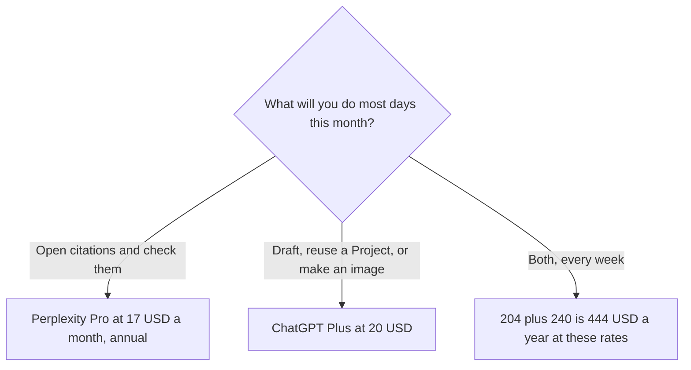

**Pay for Perplexity Pro when the job is an answer with sources you will click. Pay for ChatGPT Plus when the job is a draft, a project, or an image in the chat you already use.** The stickers are $17 a month billed annually versus $20 a month. They buy different work. Many people need one. Some weeks need both, and that is $17 plus $20 if you take Pro's annual rate as the monthly equivalent.

The feature split for research, which is not only the invoice, is [ChatGPT vs Perplexity for research](/blog/chatgpt-vs-perplexity-for-research-2026/). Perplexity's full ladder is [Perplexity pricing explained](/blog/perplexity-pricing-explained-2026/). Whether Pro is the right upgrade at all is [is Perplexity Pro worth it](/blog/is-perplexity-pro-worth-it-2026/).

Prices are US list prices excluding tax from directory pages checked October 16, 2026. Perplexity's card lists the annual monthly rate and says monthly billing costs more. It does not print a monthly dollar this page will guess. Published October 24, 2026. We did not score answer quality.

## The two invoices

| | [Perplexity](/tools/perplexity/) Pro | [ChatGPT](/tools/chatgpt/) Plus |
|---|---|---|
| Sticker | $17 a month billed annually | $20 a month |
| A year at the printed rate | 12 × $17 = $204 | 12 × $20 = $240 |
| Free tier under it | Top models with limited weekly usage, and citations | Text chat, with limited tools |
| What the paid tier adds, on the card | Higher limits, Perplexity Computer, premium data such as PitchBook and Statista, files and apps, Model Council, model choice | Projects, custom GPTs, higher limits, expanded deep research and Codex usage |
| The next step up | Max is $167 a month billed annually | Pro starts at $100, then $200 or $500 |
| A company seat | Enterprise Pro is $40 a user a month, or $400 a year | Business is $20 a user a month billed annually, or $25 monthly, for two or more users |

The $36 gap between $204 and $240 is real and small. The product gap is the reason to pick. Do not buy the cheaper sticker for the job it does not do.

## What each $17 or $20 is for

**Perplexity Pro.** Free already cites sources, with a weekly cap on top models. Pro is the seat for people who hit that cap or need Computer, premium data, and model choice. Max at $167 a month billed annually is heavy sustained research, with 10,000 monthly credits and 35,000 bonus credits on the card. Do not buy Max to replace Plus. The review is [Perplexity review](/blog/perplexity-review-2026/).

A year of Pro is $204. Enterprise Pro at $40 × 12 = $480 a user, or $400 if you use the yearly figure the card also prints. Those are admin seats, not a nicer answer.

**ChatGPT Plus.** Go at $8 is the cheaper ChatGPT step and may include ads. Plus at $20 is the professional default on this site: projects, custom GPTs, and more room. Pro at $100 and up is capacity after Plus runs out. It is not required to compete with Perplexity Pro. The ladder is [ChatGPT Go vs Plus vs Pro](/blog/chatgpt-go-vs-plus-vs-pro-2026/).

Plus can search and draft. The research comparison linked above is where to decide if search-inside-ChatGPT is enough. If you will not click citations, Pro's extra data sources do not help you.

**The neighbors, so you do not add a third by accident.** [Claude](/tools/claude/) Pro is $20 a month, or $17 billed annually, and is the long-document seat. [Gemini](/tools/gemini/) is free with a Google account. Google AI Pro is $19.99 a month when the work is in Gmail and Docs. [Elicit](/tools/elicit/) is the paper-table tool when the web is the wrong corpus. The split is [Perplexity vs Elicit for research](/blog/perplexity-vs-elicit-for-research-2026/). The search three-way is [Perplexity vs ChatGPT vs Gemini for search](/blog/perplexity-vs-chatgpt-vs-gemini-for-search-2026/).

## When both bills are rational

Pay both when you can name the hour. A founder who checks a market in Perplexity and drafts the memo in ChatGPT is using $204 + $240 = $444 a year at these rates. A founder who only drafts can stay on Plus. A founder who only checks sources can stay on Perplexity Free until the weekly cap hurts, then Pro.

The market-research workflow is [how to use Perplexity for market research](/blog/how-to-use-perplexity-for-market-research-2026/). The claim check on the memo is [how to fact-check AI writing](/blog/how-to-fact-check-ai-writing-2026/).

Do not buy either seat to brainstorm campaign names. That session is [ChatGPT vs Claude for brainstorming](/blog/chatgpt-vs-claude-for-brainstorming-2026/).

## FAQ

### Is Pro cheaper than Plus?

On the annual monthly rate, yes: $17 versus $20, and $204 versus $240 over twelve months. Perplexity says monthly billing costs more and this page does not invent that monthly number. Cheaper is the wrong word if you needed projects and a custom GPT.

### Does ChatGPT Plus include Perplexity?

No. They are different products. Plus can browse inside ChatGPT. Pro is Perplexity's plan, with its own data sources and its own caps.

### Should a team buy Enterprise Pro or ChatGPT Business?

Enterprise Pro is $40 a user a month for Perplexity's admin seat. ChatGPT Business is $20 a user a month billed annually and does not train on business data by default. Buy the one that matches the work. A five-person research desk on Enterprise Pro is 5 × $40 = $200 a month. A five-person drafting desk on Business annual is 5 × $20 = $100 a month. Those totals are not substitutes.

### Is Max the fair comparison to Plus?

No. Max at $167 a month billed annually is a heavy plan. The fair sticker comparison to Plus is Pro at $17 billed annually. Move to Max when Pro's limits, not a blog, say so.

## Last verified

October 16, 2026 for Perplexity, ChatGPT, Claude, and Gemini prices named above. Perplexity's month-to-month Pro dollar was not printed on the card this site recorded. Published October 24, 2026.

**Sources:** [Perplexity pricing](https://www.perplexity.ai/hub/pricing), [ChatGPT pricing](https://chatgpt.com/pricing), [Claude pricing](https://claude.com/pricing).

*Published by Andrew for [AI Tools Optimizer](https://aitoolsoptimizer.com).*

[Perplexity](/tools/perplexity/) is in the [research and search directory](/tools/category/research-search/). Directory pages may use affiliate links. A purchase through them may earn us a commission at no extra cost to you.
