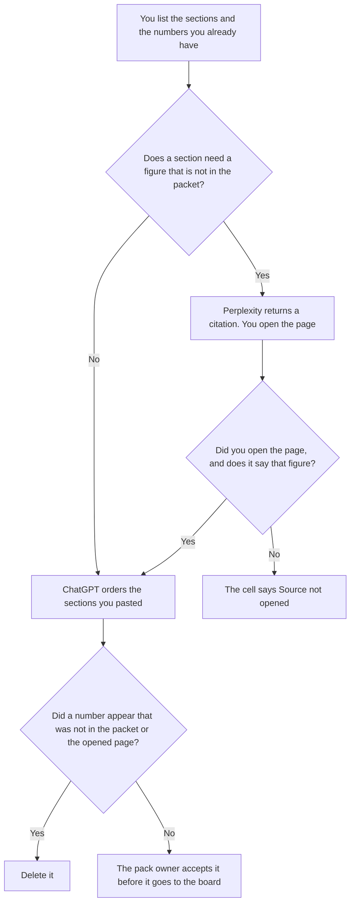

**Use Perplexity when a board pack needs an outside figure and the cell must carry a page you can open. Use ChatGPT when you are ordering sections of a packet a person already assembled, and every number is already in that packet.** The model may label a missing source. It may not invent a metric, a forecast, or a peer comparison. A vendor table with your columns is [Perplexity vs ChatGPT for vendor comparisons](/blog/perplexity-vs-chatgpt-for-vendor-comparisons-2026/). The slides, after the packet exists, are [Gamma vs Plus AI for board decks](/blog/gamma-vs-plus-ai-for-board-decks-2026/).

Perplexity's Pro price is the October 24, 2026 help-center read recorded in [Perplexity pricing explained](/blog/perplexity-pricing-explained-2026/). A refetch of perplexity.ai/hub/pricing timed out on October 24, so this page does not add a monthly dollar. ChatGPT's Plus price is the October 24 plan-page figure recorded in [ChatGPT vs Claude for stakeholder updates](/blog/chatgpt-vs-claude-for-stakeholder-updates-2026/). Notion and Gamma prices are from directory pages checked October 16, 2026. Published October 24, 2026. We did not score packs.

## Which page of the pack you are building

| The page | Start here | First paid step | The limit |
|---|---|---|---|
| An outside figure that needs a citation | [Perplexity](/tools/perplexity/) | Pro is $17 a month billed annually | No number without a page you opened |
| Sections of a packet you already have | [ChatGPT](/tools/chatgpt/) | Plus is $20 a month | No figure that was not in the packet |
| The file the next pack will copy | [Notion AI](/tools/notion-ai/) | Business is $20 a seat a month | Plus at $10 is not the full AI tier |
| A deck after the numbers are accepted | [Gamma](/tools/gamma/) | Plus is $9 a seat a month | The deck does not add a metric |

A sentence that calls a change "immaterial" has added a judgment. If the packet does not say immaterial, the draft does not say it. A date that was not in the packet says Date not in the source.

ChatGPT Go is $8 a month on the October 24 plan page. Plus is the seat for a saved pack. The review is [ChatGPT review](/blog/chatgpt-review-2026/). The full Perplexity ladder, including Max and Enterprise, is the pricing article. Enterprise is [Perplexity Enterprise pricing explained](/blog/perplexity-enterprise-pricing-explained-2026/). This comparison is the personal Pro seat against ChatGPT Plus for one pack.

## What the pack is allowed to contain

The sections you named, the numbers you pasted, and the citations you opened. A risk that was not in the packet stays out. A comparison company that was not in the packet stays out. The slide file can repeat a number after the owner accepts it. It cannot be the first place the number appears.

**Perplexity Pro** is the outside-figure path. The October 24 read describes weekly limits as average use, plus Computer, file search, and model choice on that seat. Open the source. A citation you did not open is not in the pack. The research desk is [Perplexity review](/blog/perplexity-review-2026/).

**ChatGPT Plus** is the packet you already trust. Paste the sections in the order you want. A version that adds a market size is the version you delete. The ladder is [ChatGPT pricing explained](/blog/chatgpt-pricing-explained-2026/).

**Notion Business** stores the accepted section, the source link, and the date the owner accepted it. The invoice is [Notion AI pricing explained](/blog/notion-ai-pricing-explained-2026/).

**Gamma Plus** is the deck after that acceptance, at $9 a seat a month on the October 16 card. The deck quotes the pack. It does not update the pack. Pro at $18 a seat is a larger credit pool on that card, not a reason to add a metric.

A prompt that holds the line:

"Order the board-pack sections from the packet I pasted. If a figure has no source, write Source not opened. Do not add a metric. Do not add a forecast. Do not call a change immaterial."

## What not to delegate

Do not ask what the board "will want to hear." Do not paste a draft forecast so the pack "looks complete." Do not send it because the headings match last quarter. The pack owner accepts every number. A citation is a page you opened.

## FAQ

### How is this different from a vendor comparison?

A vendor comparison fills columns you defined, for a purchase. A board pack is the set of sections a board will see, which may include a vendor only if you already put that vendor in the packet. The comparison page does not write the pack. The pack does not invent a vendor.

### How is this different from a board deck?

The pack is the numbers and the sources. The deck is the slides after those numbers are accepted. Gamma can format the deck. It cannot be the place a new figure appears. If the deck and the pack disagree, the pack wins until the owner changes it.

### Which one produces a safer pack?

We did not measure that. Perplexity fits a figure that needs a page. ChatGPT fits a packet you already assembled. The pack is safer when every outside number has a page you opened, and a missing source says so.

### Who may send it to the board?

The pack owner. A formatted draft is not a send. Two sections do not get two versions of the same number. If last quarter's pack used a different figure, say which source changed. Do not average them.

## Last verified

October 24, 2026 for Perplexity's annual Pro figure, via the pricing article. The hub pricing URL timed out that day. October 24, 2026 for ChatGPT's plan page, via the stakeholder article. October 16, 2026 for Notion and Gamma. Published October 24, 2026.

**Sources:** [Perplexity pricing](https://www.perplexity.ai/hub/pricing), [ChatGPT and Codex pricing](https://learn.chatgpt.com/docs/pricing), [Notion pricing](https://www.notion.com/pricing), [Gamma pricing](https://gamma.app/pricing).

*Published by Andrew for [AI Tools Optimizer](https://aitoolsoptimizer.com).*

[Perplexity](/tools/perplexity/) is in the [research directory](/tools/category/research-search/). Directory pages may use affiliate links. A purchase through them may earn us a commission at no extra cost to you.
