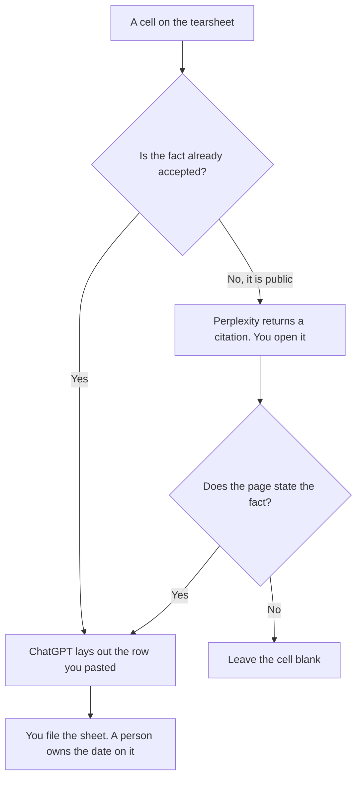

**Use Perplexity when the tearsheet needs a public fact with a citation you can open. Use ChatGPT when you are laying out a one-page sheet from facts a person already accepted.** The model may format a row. It may not invent a price, a customer logo, or a feature the source does not state. The longer narrative is [how to write a competitive positioning brief with AI](/blog/how-to-write-a-competitive-positioning-brief-with-ai-2026/). Checking a single claim is [Perplexity vs ChatGPT for fact checks](/blog/perplexity-vs-chatgpt-for-fact-checks-2026/).

Perplexity and ChatGPT prices are from directory pages checked October 16, 2026. perplexity.ai/pro and chatgpt.com/pricing returned HTTP 403 on October 24, so this page does not replace those cards. Notion's price is from the same October 16 record. Claude's Pro price is from claude.com/pricing on October 24. Published October 24, 2026. We did not score competitive wins.

## Which seat matches the sheet

| The cell you are filling | Start here | First paid step | The limit |
|---|---|---|---|
| A public price, date, or feature, with a link | [Perplexity](/tools/perplexity/) | Pro is $17 a month billed annually | You open the citation. A dead link empties the cell |
| The one-page layout, from rows you already checked | [ChatGPT](/tools/chatgpt/) | Plus is $20 a month | No new fact in the layout pass |
| The page sales will reuse | [Notion AI](/tools/notion-ai/) | Business is $20 a seat a month | The tearsheet in chat is not the page they open |
| A paragraph under the table | [Claude](/tools/claude/) | Pro is $17 a month billed annually, or $20 monthly | The paragraph may not add a row |

Perplexity's October 16 card says monthly billing costs more than the $17 annual figure and tells you to check the pricing page. Max is $167 a month billed annually on that card. A tearsheet does not need Max. The invoice is [Perplexity pricing explained](/blog/perplexity-pricing-explained-2026/).

ChatGPT Go is $8 a month and may include ads. Plus is the seat for a saved column list. The review is [ChatGPT review](/blog/chatgpt-review-2026/).

## What a cell is allowed to hold

A fact you can open, the date you checked it, and the source title. If two sources disagree, the cell says Conflict and names both. It does not average them. A logo appears only when you have the right to use it. A "likely" feature is not a feature.

**Perplexity Pro** is the lookup. Ask for the fact and the URL. If the answer has no citation, the cell stays empty. The mode that refuses an uncited sentence is [what AI citation-required mode is](/blog/what-is-ai-citation-required-mode-2026/).

**ChatGPT Plus** is the layout. Paste the accepted rows. Ask for a one-page table. A layout pass that adds a row "for completeness" is the pass you discard.

**Notion Business** holds the sheet the team will copy. Put the checked date in the header. A sheet with no date is already stale.

A prompt that holds the line:

"Build a tearsheet from the rows I pasted. Do not add a competitor, a price, or a feature. If a cell is empty, leave it empty. Do not describe a product as winning."

## What not to delegate

Do not ask which vendor is better. Do not paste a private win-loss note into a public-search product. Do not let a later layout pass update a price that the citation pass recorded. The positioning brief can argue. The tearsheet stays a table of sourced cells.

## FAQ

### Which one makes a more accurate tearsheet?

We did not measure that. Perplexity fits a public fact you still have to open. ChatGPT fits rows you already accepted. Accuracy is the cell that matches the page you opened, on the date you wrote down.

### Do I need both?

Often, in that order: cite, then lay out. One tool doing both is how an unsourced sentence becomes a cell. If you only have accepted rows, ChatGPT is enough.

### What if the vendor's pricing page is blocked?

Leave the price blank and write Source unread. Do not copy a number from memory or from an old sheet without a date. The October 24 fetches for this article hit HTTP 403 on two pricing pages. Those cells stayed on the older directory record, with the date stated.

### Who may send the sheet to a seller?

The owner named on the page. A model does not send it. A sheet that calls a competitor dishonest is not a tearsheet. Delete that sentence.

## Last verified

October 16, 2026 for Perplexity, ChatGPT, and Notion. October 24, 2026 for Claude's Pro price, and for the HTTP 403 results named above. Published October 24, 2026.

**Sources:** [Perplexity pricing](https://www.perplexity.ai/pro), [ChatGPT pricing](https://chatgpt.com/pricing/), [Notion pricing](https://www.notion.com/pricing), [Claude pricing](https://claude.com/pricing).

*Published by Andrew for [AI Tools Optimizer](https://aitoolsoptimizer.com).*

[Perplexity](/tools/perplexity/) is in the [research and search directory](/tools/category/research-search/). Directory pages may use affiliate links. A purchase through them may earn us a commission at no extra cost to you.
