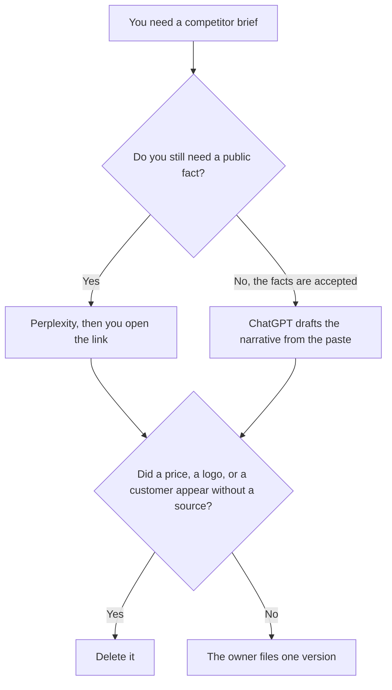

**Use Perplexity when the competitor brief needs a public fact with a citation you can open. Use ChatGPT when you are turning facts a person already accepted into a short narrative.** The model may order sections. It may not invent a price, a customer, or a feature the source does not state. A one-page sheet of the same facts is [Perplexity vs ChatGPT for competitive tearsheets](/blog/perplexity-vs-chatgpt-for-competitive-tearsheets-2026/). A vendor you might buy, which is a different subject, is [Perplexity vs ChatGPT for vendor research](/blog/perplexity-vs-chatgpt-for-vendor-research-2026/).

Perplexity, ChatGPT, and Notion prices are from directory pages checked October 16, 2026. perplexity.ai/pro and chatgpt.com/pricing returned HTTP 403 on October 24, so those cards stay the price record. Claude's prices are from claude.com/pricing on October 24. Published October 24, 2026. We did not score competitive wins.

## Which brief you are writing

| The page in front of you | Start here | First paid step | The limit |
|---|---|---|---|
| A public price, date, or feature, with a link | [Perplexity](/tools/perplexity/) | Pro is $17 a month billed annually | You open the citation. A dead link empties the cell |
| A narrative from facts you already accepted | [ChatGPT](/tools/chatgpt/) | Plus is $20 a month | No fact that was not in the paste |
| A long brief that must keep one definition of the competitor | [Claude](/tools/claude/) | Pro is $17 a month billed annually, or $20 monthly | Still no unsourced claim |
| The page the team will reread | [Notion AI](/tools/notion-ai/) | Business is $20 a seat a month | Plus at $10 is not the full AI tier |

Perplexity Enterprise Pro is $40 a user a month, or $400 a year, on the October 16 card, when the brief is a company record and you need admin controls. Max at $167 a month billed annually is a personal ceiling, not the default for one brief. Monthly prices for Pro were not on the card we used. Do not invent one.

ChatGPT Go is $8 a month and may include ads, on the October 16 card. Plus is the seat for a saved outline. Business is $20 a user a month billed annually, or $25 monthly, for two or more users, when the brief should not train the model by default. The review is [ChatGPT review](/blog/chatgpt-review-2026/).

## What the brief may claim

A fact you opened, a quote you pasted, and a judgment a person already wrote and labeled as a judgment. If the cell is empty, the brief says Unknown. A narrative that "rounds" a competitor's price has edited the market.

**Perplexity Pro** is the research pass. Click through. If the citation is a homepage, the cell is not filled. The positioning narrative that comes after the facts is [how to write a competitive positioning brief with AI](/blog/how-to-write-a-competitive-positioning-brief-with-ai-2026/).

**ChatGPT Plus** is the writing pass after the facts are stable. Paste them. A second draft that adds a win story you did not paste is the draft you delete.

**Claude Pro** fits when the brief is long enough that one definition of the competitor has to survive every section. Change the definition once, in the Project, then reread the sections that cited it. The review is [Claude review](/blog/claude-review-2026/).

**Notion Business** is the page if that is the wiki. The chat is not the system of record.

A prompt that holds the line:

"Draft the competitor brief from the facts and the links I pasted. If a field has no source, write Unknown. Do not add a customer, a price, or a roadmap date."

## What not to delegate

Do not ask which competitor is "winning." Do not paste an internal roadmap into a personal account and ask the model to compare it with a public page. Do not ship two versions. File the one a person accepted.

## FAQ

### Which one writes a better brief?

We did not measure that. Perplexity fits the cited fact. ChatGPT fits the narrative after the facts are accepted. The brief is usable when every factual sentence traces to a source you opened or a paste you labeled.

### Do I need both?

Often one after the other, not both at once on the same blank page. Research first. Then one narrative. Merging two narratives is how a price survives in one paragraph and changes in the next.

### How is this different from a tearsheet?

The tearsheet is one page of cells. This brief is the longer note a reader can follow. The cells still follow the tearsheet rule: no source, no claim. Do not let the extra length become a place to hide an unsourced sentence.

### Who may send the brief?

The owner of that competitive view. A finished draft is not a send. A citation the owner did not open is not a source.

## Last verified

October 16, 2026 for Perplexity, ChatGPT, and Notion. October 24, 2026 for Claude. The October 24 refetch of the Perplexity and ChatGPT pricing URLs returned HTTP 403. Published October 24, 2026.

**Sources:** [Perplexity](https://www.perplexity.ai/), [ChatGPT pricing](https://chatgpt.com/pricing/), [Claude pricing](https://claude.com/pricing), [Notion pricing](https://www.notion.com/pricing).

*Published by Andrew for [AI Tools Optimizer](https://aitoolsoptimizer.com).*

[Perplexity](/tools/perplexity/) is in the [research and search directory](/tools/category/research-search/). Directory pages may use affiliate links. A purchase through them may earn us a commission at no extra cost to you.
