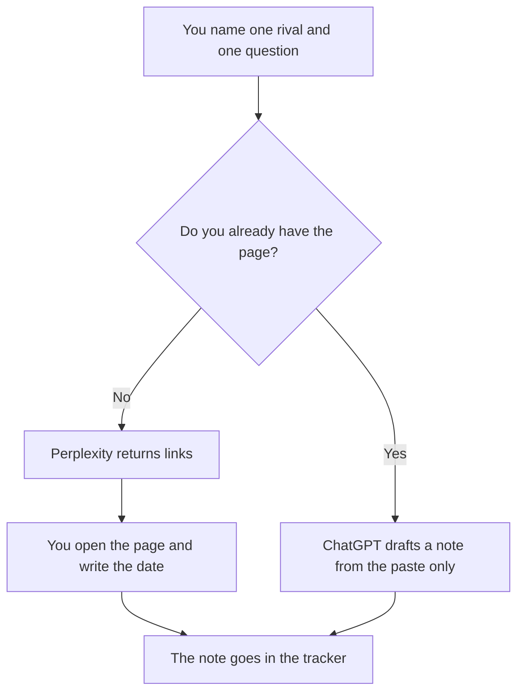

**Use Perplexity when the scan needs a citation you can open. Use ChatGPT when you already have the page and you want a note drafted from that paste.** A scan that invents a rival's price, a funding round, or a feature is a rumor with headings. We did not score whose answers win more deals.

The wider research split is [ChatGPT vs Perplexity for research](/blog/chatgpt-vs-perplexity-for-research-2026/). The log you keep after the scan is [how to build a competitor tracker with AI](/blog/how-to-build-a-competitor-tracker-with-ai-2026/). The sourced story you tell later is [how to write a competitive battle narrative with AI](/blog/how-to-write-a-competitive-battle-narrative-with-ai-2026/).

Prices are US list prices excluding tax from directory pages checked October 16, 2026. Published October 24, 2026. Public pages only. This page does not describe how to get into a private account.

## Which seat matches the scan

| The scan you actually need | Start here | What you still do |
|---|---|---|
| A first pass with links you will click | [Perplexity](/tools/perplexity/) Free, within the weekly limit | Open the page. Record the date. Drop any claim whose page you did not open |
| You will do this every week | Perplexity Pro at $17 a month billed annually | The invoice is the seat. The source is still the page |
| You already captured the page and want a tight note | [ChatGPT](/tools/chatgpt/) Free, or Plus at $20 a month | The paste is the source. The model may not add a fact from memory |
| The note has to follow a long battlecard template | [Claude](/tools/claude/) Pro at $20 a month, or $17 billed annually | Same rule. Template fields with no source stay Missing |
| The running log lives in a wiki | [Notion AI](/tools/notion-ai/) Business at $20 a seat a month | The page in Notion is the record. The chat is the draft |

Perplexity Max is $167 a month billed annually on the directory card. A weekly scan of public pricing pages does not require it. Enterprise Pro is $40 a user a month, or $400 a year. Buy Enterprise when an admin has to control the workspace, not because a rival's homepage is long.

ChatGPT Go at $8 a month may include ads. A competitor note is not a place to treat an ad as a source. Pro at $100 and above is capacity. It does not know the rival's roadmap.

## What each product is doing

**Perplexity** is the retrieval step. Pro at $17 a month billed annually is the citation seat the directory records. The directory does not print a monthly-only Pro dollar in the row we used, so this page does not either. Open the citation. A snippet in the answer is not the source. The invoice is [Perplexity pricing explained](/blog/perplexity-pricing-explained-2026/). The market-research habit is [how to use Perplexity for market research](/blog/how-to-use-perplexity-for-market-research-2026/).

**ChatGPT** is the drafting step after you have the text. Plus at $20 adds projects, which helps if the same template is reused. Free can draft from a paste. If the model adds a feature the paste does not contain, delete the sentence. That addition is [what an AI hallucination is](/blog/what-is-ai-hallucination-2026/).

**Claude** is the same drafting job when the template is long and you want it in a Project. It is not a second web index. If you need the web, start in Perplexity, then paste.

A prompt that holds the line:

"From this pasted page only, list the plan names and prices that appear, with the date I gave you. If a price is not on the page, write Missing. Do not infer a discount. Do not describe a feature that is not in the paste. Keep each note to four lines."

The date on that page is [what retrieval freshness is](/blog/what-is-retrieval-freshness-2026/). A page from last year is a fact about last year.

## What not to delegate

Do not ask either product for a private deck, a closed community, or a customer's login. Do not mail a scan you have not opened. Do not let a model turn two public prices into a "winner." The battle narrative is a document you approve, with the pages linked.

The teardown format, once you have the page, is [how to create a competitor teardown with AI](/blog/how-to-create-a-competitor-teardown-with-ai-2026/).

## FAQ

### Which one is more accurate?

We did not measure that. Perplexity is the tool that is supposed to show the page. ChatGPT is the tool that should stay inside a page you supply. Accuracy is whether you opened the URL and kept the date.

### Can ChatGPT browse for this?

Some plans can browse. Treat a browsed sentence the same way: open it, or drop it. A browse tool does not replace the tracker. If you will not click, use Perplexity so the link is the point of the product, then click anyway.

### Is Pro required on either side?

No. Free on both can do one scan. Pay when the weekly limit or the project habit is real. Max and ChatGPT Pro are the wrong first purchase for a public pricing page.

### How do we keep last month's note from going stale?

Put a review date on the tracker row. When the date passes, fetch the page again. Do not ask the model if the old note is "still fine." The page is the check.

## Last verified

October 16, 2026 for Perplexity, ChatGPT, Claude, and Notion AI. Published October 24, 2026.

**Sources:** [Perplexity pricing](https://www.perplexity.ai/pro), [ChatGPT pricing](https://chatgpt.com/pricing/), [Claude pricing](https://claude.com/pricing).

*Published by Andrew for [AI Tools Optimizer](https://aitoolsoptimizer.com).*

[Perplexity](/tools/perplexity/) is in the [research and search directory](/tools/category/research-search/). Directory pages may use affiliate links. A purchase through them may earn us a commission at no extra cost to you.
