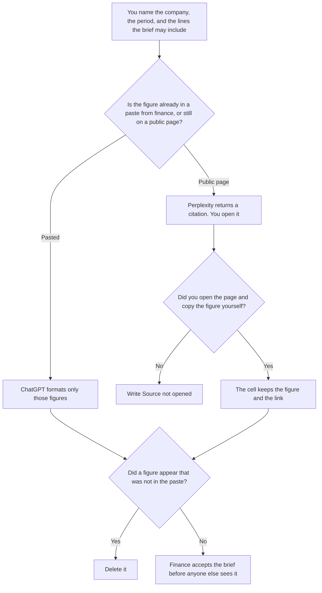

**Use Perplexity when an earnings brief needs a figure from a filing or a public page, and the cell must carry a link you will open. Use ChatGPT when finance already pasted the figures and you are formatting the brief.** The model may label a missing source. It may not invent revenue, guidance, a margin, or a comparison with another company. A board packet assembled from numbers you already have is [Perplexity vs ChatGPT for board packs](/blog/perplexity-vs-chatgpt-for-board-packs-2026/). This page is the earnings brief: one period, the lines finance named, and the filing behind any outside number.

The stakeholder note after the brief exists is [ChatGPT vs Claude for stakeholder updates](/blog/chatgpt-vs-claude-for-stakeholder-updates-2026/). That note is not the brief.

Perplexity's Pro price is the October 24, 2026 help-center read recorded in [Perplexity pricing explained](/blog/perplexity-pricing-explained-2026/). A refetch of perplexity.ai/hub/pricing timed out on October 24, so this page does not add a monthly dollar. ChatGPT's Plus price is the October 24 plan-page figure recorded in [ChatGPT pricing explained](/blog/chatgpt-pricing-explained-2026/). Notion and Grammarly prices are from directory pages checked October 16, 2026. Published October 24, 2026. We did not score briefs. This page is not investment advice.

## Which number is allowed in the brief

| The input | Start here | First paid step | The limit |
|---|---|---|---|
| A filing or a public page you still have to open | [Perplexity](/tools/perplexity/) | Pro is $17 a month billed annually | No figure without a page you opened |
| Figures finance already pasted | [ChatGPT](/tools/chatgpt/) | Plus is $20 a month | No line that was not in the paste |
| The file the next period will copy | [Notion AI](/tools/notion-ai/) | Business is $20 a seat a month | Plus at $10 is not the full AI tier |
| A clarity pass that must not touch a figure | [Grammarly](/tools/grammarly/) | Pro is $12 a member a month billed annually, or $30 monthly | Compare every number before and after |

A sentence that says the company "beat" a number you did not paste has added a conclusion. If guidance is missing, the line says Guidance not in the source. It does not estimate it. Put color in a note labeled Not in the brief.

Perplexity Free can return a few cited searches. Pro at $17 annual is the seat for a brief you will redo each period, on the October 24 record. Enterprise is a different seat. This brief does not require it unless the company already decided the work is an organization account. The organization prices are [Perplexity Enterprise pricing explained](/blog/perplexity-enterprise-pricing-explained-2026/).

ChatGPT Go is $8 a month. Plus is the seat for a saved brief. The review is [ChatGPT review](/blog/chatgpt-review-2026/).

## What the brief is allowed to contain

The period you named, the lines you named, and the figures you pasted or copied from a page you opened. A peer comparison that was not requested stays out. A forecast that was not in the filing stays out. The link stays next to the figure. A citation you did not open is not a figure.

**Perplexity Pro** is the public-page path. You open the filing. You copy the line. You do not ask the model to "pull the quarter" and paste the paragraph into the brief unread.

**ChatGPT Plus** is the format path. The numbers are already in the paste. A version that adds a year-ago column you did not supply is the version you delete.

**Notion Business** stores the accepted brief, the period, and the person who accepted it. The invoice is [Notion AI pricing explained](/blog/notion-ai-pricing-explained-2026/).

**Grammarly Pro** is the pass after the figures are stable. Reject a suggestion that rounds a number or adds an adjective to a result. The invoice is [Grammarly pricing explained](/blog/grammarly-pricing-explained-2026/).

A prompt that holds the line:

"Draft the earnings brief from the period and the figures I pasted. If a line has no figure, write Figure not in the source. Do not add guidance. Do not add a peer comparison. Do not say the company beat or missed."

## What not to delegate

Do not ask what the quarter "means for the stock." Do not paste a headline and treat it as the filing. Do not send the brief because the prose sounds calm. Finance accepts it. A cited paragraph you did not open is not a source.

## FAQ

### How is this different from a board pack?

The board-pack page is a packet a person already assembled, plus an outside figure that needs a page you can open. This page is one earnings period and the lines finance said the brief may include. A board pack can attach this brief. It should not grow new earnings lines inside the pack prompt. Use that page for the packet. Use this page for the period.

### How is this different from a stakeholder update?

The update tells a named audience about a decision that already happened. The brief is the figures for a period, before that note. An update can say the brief is ready. It does not replace the brief, and it does not add a figure the brief does not have.

### Which one is more accurate?

We did not measure that. Perplexity fits a figure you still have to open. ChatGPT fits figures already pasted. The brief is safer when every number matches a paste or a page you opened, and a missing line says so.

### Who may send the brief?

The finance owner named on the file. A formatted page is not acceptance. Source not opened stays until a person opens the page and copies the figure.

## Last verified

October 24, 2026 for Perplexity's annual Pro figure and for ChatGPT's plan page, via the posts cited above. The hub pricing URL timed out that day. October 16, 2026 for Notion and Grammarly. Published October 24, 2026.

**Sources:** [Perplexity pricing](https://www.perplexity.ai/hub/pricing), [ChatGPT and Codex pricing](https://learn.chatgpt.com/docs/pricing), [Notion pricing](https://www.notion.com/pricing), [Grammarly pricing](https://www.grammarly.com/plans).

*Published by Andrew for [AI Tools Optimizer](https://aitoolsoptimizer.com).*

[Perplexity](/tools/perplexity/) is in the [research directory](/tools/category/research-search/). Directory pages may use affiliate links. A purchase through them may earn us a commission at no extra cost to you.
