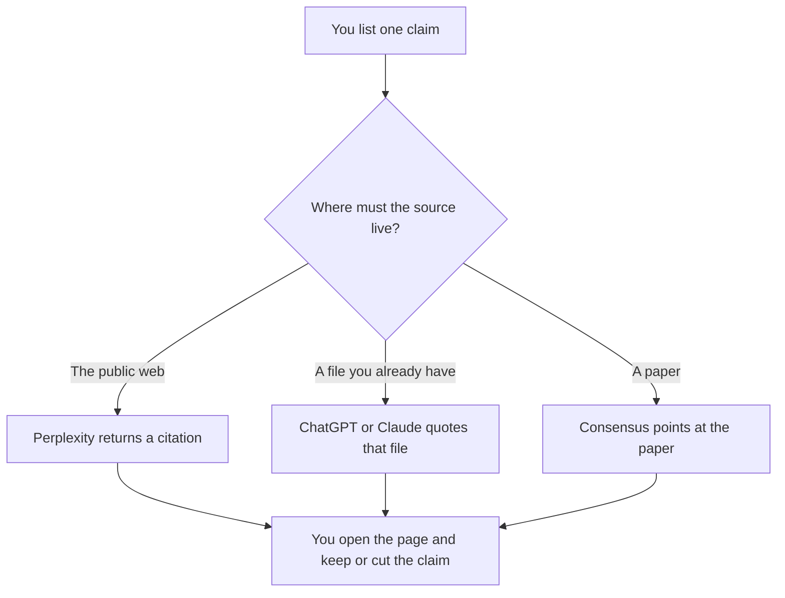

**Use Perplexity when the claim needs a page on the public web and you will open that page. Use ChatGPT when you already have the source in front of you and you need the draft split into claims.** A fact check is a list of claims, each with a source you opened, and a delete mark on every claim that has none. A second model is a way to find the page. It is not the witness. The step-by-step habit is [how to fact-check AI writing](/blog/how-to-fact-check-ai-writing-2026/). A sourced research packet for a proposal, which is a different job, is [Perplexity vs ChatGPT for RFP research](/blog/perplexity-vs-chatgpt-for-rfp-research-2026/).

The failure mode is [what an AI hallucination is](/blog/what-is-ai-hallucination-2026/). An answer that names a passage is [what retrieval-augmented chat is](/blog/what-is-retrieval-augmented-chat-2026/). Whether the passage supports the sentence is [what AI groundedness is](/blog/what-is-ai-groundedness-2026/).

Prices are US list prices excluding tax from directory pages checked October 16, 2026. Published October 24, 2026. We did not score accuracy. Monthly prices for Perplexity Pro and Max were higher than the annual figures on the card, and this page prints only the annual numbers the directory confirmed.

## Which seat matches the claim

| The claim you actually have | Start here | What you still do |
|---|---|---|
| A sentence, and you need a public page | [Perplexity](/tools/perplexity/) Free | You open the citation before you keep the sentence |
| The same lookup, often, with a model choice | Perplexity Pro at $17 a month billed annually | You still open the page. Pro does not open it for you |
| The source is already in the draft or the PDF | [ChatGPT](/tools/chatgpt/) Plus at $20 a month | You split claims. You do not ask it to confirm itself |
| The claim is about a paper | [Consensus](/tools/consensus/) Free, or Pro at $12 a month billed annually ($144 a year) | You open the paper. A snapshot is not the paper |
| A long source you will not re-paste | [Claude](/tools/claude/) Pro at $20 a month, or $17 billed annually | The Project holds the source. The check quotes it |

Perplexity Max is $167 a month billed annually. ChatGPT Pro starts at $100. A fact check of a draft does not need either. Enterprise Perplexity, at $40 a user a month for Enterprise Pro, is the row when the company requires an admin. ChatGPT Business is $20 a user a month billed annually, with a two-user minimum, when the draft is company text and a personal account is against policy.

## What a check looks like

One claim per line. The source URL or the file name. A word you choose: Keep, Cut, or Conflict. Keep means you opened the source and it says the thing. Cut means it does not. Conflict means two sources you opened disagree, and a person will decide. The model may propose the line. It may not choose Keep.

**Perplexity Pro** is the paid path when you are doing this often and you want the cited lookup as the habit. The invoice is [Perplexity pricing explained](/blog/perplexity-pricing-explained-2026/). The product still asks you to click through. The review path is that pricing article plus the directory page.

**ChatGPT Plus** is the paid path when the source is a paste and the work is splitting a paragraph into claims without adding new ones. Asking ChatGPT whether its own paragraph is true is the check this page refuses. The review is [ChatGPT review](/blog/chatgpt-review-2026/).

**Consensus Pro** is the paid path when the claim is about peer-reviewed research. Free includes unlimited paper searches, 10 Pro messages, and 3 Deep reviews a month, on the card. The invoice is [Consensus pricing explained](/blog/consensus-pricing-explained-2026/).

A prompt that holds the line:

"Split the paragraph into claims. For each claim, quote the source I pasted or write No source in the paste. Do not add a claim. Do not mark anything Keep. I will open the source."

## What not to delegate

Do not ask "is this true?" and ship the yes. Do not treat a citation you did not open as a source. Do not use a fact-check prompt to add fresher numbers the draft did not have. New numbers are a new draft, and they need their own open pages.

## FAQ

### Which one fact-checks better?

We did not measure that. Pick Perplexity when you need a public page to open. Pick ChatGPT when the source is already in your hands and the work is the claim list. The check happens when you open the source, not when the model finishes typing.

### Is a citation enough?

A citation is a pointer. It is enough only after you open it and the page says what the sentence says. A broken link, a page that says something else, and a page you cannot access are all Cut until a person resolves them.

### What about numbers in our own product?

Those come from the system that owns the number, not from a web search. Paste the figure from the report you trust. If the draft's number disagrees with that report, write Conflict. The web will not settle an internal metric.

### Can Claude replace both?

Claude is the right seat when the source is a long file in a Project and you want the claim list quoted from that file. It is the wrong seat when you needed a current public page and you did not bring one. Use Perplexity for the lookup, then a project for the file you downloaded.

## Last verified

October 16, 2026 for Perplexity, ChatGPT, Consensus, and Claude. Published October 24, 2026.

**Sources:** [Perplexity pricing](https://www.perplexity.ai/pro), [ChatGPT pricing](https://chatgpt.com/pricing/), [Consensus pricing](https://consensus.app), [Claude pricing](https://claude.com/pricing).

*Published by Andrew for [AI Tools Optimizer](https://aitoolsoptimizer.com).*

[Perplexity](/tools/perplexity/) is in the [research and search directory](/tools/category/research-search/). Directory pages may use affiliate links. A purchase through them may earn us a commission at no extra cost to you.
