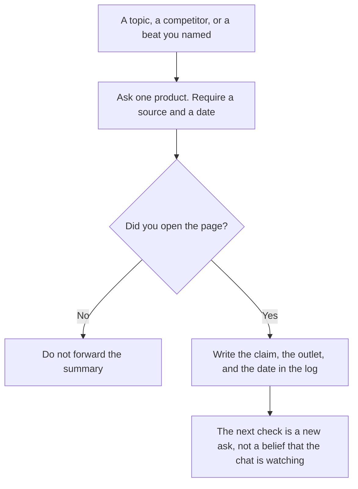

**Use Perplexity when the monitoring habit is a cited answer you open before you repeat a claim. Use ChatGPT Plus when the watchlist already lives in a Project and you want a scheduled task in that same seat.** Neither product is a newswire. A sentence with no date and no page you opened is a rumor you typed yourself. This page does not claim either tool sends breaking-news alerts. The directory does not record an alert product for them.

The research habit for papers and reports is [ChatGPT vs Perplexity for research](/blog/chatgpt-vs-perplexity-for-research-2026/). Shopping is [Perplexity vs ChatGPT for shopping research](/blog/perplexity-vs-chatgpt-for-shopping-research-2026/). The seat math without a job attached is [Perplexity Pro vs ChatGPT Plus](/blog/perplexity-pro-vs-chatgpt-plus-cost-2026/). A weekly digest you assemble on purpose is [how to build an AI research digest](/blog/how-to-build-an-ai-research-digest-2026/).

Prices are US list prices excluding tax from directory pages checked October 16, 2026. Perplexity's card lists annual rates and says monthly billing costs more, without a monthly dollar this page should invent. Published October 24, 2026. We did not score which product surfaces a story first.

## What "monitoring" means here

| Habit | Start here | What you still do |
|---|---|---|
| Ask what changed, and require links | [Perplexity](/tools/perplexity/) Free for a light week. Pro when the free weekly limit is the constraint | Open the citation. Write the publication and the date in your log |
| Keep a named watchlist beside the brief | [ChatGPT](/tools/chatgpt/) Plus, in a Project | Paste the source. Do not ask the Project to remember the news by itself |
| A nudge on a cadence you chose | ChatGPT Plus, which lists scheduled tasks | The task can remind you to look. It is not a confirmation the story is real |
| A folder of threads for one topic | Perplexity Spaces, which the card lists as a feature | Spaces organize the work. They do not replace the citation |
| A page your team will reread next month | [Notion AI](/tools/notion-ai/) Business at $20 a seat | The log is the record. The chat is not |

A stale summary that sounds current is [a hallucination](/blog/what-is-ai-hallucination-2026/) with a timestamp problem. The check is [how to fact-check AI writing](/blog/how-to-fact-check-ai-writing-2026/).

## What the seats cost

**Perplexity Free** includes cited answers and limited weekly usage of top models. **Pro is $17 a month billed annually.** At that recorded rate, 12 × $17 = $204 for a year. Pro adds Perplexity Computer, premium data sources the card names as PitchBook and Statista, file and app creation, Model Council, and model choice. **Max is $167 a month billed annually** (12 × $167 = $2,004) for heavier Computer use, with 10,000 monthly credits and 35,000 bonus credits on the card. **Enterprise Pro is $40 a user a month ($400 a year on the card).** **Enterprise Max is $325 a user a month ($3,250 a year).** Quote those pairs as recorded. Do not multiply $40 by 12 and replace the $400 figure. The invoice is [Perplexity pricing explained](/blog/perplexity-pricing-explained-2026/). The product page is [Perplexity review](/blog/perplexity-review-2026/).

**ChatGPT Plus is $20 a month**, or $240 a year at that rate. Projects and scheduled tasks are on the Plus card. **Go is $8**, and the card says it may include ads. **Business is $20 a user a month billed annually**, minimum two users, with no training on business data by default. A watchlist that includes unreleased company news belongs on the plan your admin allows. The ladder is [ChatGPT Go vs Plus vs Pro](/blog/chatgpt-go-vs-plus-vs-pro-2026/).

**[Claude](/tools/claude/) Pro at $20, or $17 billed annually**, is a reasonable place to turn a source you already opened into a brief. It is not the cited-search start. The writing seat is [ChatGPT vs Claude for writing](/blog/chatgpt-vs-claude-for-writing-2026/).

**Notion Business at $20 a seat** is where the log should live if more than one person will rely on it. Plus at $10 is not the full AI tier. The invoice is [Notion AI pricing explained](/blog/notion-ai-pricing-explained-2026/).

Premium data on Perplexity Pro is not a newsroom. PitchBook and Statista, as named on the card, are reference sources. They do not, by themselves, mean this morning's story is in the answer. Still open the page.

## A watchlist that stays honest

Write five topics, not fifty. For each, name what would make you act: a price change, a filing, a launch, a regulation. Ask for items since a date you type. If the answer has no item after that date, record "nothing found," which is a result. Do not ask the model to fill the gap with something older and call it new.

A prompt that holds the line:

"List items since the date I gave, on these topics only. For each, include the outlet, the date, and the URL. If you cannot provide a URL I can open, omit the item. Do not predict what will happen next. If nothing qualifies, say nothing found."

Market context that is not a news log is [how to use Perplexity for market research](/blog/how-to-use-perplexity-for-market-research-2026/). A competitor tracker you operate on a cadence is [how to build a competitor tracker with AI](/blog/how-to-build-a-competitor-tracker-with-ai-2026/).

## FAQ

### Will this replace a news alert?

Not on the facts this directory records. Scheduled tasks in ChatGPT can remind you to run the check. They are not a claim that every story was fetched. If you need a wire, buy a wire. Use these tools to read and to log.

### Is Pro required to see citations?

The directory says cited answers are part of Perplexity, including the free plan's description of the product. Free limits weekly usage. Move to Pro when that limit blocks a watch you still need, not because a paid plan is more true.

### Can I paste articles into ChatGPT instead?

Yes, if you have the right to, and you paste the piece you opened. That is reading, not monitoring. Monitoring without a source you opened is forwarding. Business is the admin step when the paste is sensitive.

### How often should we check?

On the cadence the decision needs. A weekly product review can be weekly. A launch week can be daily, and then it should stop. A model does not choose the cadence. You do. Write the next check date in the log.

## Last verified

October 16, 2026 for Perplexity, ChatGPT, Claude, and Notion AI. Published October 24, 2026.

**Sources:** [Perplexity pricing](https://www.perplexity.ai/hub/pricing), [ChatGPT pricing](https://chatgpt.com/pricing/), [Claude pricing](https://claude.com/pricing).

*Published by Andrew for [AI Tools Optimizer](https://aitoolsoptimizer.com).*

[Perplexity](/tools/perplexity/) is in the [research and search directory](/tools/category/research-search/). Directory pages may use affiliate links. A purchase through them may earn us a commission at no extra cost to you.
