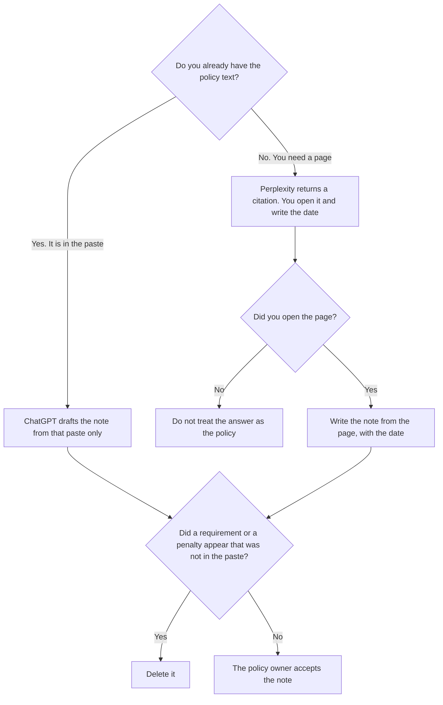

**Use Perplexity when the research step is a page you still have to open, with the date you write down. Use ChatGPT when you already have the policy text and you want a note that only uses that paste.** The model may list what the page says. It may not invent a requirement, a penalty, or a jurisdiction. Writing the rule your company already chose is [Claude vs ChatGPT for policy drafts](/blog/claude-vs-chatgpt-for-policy-drafts-2026/). Summarizing a rule you already hold is [Claude vs ChatGPT for policy summaries](/blog/claude-vs-chatgpt-for-policy-summaries-2026/). This page is the research before either of those drafts.

Opening a citation to check a claim is [Perplexity vs ChatGPT for fact checks](/blog/perplexity-vs-chatgpt-for-fact-checks-2026/). An RFP packet is [Perplexity vs ChatGPT for RFP research](/blog/perplexity-vs-chatgpt-for-rfp-research-2026/).

Perplexity's Pro price is the figure in [Perplexity pricing explained](/blog/perplexity-pricing-explained-2026/), from the pricing page recorded there. ChatGPT's Plus price is the October 24, 2026 plan-page figure recorded in [ChatGPT pricing explained](/blog/chatgpt-pricing-explained-2026/). Claude's prices are the October 24 read of claude.com/pricing recorded in [Claude pricing explained](/blog/claude-pricing-explained-2026/). Notion is the October 16 directory card. Published October 24, 2026. We did not score sources. A citation is not legal advice.

## Which research step you are on

| The step | Start here | First paid step | The limit |
|---|---|---|---|
| You still need a page you can open | [Perplexity](/tools/perplexity/) | Pro is $17 a month billed annually | The note names the URL and the date you wrote down |
| You already pasted the policy text | [ChatGPT](/tools/chatgpt/) | Plus is $20 a month | No requirement that was not in the paste |
| The same clause must stay word for word in the note | [Claude](/tools/claude/) | Pro is $17 a month billed annually, or $20 monthly | A paraphrase is not the clause |
| The page the company will keep | [Notion AI](/tools/notion-ai/) | Business is $20 a seat a month | Plus at $10 is not the full AI tier |

A sentence that says a rule "generally requires" a control has added a requirement. If the page does not say it, the line says Not on the page. A penalty you did not read stays out. Perplexity's answer is a pointer. The page is the source. ChatGPT's note is only as good as the paste. A paste of a summary is not a paste of the policy.

Enterprise Pro on the Perplexity pricing article starts at $40 a seat. That is an admin seat, not a more accurate reading of a statute. This page quotes Pro at $17 a month billed annually for the individual research step. Max, at $167 a month billed annually on that article, is a heavier Computer seat. It does not make an unopened link into a source.

## What the note is allowed to say

The words on the page you opened, or the words in the paste, plus the date you recorded. A company rule is a separate document. Research does not adopt the public page as your policy. The draft, if you write one later, uses the policy-draft page and a decision a person already made.

**Perplexity Pro** is the citation step. The invoice is [Perplexity pricing explained](/blog/perplexity-pricing-explained-2026/).

**ChatGPT Plus** is the paste. Go is $8 a month on the October 24 plan page. Plus is the seat for a saved note. The review is [ChatGPT review](/blog/chatgpt-review-2026/).

**Claude Pro** holds a clause that the note must quote. The review is [Claude review](/blog/claude-review-2026/).

**Notion Business** stores the URL, the date, and the accepted note. The invoice is [Notion AI pricing explained](/blog/notion-ai-pricing-explained-2026/).

A prompt that holds the line:

"List only what the policy text I pasted says. If a requirement is not in the paste, write Not on the page. Do not add a penalty. Do not say what our company should do."

## What not to delegate

Do not ask which policy is "best practice" and skip the page. Do not treat a citation you did not open as a source. Do not paste the note into a company policy. The policy owner accepts the research note. Counsel accepts a rule. This page is not counsel.

## FAQ

### How is this different from a policy draft?

The draft page writes a rule a person already chose. This page finds or reads a policy text and keeps a note of what it says. Research can come back with Not on the page. A draft that fills that blank has invented a rule. Use the draft page after a person decides. Use this page before that decision.

### How is this different from a policy summary?

The summary page restates a rule you already hold, and the rule stays the rule. This page is how you get the text: a link you open, or a paste you already have. A summary of a link you did not open is not a summary of the policy.

### How is this different from a fact check?

The fact-check page is one claim, opened against a page. This page is a policy: requirements, scope, and what the text does not say. A single disputed number can use the fact-check page. A clause you might later adopt uses this one, and still needs a person.

### Who may file the note?

The person who opened the page or who owns the paste. Not on the page stays out of the company policy. A formatted note is not a legal conclusion.

## Last verified

October 24, 2026 for ChatGPT's plan page and for Claude, via the posts cited above. Perplexity's Pro price is the figure in the pricing article cited above. October 16, 2026 for Notion. Published October 24, 2026. This page is not legal advice.

**Sources:** [Perplexity pricing](https://www.perplexity.ai/pro), [ChatGPT and Codex pricing](https://learn.chatgpt.com/docs/pricing), [Claude pricing](https://claude.com/pricing), [Notion pricing](https://www.notion.com/pricing).

*Published by Andrew for [AI Tools Optimizer](https://aitoolsoptimizer.com).*

[Perplexity](/tools/perplexity/) is in the [research and search directory](/tools/category/research-search/). Directory pages may use affiliate links. A purchase through them may earn us a commission at no extra cost to you.
