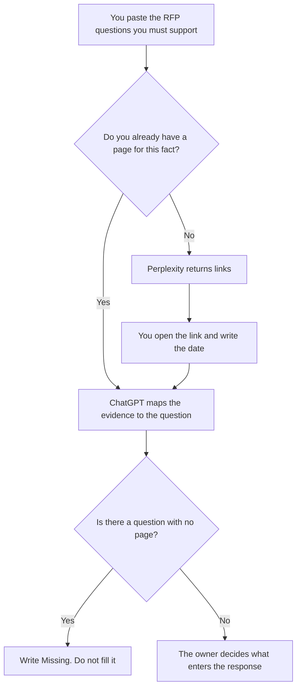

**Use Perplexity when the RFP needs a public fact and a link you will open before the sentence enters the file. Use ChatGPT when you are formatting evidence you already collected against the buyer's questions.** Research is the gathering. The response is a later document, written only from what you can support. A citation the model guessed is not a source. A requirement you cannot find stays Missing.

Choosing a vendor, which is a different packet, is [Perplexity vs ChatGPT for vendor research](/blog/perplexity-vs-chatgpt-for-vendor-research-2026/). The file you send back is [how to write an RFP response with AI](/blog/how-to-write-a-rfp-response-with-ai-2026/). A security questionnaire, which is narrower, is [how to write a security questionnaire response with AI](/blog/how-to-write-a-security-questionnaire-response-with-ai-2026/).

Prices are US list prices excluding tax from directory pages checked October 16, 2026. Published October 24, 2026. We did not score which tool wins bids. This page is not legal advice and not a security review.

## Which seat matches the question list

| The research you actually need | Start here | What you still do |
|---|---|---|
| A public page: a filing, a docs URL, a pricing page | [Perplexity](/tools/perplexity/) Free, within the weekly limit | Open every link you will quote. Write the date |
| More room and the paid research features on that card | Perplexity Pro at $17 a month billed annually | A premium source is still a page you open |
| The packet is confidential | Enterprise Pro at $40 per user a month, or $400 a year | Read the current data terms before you upload the RFP |
| You already have quotes, links, and dates | [ChatGPT](/tools/chatgpt/) Plus at $20 a month | The model maps evidence to questions. It does not add a fact |
| One question from a paste | ChatGPT Free or Perplexity Free | Missing stays Missing |
| The working file lives in the wiki | [Notion AI](/tools/notion-ai/) Business at $20 a seat a month | The page is the record |

Perplexity Max is $167 a month billed annually on the directory card. An RFP research pass does not need that seat unless you already live in Max for other work. ChatGPT Business, at $20 a user a month billed annually with a two-user minimum, is the row when the buyer's document cannot sit in a personal account.

## What may enter the file

A sentence with a link you opened, the date you opened it, and the question it answers. A requirement copied from the RFP, unchanged. A gap labeled Missing. What may not enter: a certification you did not find, a customer count, a price from memory, or a competitor's feature list the model summarized without a page.

**Perplexity Pro** is the search seat. The review is [Perplexity review](/blog/perplexity-review-2026/). The full ladder is [Perplexity pricing explained](/blog/perplexity-pricing-explained-2026/).

**ChatGPT Plus** is the formatting seat once the links are real. The card lists deep research on Plus. Deep research is still a stack of pages you open before a sentence is final. The review is [ChatGPT review](/blog/chatgpt-review-2026/).

A long internal policy the answers must not contradict can sit with [Claude](/tools/claude/) Pro at $20 a month, or $17 billed annually. Claude formats. It does not fetch a public fact you have not pasted. The review is [Claude review](/blog/claude-review-2026/).

A prompt that holds the line:

"Map each RFP question I pasted to the evidence bullets I pasted. If a question has no bullet, write Missing. Do not add a source, a date, a certification, or a number. Do not draft the final response. This is a research table."

## What not to delegate

Do not ask the model to answer the RFP. Do not paste a confidential buyer document into a consumer plan your company forbids. Do not treat a search snippet as the page. The person who will sign the response reads the table first. The score you might later give a vendor is [how to write a vendor scorecard with AI](/blog/how-to-write-a-vendor-scorecard-with-ai-2026/). Research is not that score.

## FAQ

### Which one is more accurate for an RFP?

We did not measure accuracy. Perplexity is the seat that returns links. ChatGPT is the seat that formats evidence you already hold. Accuracy is the page you opened and the date you wrote down.

### Can we research and write the response in one chat?

You can, and the file will mix guesses with evidence. Keep the research table separate. The response workflow starts only when Missing items are resolved or explicitly left out.

### What if the fact is behind a login?

Then a public search will not retrieve it. Ask the owner who has access, or mark the question Missing. Do not reconstruct a gated price from a secondary blog.

### Is vendor research the same task?

Vendor research compares products you might buy. RFP research supports questions in a bid you might answer or issue. The habits match: open the page, date it, leave gaps empty. The packet is different, and the vendor article is the other one.

## Last verified

October 16, 2026 for Perplexity, ChatGPT, Claude, and Notion AI. Published October 24, 2026.

**Sources:** [Perplexity pricing](https://www.perplexity.ai/hub/pricing), [ChatGPT pricing](https://chatgpt.com/pricing/), [Claude pricing](https://claude.com/pricing), [Notion pricing](https://www.notion.com/pricing).

*Published by Andrew for [AI Tools Optimizer](https://aitoolsoptimizer.com).*

[Perplexity](/tools/perplexity/) is in the [research and search directory](/tools/category/research-search/). Directory pages may use affiliate links. A purchase through them may earn us a commission at no extra cost to you.
