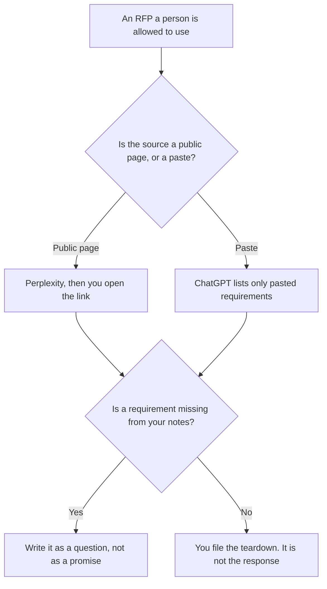

**Use Perplexity when the teardown has to cite a public RFP section or a vendor page you still open. Use ChatGPT when the RFP is a document you paste, and the teardown may use only that paste.** The model may list requirements that are in the source, mark a gap you define, and format questions. It may not add a requirement, a price, or a promise that you will comply. Researching the market around an RFP is [Perplexity vs ChatGPT for RFP research](/blog/perplexity-vs-chatgpt-for-rfp-research-2026/). Writing the response, after a person decides what you will commit to, is [how to write an RFP response with AI](/blog/how-to-write-a-rfp-response-with-ai-2026/).

Perplexity and Notion prices are from directory pages checked October 16, 2026. ChatGPT Plus is $20 a month on the October 24 Codex plan page. Claude's prices are from claude.com/pricing on October 24, 2026. Published October 24, 2026. We did not score proposals. This page is not procurement advice.

## Which teardown you are writing

| The source | Start here | First paid step | The limit |
|---|---|---|---|
| A public RFP or a vendor page, with a link you open | [Perplexity](/tools/perplexity/) | Pro is $17 a month billed annually | The citation is the check. A snippet is not the section |
| An RFP file you are allowed to paste | [ChatGPT](/tools/chatgpt/) | Plus is $20 a month | No requirement that is not in the paste |
| A standing teardown format | [Claude](/tools/claude/) | Pro is $17 a month billed annually, $200 up front, or $20 monthly | The Project holds the headings. It does not bid |
| The page the team will mark up | [Notion AI](/tools/notion-ai/) | Business is $20 a seat a month | The chat is not the bid file |

A teardown that says "we fully comply" has skipped the bid. Compliance is a person's sentence, on the response, after they have read the section. Vendor diligence on a company, which is a different read, is [Perplexity vs Gemini for vendor diligence](/blog/perplexity-vs-gemini-for-vendor-diligence-2026/).

## What the teardown may contain

The requirement id or the heading from the source, the sentence you quoted, and a status you defined: in the paste, not in the paste, or unclear. A status of "easy win" is not a status. Delete it.

**Perplexity Pro** is the public-source path. Free exists with limited weekly usage of top models, on the October 16 card. Open the link and write the date you opened it. The invoice is [Perplexity pricing explained](/blog/perplexity-pricing-explained-2026/).

**ChatGPT Plus** is the closed-document path. Do not turn on a browse that fetches a different RFP and mixes the requirements. Go at $8 a month is on the October 24 plan page. Plus is the seat for a long paste. The review is [ChatGPT review](/blog/chatgpt-review-2026/).

**Claude Pro** is the format you reuse: the same columns every time. It does not make the bid more true. The review is [Claude review](/blog/claude-review-2026/).

**Notion Business** is the working page. The submitted response, if you submit one, is a file a person owns.

A prompt that holds the line:

"Tear down this RFP using only the text I pasted or the links I opened. Quote the requirement. If our notes do not address it, write Not in notes. Do not write that we comply. Do not add a price."

## What not to delegate

Do not paste a confidential RFP into a personal account your policy forbids. Do not ask which vendor will win. Do not let the teardown become the response by adding adjectives.

## FAQ

### Which one finds more requirements?

We did not measure that. Perplexity fits a public page you can open. ChatGPT fits a document you paste and do not want mixed with the web. The teardown is done when every line cites a section a person can find.

### How is this different from RFP research?

Research is the market and the background around a bid. A teardown is the requirement list from the RFP itself. Mixing them is how a competitor's feature becomes "a requirement" the buyer did not write.

### Can the model draft the answers?

Only after a person has marked which requirements you will answer, and with what fact. That draft is the response article. This page stops at the list and the gaps.

### Who may send the teardown to a buyer?

Nobody, unless your process says the teardown is an external document. It is usually internal. A clean table is not a proposal.

## Last verified

October 24, 2026 for ChatGPT Plus and Claude. October 16, 2026 for Perplexity and Notion. Published October 24, 2026.

**Sources:** [Perplexity pricing](https://www.perplexity.ai/pro), [ChatGPT and Codex pricing](https://learn.chatgpt.com/docs/pricing), [Claude pricing](https://claude.com/pricing), [Notion pricing](https://www.notion.com/pricing).

*Published by Andrew for [AI Tools Optimizer](https://aitoolsoptimizer.com).*

[Perplexity](/tools/perplexity/) is in the [research and search directory](/tools/category/research-search/). Directory pages may use affiliate links. A purchase through them may earn us a commission at no extra cost to you.
