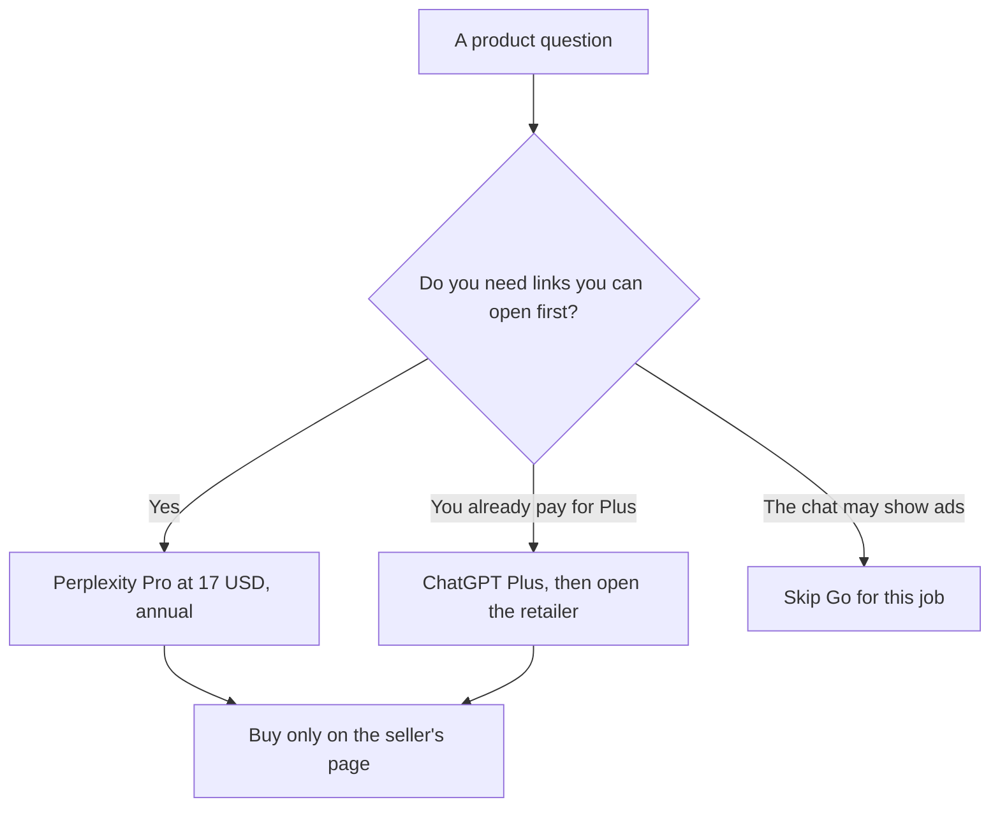

**Use Perplexity Pro, $17 a month billed annually, when the shopping question needs a source you can open before you buy. Use ChatGPT Plus at $20 when you already live in ChatGPT and you will still open the retailer page yourself.** Neither subscription is a price guarantee. A model sentence that names a dollar, a coupon, or a review score is a lead. The page with the add-to-cart button is the price.

The seat math, without the shopping job, is [Perplexity Pro vs ChatGPT Plus](/blog/perplexity-pro-vs-chatgpt-plus-cost-2026/). The research habit for papers and reports is [ChatGPT vs Perplexity for research](/blog/chatgpt-vs-perplexity-for-research-2026/). A confident unsourced detail is [what an AI hallucination is](/blog/what-is-ai-hallucination-2026/).

Prices are US list prices excluding tax from directory pages checked October 16, 2026. Perplexity's card lists annual rates and says monthly billing costs more, without a monthly dollar this page should invent. Published October 24, 2026. We did not score which product either tool recommends.

## What you are comparing

| | [Perplexity](/tools/perplexity/) | [ChatGPT](/tools/chatgpt/) |
|---|---|---|
| Free | Limited weekly usage of top models | Unlimited text chats on the directory card, with limited tools |
| The step most shoppers mean | Pro, $17 a month billed annually. Model choice, files, and premium data such as PitchBook and Statista on the card | Plus, $20 a month. Projects, deeper research limits, and custom GPTs |
| A heavier personal plan | Max, $167 a month billed annually | Pro at $100, $200, or $500 |
| Ads | Not listed as part of Pro on the card we used | Go at $8 may include ads, on the directory note. A poor default for comparing products |
| What to do with a price | Open the citation, then the retailer | Open the source the answer used, then the retailer |
| What the subscription does not include | The item, the tax, or the return policy | The item, the tax, or the return policy |

A year of Perplexity Pro at the recorded annual rate is 12 × $17 = $204. A year of ChatGPT Plus is 12 × $20 = $240. The $36 gap does not make either one a buying agent. Go at $8 is $96 a year and may include ads. If the answer sits next to an ad, you are no longer only comparing sources.

## How to research a purchase without inventing a deal

**A spec you can check.** Ask for the manufacturer's page and one retailer, then read both. Perplexity's product is an answer with citations. Pro adds model choice and, on the card, premium data sources that matter more for company research than for a toaster. The review is [Perplexity review](/blog/perplexity-review-2026/).

**A spreadsheet of constraints you already wrote.** Price ceiling, size, and the feature you will not compromise. [ChatGPT](/tools/chatgpt/) Plus can hold that list in a Project. It may not add a discount that was not on the page. The project comparison is [Claude Projects vs ChatGPT Projects](/blog/claude-projects-vs-chatgpt-projects-2026/).

**A second opinion on a long buyer's guide you paste.** [Claude](/tools/claude/) Pro is $20 a month, or $17 billed annually. Paste the guide. Ask for claims that lack a source in the paste. That is editing, not a new search. The writing pair is [ChatGPT vs Claude for writing](/blog/chatgpt-vs-claude-for-writing-2026/).

**You already pay for Google.** [Gemini](/tools/gemini/) is free with a Google account. Google AI Plus is $4.99 a month. That can be enough for a casual comparison inside mail and docs, and it is a different article: [Gemini vs ChatGPT for Google Workspace](/blog/gemini-vs-chatgpt-for-google-workspace-2026/).

Write down the date you checked the price. Shopping pages change. A citation from last week is a stale shelf.

## FAQ

### Can either tool buy the item?

Do not give a model a card, a login, or permission to check out. Use it to gather pages. You place the order on the seller's site, where the return policy is visible.

### Is Pro required for citations?

Perplexity's free plan still answers with sources, with limited weekly usage of top models on the directory card. Pro is the step when you hit that limit or you want the paid features on the card. Free is a fair test for one purchase.

### Should I trust a "best of" list?

Trust the rows you can open. A ranked list with no links is a draft outline. The check is [how to fact-check AI writing](/blog/how-to-fact-check-ai-writing-2026/).

### What about reviews and star ratings?

Open the review source. A model that says "users love it" without a page is not a rating. We do not republish star ratings from a chat.

## Last verified

October 16, 2026 for Perplexity, ChatGPT, Claude, and Gemini. Published October 24, 2026.

**Sources:** [Perplexity pricing](https://www.perplexity.ai/hub/pricing), [ChatGPT pricing](https://chatgpt.com/pricing/), [Claude pricing](https://claude.com/pricing).

*Published by Andrew for [AI Tools Optimizer](https://aitoolsoptimizer.com).*

[Perplexity](/tools/perplexity/) is in the [research and search directory](/tools/category/research-search/). Directory pages may use affiliate links. A purchase through them may earn us a commission at no extra cost to you.
