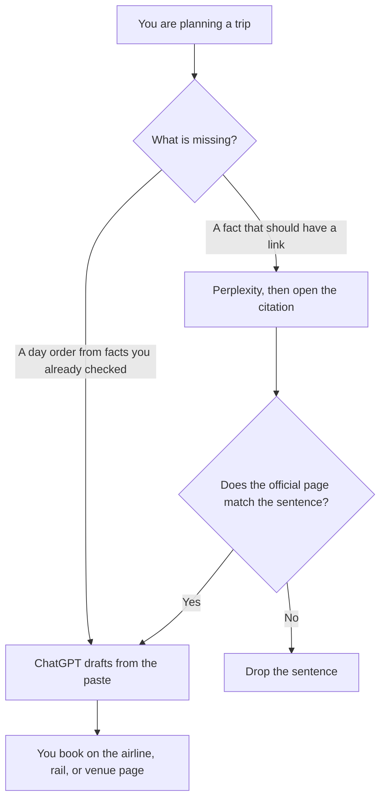

**Use Perplexity when the travel question needs a page you can open: a visa rule, a museum hour, a fare condition. Use ChatGPT when you already have those facts and you want a day-by-day draft from constraints you paste.** A draft itinerary is not a booking. The ChatGPT-versus-Gemini version of the same trip, which is a different pair, is [ChatGPT vs Gemini for travel planning](/blog/chatgpt-vs-gemini-for-travel-planning-2026/). The habit of checking a cited sentence is [Perplexity vs ChatGPT for fact checks](/blog/perplexity-vs-chatgpt-for-fact-checks-2026/).

Prices are US list prices excluding tax from directory pages checked October 16, 2026. The directory says Perplexity monthly billing costs more than the annual figure and does not print that monthly dollar here. Published October 24, 2026. We did not score itineraries. We did not book a trip.

## Which question you actually have

| The question | Start here | First paid step | What you still open |
|---|---|---|---|
| What does the official page say, with a link | [Perplexity](/tools/perplexity/) Free | Pro is $17 a month billed annually | The page the citation names |
| Turn dates, budget, and cities I pasted into a draft | [ChatGPT](/tools/chatgpt/) | Plus is $20 a month, with Projects | Every hour and price in the draft |
| The same draft next to Gmail and a Google Doc | [Gemini](/tools/gemini/) | Google AI Pro is $19.99 a month | The same official pages |
| A copy of the plan the group can edit | [Notion AI](/tools/notion-ai/) | Business is $20 a seat a month | The plan, after the facts survive |

Perplexity Max is $167 a month billed annually on the directory card. A vacation plan does not need Max. ChatGPT Go is $8 a month. A plan you will book from is a poor place to discover a limit mid-draft. Plus is the seat if this is a real trip. The ChatGPT review is [ChatGPT review](/blog/chatgpt-review-2026/).

## What each seat is for

**Perplexity Pro** is the cited lookup. Free can answer with citations and limited weekly usage of top models. Pro adds the higher limits and the extras on the pricing article. The invoice is [Perplexity pricing explained](/blog/perplexity-pricing-explained-2026/). A citation that points at a blog repeating another blog is not the venue. Follow the link until you hit the page that can change the hour.

**ChatGPT Plus** holds the constraints in a Project: dates, who is going, the budget you wrote, and the facts you already checked. Ask for a draft. Delete any hour, price, or visa line that was not in your paste. A confident closure is a rumor until the venue says it. That failure has a name: [what an AI hallucination is](/blog/what-is-ai-hallucination-2026/).

**Gemini** belongs in this table when the trip mail already lives in Gmail and the notes already live in a Doc. The travel comparison against ChatGPT is the other article. Do not run three chats and merge them by vibe.

**Notion** is where the surviving plan goes if more than one person will edit it. The chat is not the itinerary the group follows.

A prompt that holds the line:

"Draft a day order from the dates, cities, and checked facts I pasted. If a fact is not in the paste, write Missing. Do not add an opening hour, a price, or a visa rule."

## What not to delegate

Do not ask either tool to book. Do not paste passport numbers, full card numbers, or booking codes into a chat so the plan "feels real." A redacted constraint is enough. The removal step is [what AI PII redaction is](/blog/what-is-ai-pii-redaction-2026/).

## FAQ

### Which one plans a better trip?

We did not measure that. Perplexity is the lookup with a link. ChatGPT is the draft from constraints you already trust. The trip is better when you open the official page before you pay.

### Is Perplexity Pro $17 a month?

On the directory card checked October 16, 2026, Pro is $17 a month billed annually. The same card says monthly billing costs more and points you at the pricing page for that rate. Quote checkout if the two differ.

### Do I still need the ChatGPT versus Gemini article?

Yes, if you are choosing between those two chats for the draft. This page is the step before the draft: get a citation, open it, then write the days.

### Can I skip the official page if both tools agree?

Agreement is two sentences. The page that sells the ticket is the record. If the tools agree and the venue disagrees, the venue wins.

## Last verified

October 16, 2026 for Perplexity, ChatGPT, Gemini, and Notion. Published October 24, 2026. Hours, visas, and fares change. The page you will pay is the record.

**Sources:** [Perplexity pricing](https://www.perplexity.ai/hub/pricing), [ChatGPT pricing](https://chatgpt.com/pricing/), [Google AI subscriptions](https://gemini.google/subscriptions/), [Notion pricing](https://www.notion.com/pricing).

*Published by Andrew for [AI Tools Optimizer](https://aitoolsoptimizer.com).*

[Perplexity](/tools/perplexity/) is in the [research and search directory](/tools/category/research-search/). Directory pages may use affiliate links. A purchase through them may earn us a commission at no extra cost to you.
