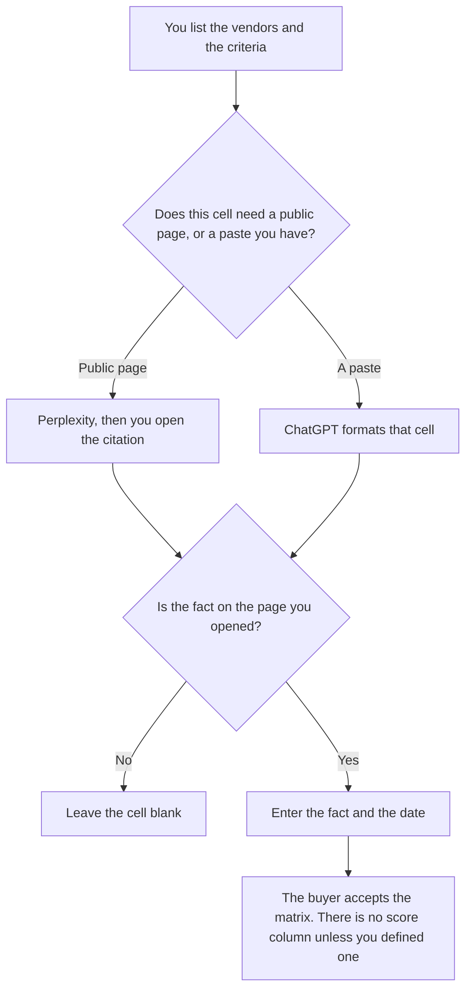

**Use Perplexity when a cell in the vendor matrix needs a public page you can open. Use ChatGPT when you are formatting the matrix from pages and notes you already pasted.** The columns are the criteria you wrote before either tool runs. A blank cell stays blank when the source is silent. The open-ended gather, before you have columns, is [Perplexity vs ChatGPT for vendor research](/blog/perplexity-vs-chatgpt-for-vendor-research-2026/). A narrative about one rival is [Perplexity vs ChatGPT for competitor briefs](/blog/perplexity-vs-chatgpt-for-competitor-briefs-2026/).

Perplexity's Pro price is the October 16 directory card. ChatGPT's Plus price is from learn.chatgpt.com/docs/pricing on October 24, 2026. Claude's prices are from claude.com/pricing that day. Notion is the October 16 card. Published October 24, 2026. We did not rank vendors.

## Which cell you are filling

| The job | Start here | First paid step | The limit |
|---|---|---|---|
| A public page for one cell | [Perplexity](/tools/perplexity/) | Pro is $17 a month billed annually | Open the page. Copy only the fact you can point at |
| The grid, from pastes | [ChatGPT](/tools/chatgpt/) | Plus is $20 a month | No column you did not name. No winner |
| The same column names next quarter | [Claude](/tools/claude/) | Pro is $17 a month billed annually, or $20 monthly | The Project keeps names. It does not pick a vendor |
| The matrix the buyer reopens | [Notion AI](/tools/notion-ai/) | Business is $20 a seat a month | The page is the record |

A comparison that declares a winner has left the job. If you want a score, you write the formula first, the way a grounding score has to be written before anyone computes it. This page does not supply a formula. Enterprise prices, when a row is a company plan, stay in the vendor's own pricing article. Do not convert a euro price into dollars.

Perplexity's October 16 card also lists Enterprise Pro at $40 a user a month, or $400 a year, and Enterprise Max at $325 a user a month, or $3,250 a year. Those are Perplexity's seats, not a discount on the vendor you are comparing. The review is [Perplexity review](/blog/perplexity-review-2026/).

ChatGPT Business is $25 a user a month billed monthly, for two or more users, on the October 24 plan page, when the matrix is company data. The annual figure of $20 is recorded in [ChatGPT Team pricing explained](/blog/chatgpt-team-pricing-explained-2026/). The review is [ChatGPT review](/blog/chatgpt-review-2026/).

## What the matrix is allowed to contain

Vendors you named, criteria you named, a fact, a source, and the date you opened it. A criterion the model thinks is important stays out until you add it yourself. A price cell uses the currency on the page.

**Perplexity Pro** fills a cell from a citation you open. A homepage is not a pricing cell. If the pricing page will not load, the cell says Page not opened.

**ChatGPT Plus** formats rows from your paste. A version that adds a "best for" column is the version you delete.

**Claude Pro** keeps the criteria spelled the same way across matrices. The review is [Claude review](/blog/claude-review-2026/). The diligence pass on files you already hold, with Gemini in the other seat, is [Perplexity vs Gemini for vendor diligence](/blog/perplexity-vs-gemini-for-vendor-diligence-2026/).

**Notion Business** stores the accepted matrix. The invoice is [Notion AI pricing explained](/blog/notion-ai-pricing-explained-2026/).

A prompt that holds the line:

"Fill this vendor matrix only for the vendors and criteria I listed. If a cell is not in the source I pasted, leave it blank. Do not add a score. Do not name a winner. Do not convert currency."

## What not to delegate

Do not ask which vendor to buy. Do not paste a private quote into a personal chat and then treat the summary as shareable. Do not send the matrix because every cell is full. Full cells are a reason to check what was invented. The buyer accepts it.

## FAQ

### How is this different from vendor research?

Research is the gather: open the link, then format what you found. A comparison is the matrix you defined, with criteria fixed in advance. Research can supply a cell. It does not add a column.

### How is this different from a competitor brief?

A brief is a narrative about a rival. A comparison is a grid across vendors you chose, including ones that are not rivals in a story. The brief can quote one row. It is not the grid.

### Do I need both tools?

You need Perplexity when the cell is a public page, and ChatGPT when the cell is a paste. Using both on the same cell and merging them is how two dates land in one box. One source per cell.

### Who may add a vendor?

The buyer. A model that suggests a third vendor has made a proposal. Put it under Proposed, not in the matrix, until you add the row yourself.

## Last verified

October 16, 2026 for Perplexity and Notion. October 24, 2026 for ChatGPT's plan page and for Claude. The ChatGPT Business annual dollar is the same-day Team article. Published October 24, 2026.

**Sources:** [Perplexity](https://www.perplexity.ai/), [ChatGPT and Codex pricing](https://learn.chatgpt.com/docs/pricing), [Claude pricing](https://claude.com/pricing), [Notion pricing](https://www.notion.com/pricing).

*Published by Andrew for [AI Tools Optimizer](https://aitoolsoptimizer.com).*

[Perplexity](/tools/perplexity/) is in the [research and search directory](/tools/category/research-search/). Directory pages may use affiliate links. A purchase through them may earn us a commission at no extra cost to you.
