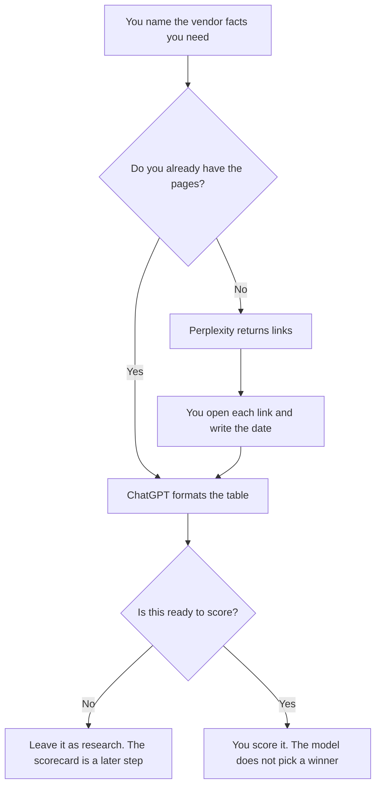

**Use Perplexity when you need a source link and a date you will open before the fact enters a comparison. Use ChatGPT when you are formatting evidence you already collected into a table.** Both can sound sure about a vendor's price or certification. Only a page you opened, with the date you opened it, belongs in the notes.

Watching rivals on a schedule is [Perplexity vs ChatGPT for competitor scans](/blog/perplexity-vs-chatgpt-for-competitor-scans-2026/). The internal table with weights is [how to write a vendor scorecard with AI](/blog/how-to-write-a-vendor-scorecard-with-ai-2026/). A stale pricing page is [what retrieval freshness is](/blog/what-is-retrieval-freshness-2026/).

Prices are US list prices excluding tax from directory pages checked October 16, 2026. Published October 24, 2026. We did not score research quality. This page is not a security review.

## Which seat matches the packet

| The research you actually need | Start here | What you still do |
|---|---|---|
| A first pass with links to pricing or docs | [Perplexity](/tools/perplexity/) Free, within the weekly limit | Open every link you will quote. Write the date |
| Premium sources and more room | Perplexity Pro at $17 a month billed annually | PitchBook or Statista on that plan is still a source you open |
| The packet is confidential and needs an org plan | Enterprise Pro at $40 per user a month, or $400 a year | Read the current data terms. This page does not summarize them |
| You already have quotes, links, and dates in a doc | [ChatGPT](/tools/chatgpt/) Plus at $20 a month | The model formats. It does not add a price |
| One short table from a paste | ChatGPT Free or Perplexity Free | Same rule. Missing stays Missing |
| The signed notes live in the wiki | [Notion AI](/tools/notion-ai/) Business at $20 a seat a month | The page is the record |

Perplexity Max is $167 a month billed annually. ChatGPT Pro starts at $100. Vendor research for one purchase does not need either. ChatGPT Go at $8 may include ads. Do not cite an ad as a vendor's feature.

## What the notes should contain

A vendor-research note has the claim, the URL, the date you opened it, and a quote short enough to check. It does not have a SOC report the model remembers, an uptime percentage, or a price from training data. If the page does not state it, write Missing and ask the vendor.

**Perplexity Pro** is the right paid seat when the job is finding the page. Citations are the product. A citation you did not open is a lead, not evidence. The review is [Perplexity review](/blog/perplexity-review-2026/). The market-research habit is [how to use Perplexity for market research](/blog/how-to-use-perplexity-for-market-research-2026/).

**ChatGPT Plus** is the right paid seat when the evidence is already in a paste and you want a clean table for a meeting. Projects hold the template. The review is [ChatGPT review](/blog/chatgpt-review-2026/). A second pass on a long packet can sit in [Claude](/tools/claude/) Pro at $20 a month, or $17 billed annually, in a Project. Claude does not replace the link.

A prompt that holds the line:

"Make a table from the quotes, URLs, and dates I pasted. Columns are claim, source, date, and gap. Do not add a claim. If I marked a cell Missing, leave it. Do not name a winner. Do not invent a price."

## What not to delegate

Do not ask which vendor to buy. Do not paste a customer's data so the model can judge a fit. Do not treat a competitor scan as a security questionnaire. The scorecard comes after the evidence. The purchase comes after a person signs the scorecard.

The order of those passes, if you build your own retrieval, is [what retrieval reranking is](/blog/what-is-retrieval-reranking-2026/). You do not need to build that to open a pricing page.

## FAQ

### Which one is more accurate on vendor facts?

We did not measure accuracy. Perplexity is how you get a link. ChatGPT is how you format links you opened. The accurate cell is the one that matches the page on the date you wrote down.

### Can I research five vendors in one prompt?

Yes, as a search for links. Quote them one at a time after you open the pages. A blended paragraph will mix a feature from one vendor into another. The table keeps them apart.

### Is this the same as a competitor scan?

A competitor scan watches rivals you sell against. Vendor research documents a supplier you might pay. The cadence and the sources differ. Use the scan article for rivals. Use this page for suppliers.

### What if the pricing page is behind a login?

Write Missing and ask sales. A model guess is not a quote. Put the quote you receive, with the date, in the evidence column.

## Last verified

October 16, 2026 for Perplexity, ChatGPT, Claude, and Notion AI. Published October 24, 2026.

**Sources:** [Perplexity Pro](https://www.perplexity.ai/pro), [ChatGPT pricing](https://chatgpt.com/pricing/), [Claude pricing](https://claude.com/pricing), [Notion pricing](https://www.notion.com/pricing).

*Published by Andrew for [AI Tools Optimizer](https://aitoolsoptimizer.com).*

[Perplexity](/tools/perplexity/) is in the [research and search directory](/tools/category/research-search/). Directory pages may use affiliate links. A purchase through them may earn us a commission at no extra cost to you.
