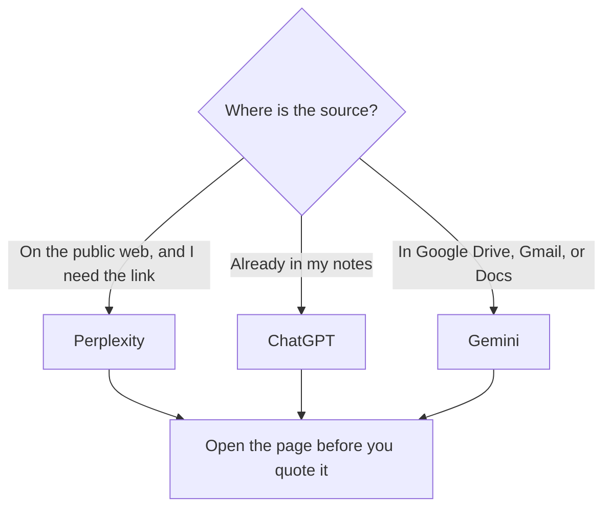

**Use Perplexity when the search result has to be a claim with a link. Use ChatGPT when you already hold the sources and need a draft. Use Gemini when the work continues in Gmail, Docs, or a Google file.** All three can sound like search. They bill for different jobs. A link you do not open is a rumor with formatting.

The research version of the ChatGPT and Perplexity split is [ChatGPT vs Perplexity for research](/blog/chatgpt-vs-perplexity-for-research-2026/). This page adds Gemini and stays on search: finding a public page, a number, or a file, and knowing which product is supposed to show it.

Prices are US list prices excluding tax. Perplexity's ladder is the one recorded in the October 24, 2026 pricing article. ChatGPT and Gemini prices are from directory pages checked October 16, 2026. Published October 24, 2026. We did not score answer quality.

## The search job

| You need | Start here | Why this one | Price to know |
|---|---|---|---|
| What a company published, with a link | [Perplexity](/tools/perplexity/) | The product is built to attach sources. You still open them | Pro is $17/month billed annually. Max is $167 billed annually |
| A rewrite of sources you pasted | [ChatGPT](/tools/chatgpt/) | The thread is the workspace. Search is optional and easy to skip | Go is $8. Plus is $20. Pro starts at $100 |
| A file in Drive, or a draft that should become a Doc | [Gemini](/tools/gemini/) | Higher Google AI plans put Gemini in Gmail and Docs | Plus is $4.99/month. Pro is $19.99/month |
| A packet of files you uploaded for one project | [Gemini Notebook](/tools/gemini-notebook/) | The corpus is the upload, and the chat stays on it | Free, with higher limits from $4.99/month |
| A scholarly claim | [Consensus](/tools/consensus/) | The corpus is papers | Pro is $12/month billed annually, or $20 monthly |

Perplexity's plan math is [Perplexity pricing explained](/blog/perplexity-pricing-explained-2026/). ChatGPT's ladder is [ChatGPT Go vs Plus vs Pro](/blog/chatgpt-go-vs-plus-vs-pro-2026/). The habit of checking the page is [how to fact-check AI writing](/blog/how-to-fact-check-ai-writing-2026/).

## What each subscription is for

**Perplexity** is the search product in this trio. Free includes limited weekly use of top models. Pro at $17 a month billed annually adds Perplexity Computer, file and app connectors, and model choice. Max at $167 billed annually is a usage tier, with 10,000 monthly credits on the card we recorded. Enterprise Pro is $40 per user per month. Buy Pro when you search often enough that the weekly free cap stops a workday. Buy Max when that usage number is the constraint you already hit. A Pro seat does not make an unopened citation true.

**ChatGPT** will answer a search-shaped question inside the same thread you use for drafting. That convenience is the risk. The reply can mix a remembered fact, a pasted note, and a looked-up line. Plus at $20 adds projects, which is the right place to keep a set of sources for one topic. Go at $8 is the cheaper entry, and the directory page notes that Go may include ads. For a search you will quote, require links and open them, or start in Perplexity and paste the kept sources into ChatGPT for the draft.

**Gemini** is the search that should meet you inside Google. Free covers the Gemini app with the limits on that plan. Google AI Plus at $4.99 is the small step up, including more usage and 200 Flow credits. Google AI Pro at $19.99 lists Gemini in Gmail and Docs on the directory card checked October 16, 2026. Buy Pro when the search result has to become a Doc or an email in that suite. Buy Perplexity when the result is a link your reader must be able to audit outside Google. Gemini Notebook is the upload case: a syllabus, a packet, a folder. It is a weak tool for "what is the live price on a vendor site," because the corpus is what you uploaded.

## A week of search, without three paid seats

Most people need one paid search habit. If your output is a memo with links, pay for Perplexity Pro and use a free chat to draft from the links you kept. If your output is a Google Doc built from files you already have, pay for Google AI Pro and use Perplexity's free tier for the occasional public page. If your output is a draft and the facts came from a call or a brief, pay for ChatGPT Plus and paste the source. A stack of Pro plus Plus plus Google AI Pro is $17 + $20 + $19.99, about $57 before tax, for three windows onto work one window could hold.

Papers are the exception. Consensus is the search over studies. The paired workflow is [how to research with Elicit and Consensus](/blog/how-to-research-with-elicit-and-consensus-2026/).

## FAQ

### Is Gemini a Perplexity alternative for web search?

It can answer questions about the web. Perplexity is still the product in this set whose default shape is a sourced answer. Use Gemini when the next step is a Google file. Use Perplexity when the next step is a link in a document someone else will audit.

### Do I need ChatGPT Pro to search?

No. Pro starts at $100 and is a usage tier for heavy model use. Search discipline is a habit on Plus, on Go, and on the free tier: ask for the link, then open it. Pay for a higher ChatGPT plan when the cap blocks drafting you already do.

### Which one should a team standardize on?

Standardize on the corpus. A team that lives in Google Workspace will get more from Gemini on a plan that includes the apps. A team that publishes claims about the market will get more from Perplexity, with a rule that a claim needs an opened source. ChatGPT remains the draft after either search.

### Can I trust the first citation?

You can open it. Trust is the sentence on the page, matched to the sentence in the answer. A retrieval-style chat still adds words. That pattern is [what retrieval-augmented chat is](/blog/what-is-retrieval-augmented-chat-2026/).

## Last verified

October 24, 2026 for the Perplexity figures as recorded in the pricing article. October 16, 2026 for ChatGPT, Gemini, Gemini Notebook, and Consensus. Published October 24, 2026.

**Sources:** [Perplexity Pro](https://www.perplexity.ai/pro), [OpenAI ChatGPT pricing](https://openai.com/chatgpt/pricing/), [Google AI plans](https://gemini.google/subscriptions/).

*Published by Andrew for [AI Tools Optimizer](https://aitoolsoptimizer.com).*

[Perplexity](/tools/perplexity/) is in the [research directory](/tools/category/research-search/). [ChatGPT](/tools/chatgpt/) and [Gemini](/tools/gemini/) are in the [chatbots directory](/tools/category/chatbots-assistants/). Directory pages may use affiliate links. A purchase through them may earn us a commission at no extra cost to you.
