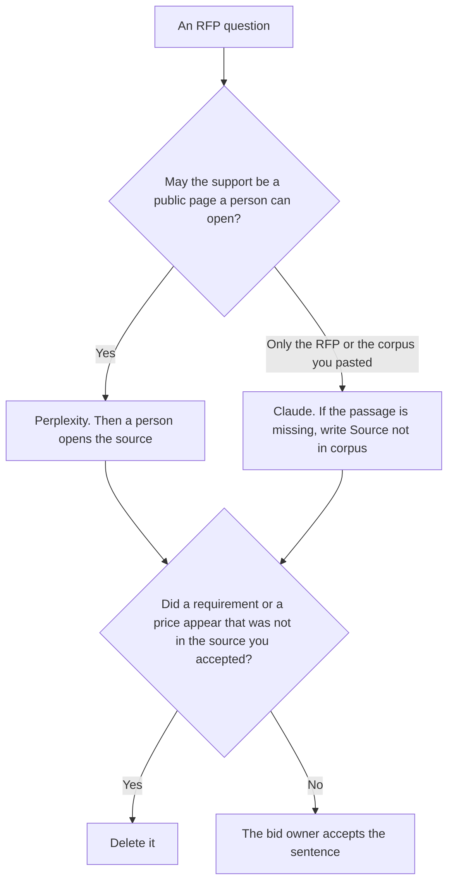

**Use Perplexity when the RFP question needs a public source a person can open, and you will open it before the sentence goes into a response. Use Claude when the answer must come only from the RFP and the corpus you pasted, and a web result would be the wrong source.** The model may quote. It may not invent a requirement, a price, or a compliance claim.

The same job against ChatGPT, which is a different cut, is [Perplexity vs ChatGPT for RFP research](/blog/perplexity-vs-chatgpt-for-rfp-research-2026/). The rule that a claim without a source does not ship is [what AI grounding citation-required is](/blog/what-is-ai-grounding-citation-required-2026/).

Perplexity's prices are the October 24, 2026 pricing-page read recorded in [Perplexity pricing explained](/blog/perplexity-pricing-explained-2026/). Claude's prices are the October 24 read of claude.com/pricing recorded in [Claude pricing explained](/blog/claude-pricing-explained-2026/). Notion is the October 16 directory card. ChatGPT's Plus price is the October 24 plan-page figure recorded in [ChatGPT pricing explained](/blog/chatgpt-pricing-explained-2026/). Published October 24, 2026. We did not score proposals.

## Which source the question allows

| The question | Start here | First paid step | The limit |
|---|---|---|---|
| A public fact the response may cite | [Perplexity](/tools/perplexity/) | Pro is $17 a month billed annually | Open the source. A citation you did not open is not support |
| A requirement that must come from the RFP or your corpus | [Claude](/tools/claude/) | Pro is $17 a month billed annually, or $20 monthly | No web substitute for a missing passage |
| The response page, with the source linked | [Notion AI](/tools/notion-ai/) | Business is $20 a seat a month | The page does not invent the requirement |
| A draft paragraph after the source is accepted | [ChatGPT](/tools/chatgpt/) | Plus is $20 a month | It is not the research step on this page |

Perplexity Pro at $17 a month billed annually is the personal research seat on the October 24 read. Max is $167 a month billed annually. Enterprise Pro is $40 a user a month, $400 a year, on that same article. You do not need Enterprise to open a public page. You need Enterprise when the company requires the admin seat. The product attaches citations. Your rule still says a person opens them. A dead link is Citation not met.

Claude is the seat when the issuer's PDF and your security appendix are the only allowed sources. A helpful web page about "typical RFP language" is out of scope. If the corpus does not answer, the line says Source not in corpus. It does not get a plausible control.

The ChatGPT comparison is about cited search versus a general assistant. This page is about whether the allowed source is the public web or a closed paste. ChatGPT Plus can still format a sentence after the source is accepted. It is not how you decide the source.

## What the research note is allowed to contain

The question, the source you opened or the passage you pasted, and the sentence that matches it. A capability you hope to have by the due date stays out. A price that was not in the source stays out. The response workflow after the facts exist is [how to write an RFP response with AI](/blog/how-to-write-a-rfp-response-with-ai-2026/).

**Perplexity Pro** is the public source. The invoice is [Perplexity pricing explained](/blog/perplexity-pricing-explained-2026/).

**Claude Pro** is the closed corpus. The review is [Claude review](/blog/claude-review-2026/).

**Notion Business** holds the accepted sentence and the link. The invoice is [Notion AI pricing explained](/blog/notion-ai-pricing-explained-2026/).

A prompt that holds the line:

"Answer this RFP question only from the source I allowed. Put the location a person can open. If the source is silent, write Source not in corpus. Do not add a requirement. Do not add a price."

## What not to delegate

Do not let the model decide the bid is compliant. Do not swap a missing passage for a web result when the rule was the corpus. Do not paste an unopened citation into the response. The bid owner accepts the sentence.

## FAQ

### How is this different from Perplexity vs ChatGPT for RFP research?

That page is cited search against a general chat draft. This page is public sources against a closed corpus. Claude is here because the corpus must not be supplemented. ChatGPT can still format the sentence after you accept the source.

### How is this different from citation-required as a product mode?

A mode can attach a link or refuse. Your RFP rule can be stricter: only this PDF, or only sources a person opened. The rule page is [what AI grounding citation-required is](/blog/what-is-ai-grounding-citation-required-2026/). A mode does not sign the response.

### When is Enterprise Perplexity the seat?

When you need the admin seat the pricing article records at $40 a user a month, $400 a year. A single researcher opening public pages can stay on Pro at $17 a month billed annually. The Enterprise page is [Perplexity Enterprise pricing explained](/blog/perplexity-enterprise-pricing-explained-2026/).

### Who may put a sentence in the response?

The bid owner, after the source is opened or the corpus passage is checked. Source not in corpus stays out of the response. A formatted answer is not a commitment.

## Last verified

October 24, 2026 for Perplexity, Claude, and ChatGPT's plan page, via the posts cited above. October 16, 2026 for Notion. Published October 24, 2026.

**Sources:** [Perplexity pricing](https://www.perplexity.ai/pro), [Claude pricing](https://claude.com/pricing), [Notion pricing](https://www.notion.com/pricing), [ChatGPT and Codex pricing](https://learn.chatgpt.com/docs/pricing).

*Published by Andrew for [AI Tools Optimizer](https://aitoolsoptimizer.com).*

[Perplexity](/tools/perplexity/) is in the [research and search directory](/tools/category/research-search/). Directory pages may use affiliate links. A purchase through them may earn us a commission at no extra cost to you.
