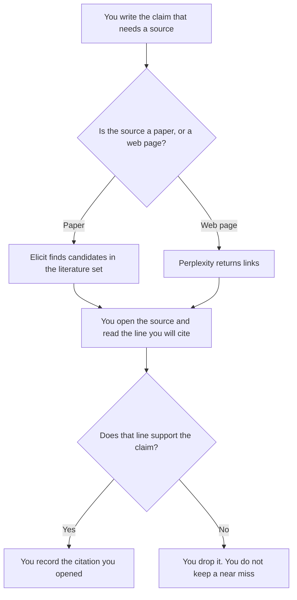

**Use Elicit when the citation has to be a paper in a literature set. Use Perplexity when the citation is a web source for a working question, and you will open it before you repeat it.** A citation the model named, that you cannot open, is not a citation. It is a rumor with punctuation. We did not score which product cites more accurately.

The broader research pair is [Perplexity vs Elicit for research](/blog/perplexity-vs-elicit-for-research-2026/). The paper workflow with a second academic tool is [how to research papers with Elicit and Consensus](/blog/how-to-research-with-elicit-and-consensus-2026/). The invoices are [Elicit pricing explained](/blog/elicit-pricing-explained-2026/) and [Perplexity pricing explained](/blog/perplexity-pricing-explained-2026/).

Prices are US list prices excluding tax from directory pages checked October 16, 2026. Published October 24, 2026. Opening a link is the check. A vendor's claim that answers are cited is not a score from us.

## Which citation, which seat

| The source you need | Start here | First paid step | What you still do |
|---|---|---|---|
| A paper, with authors and a place you can read | [Elicit](/tools/elicit/) Basic, free for unlimited paper search | Plus is $11 per user per month billed annually. The card also lists higher rates. Confirm checkout | You open the paper. A title in a table is not a quote |
| A web page, a doc, or a recent announcement | [Perplexity](/tools/perplexity/) Free | Pro is $17 a month billed annually | You open the citation. If it does not say the thing, you drop it |
| A claim about what the literature finds, across many papers | Elicit Pro at $39 per user per month billed annually, the tier the card ties to systematic review | Scale is $89 on that same annual framing | Screening is a method. The model does not replace the method you wrote |
| A second look at peer-reviewed answers | [Consensus](/tools/consensus/) Free, with limited Pro messages | Pro is $12 a month on the $144 annual plan, or $20 monthly | Still open the paper. The invoice is [Consensus pricing explained](/blog/consensus-pricing-explained-2026/) |
| A paragraph you will publish, after the sources are real | [Claude](/tools/claude/) Pro at $20 a month, or $17 billed annually | The Project holds the sources you uploaded | The model may format. It may not add a citation |

Perplexity Max is $167 a month billed annually, on the October 16 card. A citation habit does not need Max. Elicit's directory card says Plus, Pro, and Scale are $11, $39, and $89 per user per month billed annually, and that Elicit also lists higher rates such as $49 and $169. This page does not guess which number is monthly. Use the figure on the checkout you are looking at.

## What counts as a citation here

A citation is a source you opened, that contains the claim, with enough detail for someone else to open it too. A footnote the model formatted is not that, until you have done the opening. A paper that is about a nearby topic is not support. Quote, or paraphrase, only what you read.

**Elicit** is the seat when the work is literature: search, a table of papers, and extraction into columns you defined. Free covers unlimited search, summaries, and chat with papers, with limits on agent and report use, on the October 16 card. The product review is [Elicit review](/blog/elicit-review-2026/).

**Perplexity** is the seat when the question is on the web and every answer should arrive with links. Free is the test. Pro adds the paid research features on that card, including model selection. Do not paste a Perplexity paragraph into a paper and call the links a literature review. They are leads.

A prompt that holds the line:

"List sources for this claim. For each source, give the title and the link or paper id. Do not assert the claim. If you cannot point at a source, write No source. I will open them myself."

## What not to delegate

Do not ask the model to "add citations" to a finished paragraph. That is how a real-looking reference lands on a sentence it does not support. Write the claim only after the source is open. Do not cite a retrieval neighbor you cannot fetch. The structure that is supposed to keep the id is [what an embedding index is](/blog/what-is-embedding-index-2026/).

## FAQ

### Which one hallucinates fewer citations?

We did not measure that. Both can name a source that does not say what you need. The control is the same: open it, or do not cite it. Pick Elicit for papers. Pick Perplexity for the open web.

### Can I export a bibliography and skip reading?

You can export a list of candidates. A bibliography is the list you checked. An unread export is a to-do list with formatting.

### Is Consensus a substitute for Elicit?

It is a second way to look at peer-reviewed work. Use it when you want that pass. It does not remove the need to open the paper. The how-to article is the workflow. This page is the citation rule.

### What if the link is dead?

Then you do not have a citation yet. Find another source you can open, or drop the claim. A title with no living location is a name, not a source.

## Last verified

October 16, 2026 for Perplexity, Elicit, Consensus, and Claude. Published October 24, 2026.

**Sources:** [Perplexity](https://www.perplexity.ai), [Elicit](https://elicit.com), [Consensus](https://consensus.app), [Claude pricing](https://claude.com/pricing).

*Published by Andrew for [AI Tools Optimizer](https://aitoolsoptimizer.com).*

[Elicit](/tools/elicit/) is in the [research and search directory](/tools/category/research-search/). Directory pages may use affiliate links. A purchase through them may earn us a commission at no extra cost to you.
